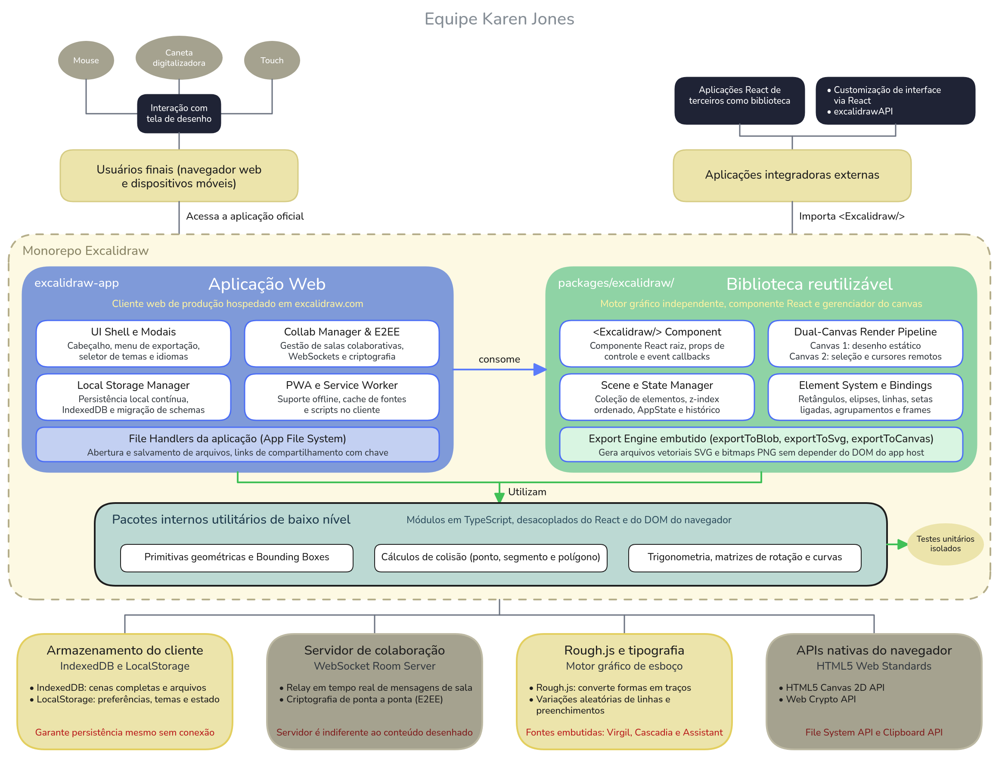

import Link from '@docusaurus/Link';

# Descrição estruturada e arquitetura do Excalidraw

## Introdução

Identificar o produto avaliado é uma das atividades da fase de estabelecer os requisitos da avaliação [[1, p. 4]](#ref-1). Esta página descreve o Excalidraw, sua organização em pacotes, suas interfaces externas e as restrições que limitam o que pode ser medido, para que o [escopo](./escopo-avaliacao.md) e os [requisitos](./requisitos-avaliacao.md) partam de uma visão concreta do produto.

## Metodologia

A descrição responde às perguntas de caracterização do produto apresentadas na aula, como as principais tarefas, os componentes que serão submetidos à avaliação e os requisitos para executá-lo [[1, p. 10]](#ref-1). Os dados técnicos foram conferidos no repositório oficial, no commit `e1b7aac` de 18/10/2026 [[2]](#ref-2), a mesma versão usada em toda a avaliação.

---

## 1. Caracterização e Classificação do Produto

O **Excalidraw** é um editor de desenho e diagramação que roda no navegador, com traço que imita esboços feitos à mão. A mesma base de código entrega dois produtos:

1. **Aplicação web e PWA (*Progressive Web App*):** editor para esboços, diagramas e notas visuais, com colaboração em tempo real criptografada de ponta a ponta e funcionamento sem conexão.
2. **Biblioteca React (`@excalidraw/excalidraw`):** pacote publicado no npm que permite a terceiros incorporar o editor em suas próprias aplicações React.

Tabela 1: Caracterização do Excalidraw

| Dimensão Técnica | Especificação no Projeto |
| :--- | :--- |
| **Nome do Produto** | Excalidraw |
| **Classificação de Software** | Aplicação web de página única (SPA) e PWA, e biblioteca de componentes React ([tipo de produto](./tipo-produto.md)) |
| **Linguagem Principal** | TypeScript |
| **Framework Base** | React |
| **Arquitetura do Repositório** | Monorepo com Yarn Workspaces (`excalidraw-app`, `packages/*` e `examples/*`) |
| **Licença** | MIT (código aberto, permissiva) |
| **Repositório Oficial** | [github.com/excalidraw/excalidraw](https://github.com/excalidraw/excalidraw) |
| **Versão avaliada** | Commit `e1b7aac` de 18/10/2026, com a biblioteca na versão 0.18.0 ([escopo](./escopo-avaliacao.md)) |

Fonte: [Gabriel Monteiro](https://github.com/GabrielSMonteiro), 2026.

---

## 2. Estrutura de Módulos e Pacotes do Monorepo

O monorepo declara três grupos de workspaces: `excalidraw-app`, `packages/*` e `examples/*`. A Tabela 2 resume a responsabilidade de cada parte. Os pacotes de matemática e utilitários são pensados para uso fora do editor, e a [Fase 02](../fase-02/gqm-manutenibilidade.md#4-q12-reusabilidade) verifica se de fato não dependem de React nem do navegador.

Tabela 2: Módulos do monorepo e responsabilidades

| Diretório/componente | Responsabilidade observável | Interfaces ou evidência |
| :--- | :--- | :--- |
| `excalidraw-app/` | Aplicação web: composição da interface, mecanismos de colaboração, armazenamento local, integrações e configuração de build. | `App.tsx`, `index.tsx`, `collab/`, `data/`, `vite.config.mts`. |
| `packages/excalidraw/` | Editor React reutilizável, componentes de UI, cena, ações, renderização e APIs de importação/exportação. | `index.tsx`, `components/`, `data/`, `scene/`, `renderer/` e `package.json`. |
| `packages/element/` | Operações e estruturas de elementos geométricos da cena. | `packages/element/src/` e seu manifesto. |
| `packages/math/`, `packages/common/`, `packages/utils/` | Rotinas de cálculo, tipos/utilitários e funcionalidades compartilhadas. | Diretórios e manifestos em `packages/`. |
| `packages/fractional-indexing/`, `packages/laser-pointer/` | Funcionalidades de apoio específicas, como ordenação e ponteiro. | Diretórios e manifestos em `packages/`. |
| `examples/` | Exemplos de integração e uso, úteis para testar reusabilidade. | Workspaces declarados no `package.json` raiz. |
| `excalidraw-app/collab/` | Coordenação da sessão colaborativa e comunicação em tempo real. | `Collab.tsx`, `Portal.tsx`, dependências de `socket.io-client`. |
| `excalidraw-app/data/` | Armazenamento local, persistência e comunicação com serviços remotos. | `LocalData.ts`, `firebase.ts`, `localStorage.ts`, `FileManager.ts`. |
| `.github/workflows/`, configurações e testes | CI, checagens, testes automatizados e ferramentas de análise de código. | `vitest.config.mts`, `tsconfig.json`, scripts `test:code`, `test:typecheck`, `test:app`. |

Fonte: [Davi Pierre](https://github.com/DaviPierre), 2026.

---

## 3. Interfaces Externas e Integrações do Sistema

O Excalidraw roda quase todo no navegador e se comunica com poucos serviços externos:

1. **APIs do navegador (Canvas 2D e área de transferência):** a superfície de desenho usa a API Canvas 2D.
2. **Rough.js:** biblioteca externa que transforma formas geométricas (retângulos, arcos, elipses) em traços com pequenas variações, que imitam o desenho à mão.
3. **Persistência local (IndexedDB e LocalStorage):** salva o desenho continuamente, sem login e sem conexão.
4. **Servidor de colaboração (Socket.IO):** encaminha as mensagens criptografadas de ponta a ponta entre os participantes de uma sala, sem acesso ao conteúdo dos desenhos.
5. **Entrada por diferentes dispositivos:** mouse, trackpad com gesto de pinça, telas sensíveis ao toque e canetas com sensibilidade à pressão.

---

## 4. Diagrama de Contexto e Arquitetura

A Figura 1 mostra as fronteiras entre os pacotes do monorepo, os perfis de usuários e as interfaces com o navegador e os serviços de rede.

Figura 1: Diagrama de contexto e arquitetura do Excalidraw

Fonte: [Gabriel Monteiro](https://github.com/GabrielSMonteiro), 2026. Redesenhada no Excalidraw por [Christopher Paraizo](https://github.com/wChrstphr) ([arquivo editável](../images/arquitetura-excalidraw.excalidraw)).

---

## 5. Dependências Tecnológicas e Restrições Operacionais

A arquitetura impõe restrições que a avaliação precisa considerar:

- **Desenho em Canvas:** como o desenho é feito em Canvas, e não em elementos HTML ou SVG, ferramentas de inspeção da página enxergam pouco dos elementos desenhados.
- **Dependência do Rough.js:** a aparência dos traços e parte do consumo de processamento dependem dessa biblioteca externa.
- **Criptografia na colaboração:** como o conteúdo é criptografado no cliente e o servidor só encaminha dados ilegíveis, a recuperação de falhas de sincronização precisa ser analisada no código do cliente.

---

## 6. Implicações Arquiteturais para a Avaliação de Qualidade

A Tabela 3 separa, para cada subcaracterística do [modelo de qualidade](./modelo-de-qualidade.md), o que é viável medir e o que fica fora do escopo. As métricas finais de cada subcaracterística estão nas páginas de [G1](../fase-02/gqm-manutenibilidade.md), [G2](../fase-02/gqm-confiabilidade.md) e [G3](../fase-02/gqm-flexibilidade.md) da Fase 02.

Tabela 3: Implicações da arquitetura para a avaliação

| Subcaracterística | O que é viável medir (dentro do escopo) | O que NÃO é viável medir (fora do escopo) | Decisão Metodológica da Equipe |
| :--- | :--- | :--- | :--- |
| **Modularidade** | Dependências estáticas entre pacotes (`excalidraw-app` $\rightarrow$ `packages/`), acoplamento eferente/aferente e ciclos via ferramentas de análise de grafos de dependência. | Impacto em tempo de execução de carregamento dinâmico de pacotes em redes corporativas com proxy restrito. | Medição via análise estática do monorepo e verificação de regras de importação do ESLint. |
| **Reusabilidade** | Isolamento do pacote `@excalidraw/excalidraw`, ausência de referências a módulos privados do app e volume de exports públicos documentados. | Validação em todos os empacotadores legados existentes no mercado (Webpack 4, Rollup antigo, Parcel 1). | Avaliação focada na compatibilidade declarada no `package.json` e nos testes de build com Vite/Next.js. |
| **Analisabilidade** | Complexidade ciclomática, linhas de código por módulo, aderência a convenções TypeScript e cobertura de documentação técnica. | Compreensibilidade subjetiva por desenvolvedores novatos sem histórico no projeto. | Coleta com ESLint, o compilador TypeScript e cloc. |
| **Modificabilidade** | Número de arquivos alterados por contribuição e arquivos extensos no código. | Custo real das alterações, em horas, para a equipe do projeto. | Histórico de pull requests pela API do GitHub e contagem de linhas com cloc. |
| **Testabilidade** | Razão de arquivos de teste para arquivos de produção, isolamento de testes unitários com Vitest e presença de testes nos fluxos de CI. | Execução de testes manuais em hardware proprietário heterogêneo de clientes corporativos. | Verificação do acervo automatizado de testes em `packages/` e `excalidraw-app/` e dos workflows do GitHub Actions. |
| **Ausência de falhas** | Histórico de issues fechadas, frequência de releases, cobertura de lint e checagem de tipos estáticos pré-merge. | Taxa de falhas observada em milhões de usuários reais em produção (telemetria privada da empresa Excalidraw). | Uso de dados públicos do repositório GitHub como proxy auditável da ausência de falhas. |
| **Disponibilidade** | Presença e corretude da configuração de Service Worker, manifesto PWA e capacidade do editor de operar sem resposta de rede externa. | Medição contínua de SLA/uptime dos servidores oficiais de infraestrutura em nuvem de excalidraw.com. | Inspeção estática das rotinas de cache offline e teste controlado em ambiente simulado sem rede. |
| **Tolerância a Falhas** | Tratamento de exceções em parsing de arquivos JSON inválidos, corrupção de dados no IndexedDB e isolamento do Canvas caso o WebSocket caia. | Estresse distribuído contra a infraestrutura de rede externa com injeção de pacotes maliciosos. | Inspeção dos blocos de captura de erro (`try/catch`), error boundaries de React e testes de regressão de importação. |
| **Recuperabilidade** | Lógica de autosave contínuo no armazenamento local do navegador e idempotência dos mecanismos de undo/redo. | Recuperação de falhas catastróficas de disco físico ou corrupção de hardware no cliente. | Análise estática do ciclo de salvamento e verificação funcional das rotinas de serialização de estado. |
| **Adaptabilidade e Escalabilidade** | Compatibilidade de viewport responsivo no código, regras CSS flexíveis e tratamento do volume de elementos no canvas. | Teste de carga extrema com dezenas de milhares de elementos simultâneos em dispositivos embarcados de baixíssimo custo. | Avaliação baseada nos limites arquiteturais declarados e testes unitários de escala de cena. |
| **Instalabilidade** | Aderência aos padrões npm, integridade de dependências (`package.json`), documentação de pré-requisitos e presença de Dockerfile funcional. | Compatibilidade de instalação em sistemas operacionais não homologados (ex.: BSD puro). | Teste automatizado do script de build do pacote e validação da imagem Docker disponibilizada. |
| **Substituibilidade** | Formatos de exportação, documentação do formato `.excalidraw` e conteúdo preservado ao exportar e reimportar. | Migração para todos os editores de diagramas concorrentes. | Exportação e reimportação de uma cena de referência em ambiente de teste. |

Fonte: [Gabriel Monteiro](https://github.com/GabrielSMonteiro), 2026.

---

## 7. Rastreabilidade com os Requisitos da Avaliação

A arquitetura descrita aqui fundamenta os [requisitos de avaliação](./requisitos-avaliacao.md):

- [RQ-MAN-01 a RQ-MAN-03](./requisitos-avaliacao.md#2-requisitos-de-manutenibilidade) analisam as fronteiras entre `excalidraw-app/` e os pacotes da [seção 2](#2-estrutura-de-módulos-e-pacotes-do-monorepo).
- [RQ-CONF-03 a RQ-CONF-07](./requisitos-avaliacao.md#3-requisitos-de-confiabilidade) tratam do isolamento entre o editor local e as falhas de rede, do servidor de colaboração e dos arquivos abertos.
- [RQ-FLEX-07 a RQ-FLEX-10](./requisitos-avaliacao.md#4-requisitos-de-flexibilidade) tratam da instalação da biblioteca no npm e da implantação da aplicação, inclusive com Docker.

---

## Referências

> <Link id="ref-1">1.</Link> RAMOS, Cristiane Soares. **AULA A07 QSW1 PROC AVAL PRODUTO**. Material da disciplina de Qualidade de Software 1, FCTE/UnB, 2026. Páginas 4 e 10. Disponível no Moodle da disciplina.
>
> <Link id="ref-2">2.</Link> EXCALIDRAW. Repositório oficial, commit `e1b7aac` de 18/10/2026. Disponível em: [https://github.com/excalidraw/excalidraw/tree/e1b7aacb356a492aa1e0fc6eb57b8896124027f0](https://github.com/excalidraw/excalidraw/tree/e1b7aacb356a492aa1e0fc6eb57b8896124027f0). Acesso em: 10 nov. 2026.

---

## Histórico de Versões

| Versão | Data | Descrição | Autor(es) | Revisor(es) |
| :---: | :---: | :--- | :--- | :--- |
| 1.0 | 18/10/2026 | Criação da descrição estruturada do produto, mapeamento de módulos, diagrama de contexto e análise de implicações para avaliação | [Gabriel Monteiro](https://github.com/GabrielSMonteiro) | [Maria Eduarda](https://github.com/eduarda-ogomes) |
| 1.1 | 20/10/2026 | Diagrama de contexto e arquitetura redesenhado no Excalidraw e publicado em PNG, com o arquivo editável | [Christopher Paraizo](https://github.com/wChrstphr) | |
| 1.2 | 10/11/2026 | Introdução e Metodologia, versão avaliada corrigida para o commit `e1b7aac` (biblioteca 0.18.0), pacotes e interfaces conferidos no repositório, linhas de Modificabilidade e Substituibilidade na tabela de implicações, tabela de módulos trazida do tipo de produto, subcaracterística Ausência de falhas adotada, tabelas e figura com título e fonte, requisitos com links, referências numeradas e retirada da citação ao critério da disciplina | [Christopher Paraizo](https://github.com/wChrstphr) | [Gabriel Monteiro](https://github.com/GabrielSMonteiro) |
