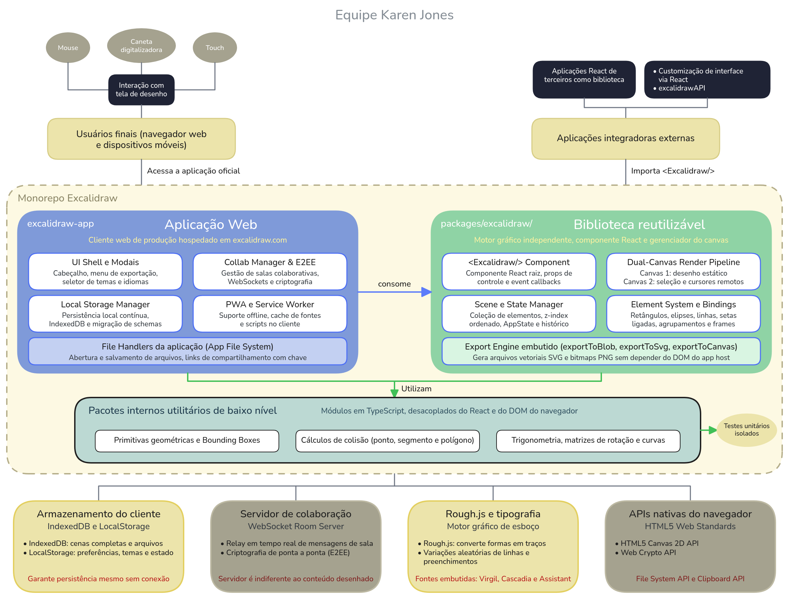

# Descrição Estruturada e Arquitetura do Excalidraw

Em conformidade com a norma **ISO/IEC 25040:2011** e com os critérios da disciplina (critério **F1-C3**), a especificação dos requisitos de avaliação exige uma compreensão detalhada da natureza do produto, sua organização arquitetural interna, dependências, fronteiras funcionais e as restrições que influenciam diretamente a viabilidade e a profundidade das medições.

---

## 1. Caracterização e Classificação do Produto

O **Excalidraw** é uma plataforma de desenho e diagramação vetorial baseada em navegadores web com estética visual que simula esboços feitos à mão livre. O projeto combina duas naturezas de software complementares em uma mesma base de código:

1. **Aplicação Web e PWA (*Progressive Web App*):** Um produto final interativo para criação de esboços, diagramas de arquitetura e notas visuais, com suporte a colaboração síncrona criptografada de ponta a ponta e funcionamento offline.
2. **Biblioteca de Componentes e Motor Gráfico (*Embeddable SDK*):** Um pacote modular publicado no ecossistema npm (`@excalidraw/excalidraw`), permitindo que terceiros integrem o quadro interativo em aplicações externas em React sem reinventar a roda de renderização geométrica.

| Dimensão Técnica | Especificação no Projeto |
| :--- | :--- |
| **Nome do Produto** | Excalidraw |
| **Classificação de Software** | Aplicação Web Rich Client (SPA / PWA) + Biblioteca de Componentes UI / Engine Gráfica |
| **Linguagem Principal** | TypeScript |
| **Framework Base** | React |
| **Arquitetura do Repositório** | Monorepo gerenciado via Yarn Workspaces |
| **Licença** | MIT (Open Source permissiva) |
| **Repositório Oficial** | [github.com/excalidraw/excalidraw](https://github.com/excalidraw/excalidraw) |
| **Branch/Versão de Análise** | v0.14.15 |

---

## 2. Estrutura de Módulos e Pacotes do Monorepo

O repositório é organizado no formato de monorepo, dividindo responsabilidades entre a casca da aplicação consumidora e os motores gráficos reutilizáveis:

### Divisão de Responsabilidades

- **`excalidraw-app/`:** Atua como cliente host, é o único módulo que possui acoplamento com a infraestrutura de backend de salas de colaboração e com as regras específicas de deploy web.
- **`packages/excalidraw/`:** O núcleo da ferramenta, não deve conhecer detalhes de hospedagem nem rotinas de autenticação do site, seu escopo restringe-se a gerenciar o estado da cena, calcular colisões e pintar os elementos na tela.
- **`packages/math/` e `packages/utils/`:** Módulos de suporte de nível baixo sem acoplamento a React ou ao DOM, garantindo alta reusabilidade e facilidade de testes unitários isolados.

---

## 3. Interfaces Externas e Integrações do Sistema

O Excalidraw opera primordialmente no lado do cliente, comunicando-se com serviços e subsistemas externos bem delimitados:

1. **APIs Nativas do Navegador (HTML5 Canvas 2D / WebGL / Clipboard):** A superfície de desenho utiliza a API 2D Canvas do navegador com pipelines para manter alta taxa de quadros durante arraste e zoom de múltiplos elementos.
2. **Motor de Renderização Rough.js:** Biblioteca externa fundamental que converte primitivas geométricas ideais (retângulos, arcos, elipses) em polígonos e curvas com variações estocásticas que imitam o traço feito à mão.
3. **Mecanismo de Persistência Local (IndexedDB e LocalStorage):** Permite salvar o estado dos desenhos continuamente em segundo plano sem necessidade de login ou conectividade com a internet.
4. **Servidor de Colaboração (Excalidraw Room Server / WebSocket):** Serviço remoto que realiza o relay de mensagens criptografadas de ponta a ponta entre participantes de uma mesma sala colaborativa. O servidor não descriptografa o conteúdo dos desenhos, garantindo privacidade.
5. **Subsistema de Entrada e Acessibilidade:** Suporte polimórfico a múltiplos dispositivos de apontamento: mouse convencional, trackpad com gestos de pinça, canetas digitalizadoras (com leitura de pressão para Apple Pencil / Wacom) e telas sensíveis ao toque.

---

## 4. Diagrama de Contexto e Arquitetura

A Figura 1 apresenta o diagrama de contexto e arquitetura do Excalidraw, evidenciando as fronteiras entre os pacotes do monorepo, os perfis de usuários externos e as interfaces com o ambiente do navegador e serviços de rede.

*Figura 1 – Diagrama de contexto e arquitetura do Excalidraw. Elaborado por: Gabriel Monteiro. Redesenhado no Excalidraw por Christopher Paraizo ([arquivo editável](../images/arquitetura-excalidraw.excalidraw)).*

---

## 5. Dependências Tecnológicas e Restrições Operacionais

A arquitetura do Excalidraw impõe certas restrições técnicas que devem ser consideradas durante a análise de qualidade:

- **Dependência do Motor Canvas:** Como o desenho é rasterizado em tela Canvas em vez de nós DOM puros (SVG/HTML), ferramentas convencionais de inspeção de acessibilidade DOM têm visibilidade limitada sobre os elementos internos do desenho.
- **Conexão com Rough.js:** O acoplamento com o Rough.js torna a fidelidade visual e parte do consumo de CPU diretamente dependentes da eficiência dessa biblioteca externa.
- **Isolamento Criptográfico na Colaboração:** Como a colaboração em tempo real emprega criptografia ponta-a-ponta no cliente, a recuperação de falhas na sincronização precisa ser inspecionada no código TypeScript do cliente, pois o servidor apenas encaminha blobs opacos.

---

## 6. Implicações Arquiteturais para a Avaliação de Qualidade

A tabela a seguir sistematiza as implicações da arquitetura do Excalidraw para o processo de medição, discriminando expressamente **o que é viável medir** e **o que não é viável medir**, fundamentando as escolhas metodológicas das fases seguintes:

| Subcaracterística | O que é viável medir (dentro do escopo) | O que NÃO é viável medir (fora do escopo) | Decisão Metodológica da Equipe |
| :--- | :--- | :--- | :--- |
| **Modularidade** | Dependências estáticas entre pacotes (`excalidraw-app` $\rightarrow$ `packages/`), acoplamento eferente/aferente e ciclos via ferramentas de análise de grafos de dependência. | Impacto em tempo de execução de carregamento dinâmico de pacotes em redes corporativas com proxy restrito. | Medição via análise estática do monorepo e verificação de regras de importação do ESLint. |
| **Reusabilidade** | Isolamento do pacote `@excalidraw/excalidraw`, ausência de referências a módulos privados do app e volume de exports públicos documentados. | Validação em todos os empacotadores legados existentes no mercado (Webpack 4, Rollup antigo, Parcel 1). | Avaliação focada na compatibilidade declarada no `package.json` e nos testes de build com Vite/Next.js. |
| **Analisabilidade** | Complexidade ciclomática, linhas de código por módulo, aderência a convenções TypeScript e cobertura de documentação técnica. | Compreensibilidade subjetiva por desenvolvedores novatos sem histórico no projeto. | Coleta via ferramentas padronizadas (ESLint, TypeScript Compiler, SonarQube/cloc). |
| **Testabilidade** | Razão de arquivos de teste para arquivos de produção, isolamento de testes unitários com Jest/Vitest e presença de testes nos fluxos de CI. | Execução de testes manuais em hardware proprietário heterogêneo de clientes corporativos. | Verificação do acervo automatizado de testes em `packages/` e `excalidraw-app/` e dos workflows do GitHub Actions. |
| **Maturidade** | Histórico de issues fechadas, frequência de releases, cobertura de lint e checagem de tipos estáticos pré-merge. | Taxa de falhas observada em milhões de usuários reais em produção (telemetria privada da empresa Excalidraw). | Uso de dados públicos do repositório GitHub como proxy auditável de maturidade. |
| **Disponibilidade** | Presença e corretude da configuração de Service Worker, manifesto PWA e capacidade do editor de operar sem resposta de rede externa. | Medição contínua de SLA/uptime dos servidores oficiais de infraestrutura em nuvem de excalidraw.com. | Inspeção estática das rotinas de cache offline e teste controlado em ambiente simulado sem rede. |
| **Tolerância a Falhas** | Tratamento de exceções em parsing de arquivos JSON inválidos, corrupção de dados no IndexedDB e isolamento do Canvas caso o WebSocket caia. | Estresse distribuído contra a infraestrutura de rede externa com injeção de pacotes maliciosos. | Inspeção dos blocos de captura de erro (`try/catch`), error boundaries de React e testes de regressão de importação. |
| **Recuperabilidade** | Lógica de autosave contínuo no armazenamento local do navegador e idempotência dos mecanismos de undo/redo. | Recuperação de falhas catastróficas de disco físico ou corrupção de hardware no cliente. | Análise estática do ciclo de salvamento e verificação funcional das rotinas de serialização de estado. |
| **Adaptabilidade e Escalabilidade** | Compatibilidade de viewport responsivo no código, regras CSS flexíveis e tratamento do volume de elementos no canvas. | Teste de carga extrema com dezenas de milhares de elementos simultâneos em dispositivos embarcados de baixíssimo custo. | Avaliação baseada nos limites arquiteturais declarados e testes unitários de escala de cena. |
| **Instalabilidade** | Aderência aos padrões npm, integridade de dependências (`package.json`), documentação de pré-requisitos e presença de Dockerfile funcional. | Compatibilidade de instalação em sistemas operacionais não homologados (ex.: BSD puro). | Teste automatizado do script de build do pacote e validação da imagem Docker disponibilizada. |

---

## 7. Rastreabilidade com os Requisitos da Avaliação

A contextualização arquitetural realizada neste documento fundamenta e valida os requisitos definidos em [Requisitos de Avaliação](./requisitos-avaliacao.md):

- Os requisitos **RQ-MAN-01** a **RQ-MAN-03** analisam diretamente as fronteiras arquiteturais entre `excalidraw-app/` e `packages/excalidraw/`.
- Os requisitos **RQ-CONF-03** a **RQ-CONF-07** concentram-se no isolamento entre a execução do editor local e as falhas das interfaces de rede e do servidor de colaboração.
- Os requisitos **RQ-FLEX-07** a **RQ-FLEX-10** avaliam a empacotabilidade do SDK e a infraestrutura de containerização identificadas na Seção 2.

---

## 8. Histórico de Versões

| Versão | Data | Descrição | Autor(es) | Revisor(es) |
| :---: | :---: | :--- | :--- | :--- |
| 1.0 | 18/10/2026 | Criação da descrição estruturada do produto, mapeamento de módulos, diagrama de contexto e análise de implicações para avaliação (Critério F1-C3) | [Gabriel Monteiro](https://github.com/GabrielSMonteiro) | [Maria Eduarda](https://github.com/eduarda-ogomes) |
| 1.1 | 20/10/2026 | Diagrama de contexto e arquitetura redesenhado no Excalidraw e publicado em PNG, com o arquivo editável | [Christopher Paraizo](https://github.com/wChrstphr) | |
