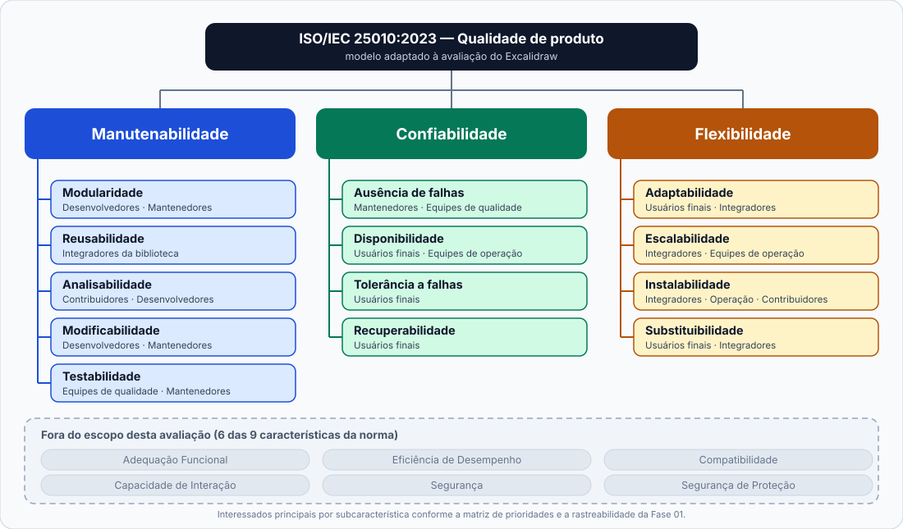

# Modelo de Qualidade

## Norma de referência

A avaliação adota o modelo de qualidade definido pela **ISO/IEC 25010:2023**, integrante da família de normas **SQuaRE (Systems and softWare Quality Requirements and Evaluation)**. Essa edição estrutura a qualidade de produto de software em **nove características** de alto nível, cada uma subdividida em subcaracterísticas que permitem uma análise mais precisa e rastreável — entre as novidades em relação à edição de 2011 estão a renomeação de *Portabilidade* para **Flexibilidade**, a adição de **Escalabilidade** como subcaracterística e a inclusão de **Segurança de Proteção** como nova característica de nível superior.

Para este trabalho, foram selecionadas **três características**: Manutenibilidade, Confiabilidade e Flexibilidade. A seleção é justificada na seção seguinte.

---

## Justificativa da seleção

A escolha das três características levou em conta o perfil do produto, o acesso disponível à equipe e os interesses dos grupos mapeados no documento de partes interessadas.

O Excalidraw é um projeto open source organizado em monorepo, com código público, histórico de versões acessível e integração contínua configurada. Isso viabiliza uma avaliação baseada em análise estática do repositório, sem necessidade de acesso à infraestrutura de produção.

A **Manutenibilidade** é relevante por se tratar de um projeto com contribuições externas frequentes. Aspectos como a organização do código, a separação entre módulos e a cobertura de testes são determinantes para a sustentabilidade do projeto a longo prazo.

A **Confiabilidade** responde às necessidades dos usuários que utilizam a ferramenta em contextos colaborativos e dependem da persistência do trabalho. Falhas de rede, perda de dados e ausência de feedback adequado em situações de erro são pontos críticos para esse grupo.

A **Flexibilidade** (renomeação de *Portabilidade* na edição 2023) é pertinente dado que o Excalidraw opera simultaneamente como aplicação web e como biblioteca npm. Isso impõe requisitos de adaptabilidade a diferentes ambientes, capacidade de escalar o uso, facilidade de instalação e interoperabilidade de dados.

Essas três características, em conjunto, cobrem os interesses dos oito grupos de interessados identificados na Fase 01.

---

## Manutenibilidade

Segundo a ISO/IEC 25010, manutenabilidade corresponde ao grau de eficácia e eficiência com que um produto pode ser modificado pelos seus mantenedores. No contexto do Excalidraw, com múltiplos contribuidores externos e uma base de código em monorepo, essa característica é central para a sustentabilidade do desenvolvimento.

| Subcaracterística | Definição (ISO/IEC 25010:2023) | Aplicação ao Excalidraw |
|---|---|---|
| **Modularidade** | O sistema é composto por componentes independentes, de forma que uma alteração em um componente cause impacto mínimo nos demais. | Separação entre `excalidraw-app/` e `packages/excalidraw/`, coesão interna dos pacotes e ausência de ciclos de dependência. |
| **Reusabilidade** | Partes do sistema podem ser utilizadas em outros sistemas ou contextos. | Independência funcional da biblioteca `@excalidraw/excalidraw` em relação à aplicação principal, estabilidade da API pública e exemplos de integração disponibilizados. |
| **Analisabilidade** | É possível avaliar o impacto de uma mudança, diagnosticar falhas e identificar partes do sistema a modificar com eficiência. | Clareza da estrutura de diretórios, qualidade da documentação de arquitetura e de contribuição, uso consistente de TypeScript e configuração de ferramentas de análise estática. |
| **Modificabilidade** | O produto pode ser alterado sem introduzir defeitos nem degradar a qualidade existente. | Grau de acoplamento entre componentes, concentração de responsabilidades em partes específicas do código e alcance das alterações observado no histórico de commits e pull requests. |
| **Testabilidade** | É possível estabelecer critérios de teste e executá-los de forma eficaz para verificar o comportamento do sistema. | Existência e organização de testes automatizados nos níveis unitário, de integração e ponta a ponta, reprodução de cenários do editor baseado em canvas e integração dos testes à pipeline de CI. |

---

## Confiabilidade

Confiabilidade, na definição da norma, é o grau em que um sistema executa suas funções esperadas sob condições específicas ao longo do tempo. Para o Excalidraw, isso se traduz em perguntas concretas: a aplicação funciona quando a conexão falha? O trabalho é salvo de forma confiável? Os erros são tratados de maneira que o usuário compreenda o que aconteceu?

| Subcaracterística | Definição (ISO/IEC 25010:2023) | Aplicação ao Excalidraw |
|---|---|---|
| **Maturidade** | O sistema apresenta histórico de operação confiável e processos estabelecidos para prevenir falhas. | Frequência e regularidade das versões publicadas, processo de revisão de código, verificação automática de tipos, lint e testes na pipeline de CI, e gestão de defeitos registrados via issues. |
| **Disponibilidade** | O sistema está operacional e acessível quando necessário para uso. | Funcionamento das funções essenciais sem conexão (PWA/offline) após o primeiro carregamento e grau de dependência de serviços externos para a operação do editor. |
| **Tolerância a falhas** | O sistema mantém operação adequada na presença de falhas de hardware ou software. | Isolamento entre edição local e sessão colaborativa, tratamento de exceções, comportamento diante de arquivos inválidos ou corrompidos e clareza das mensagens de erro para o usuário. |
| **Recuperabilidade** | O sistema consegue restaurar dados e retomar o estado anterior após uma interrupção ou falha. | Salvamento local automático, persistência dos desenhos entre sessões, funcionamento do desfazer/refazer e comportamento após reconexão em sessão colaborativa. |

> **Observação sobre Disponibilidade, Tolerância a falhas e Recuperabilidade:** estas subcaracterísticas são, por natureza, métricas de runtime. No contexto desta avaliação, serão investigadas por meio da análise estática da implementação — configuração de PWA, tratamento de exceções no código, mecanismos de persistência — e não por medições em ambiente de produção. Essa limitação de escopo será documentada explicitamente na Fase 02 ao definir as métricas.

---

## Flexibilidade

Na edição de 2023, **Flexibilidade** substitui o que a edição anterior chamava de *Portabilidade*, com escopo ampliado: além da capacidade de operar em diferentes ambientes, a característica passa a incluir explicitamente a capacidade de escalar. Para o Excalidraw, essa característica é relevante tanto para usuários que acessam a aplicação web em diferentes dispositivos quanto para desenvolvedores que integram a biblioteca em seus próprios projetos.

| Subcaracterística | Definição (ISO/IEC 25010:2023) | Aplicação ao Excalidraw |
|---|---|---|
| **Adaptabilidade** | O produto pode ser adaptado eficaz e eficientemente para diferentes ambientes operacionais, de hardware ou de uso. | Suporte a diferentes navegadores e versões, compatibilidade com distintos tamanhos de tela e dispositivos de entrada (mouse, toque e caneta), e versões de React compatíveis com a biblioteca. |
| **Escalabilidade** | O produto pode ser expandido para lidar com cargas de trabalho maiores ou contextos de uso mais amplos sem degradação de qualidade. | Capacidade da biblioteca de ser usada em aplicações com grandes volumes de elementos no canvas, comportamento sob uso intensivo de colaboração em tempo real e possibilidade de extensão das funcionalidades via API pública. |
| **Instalabilidade** | O produto pode ser instalado e desinstalado de forma eficaz em um ambiente especificado. | Facilidade de instalação via gerenciadores de pacotes, clareza dos pré-requisitos, disponibilidade de Dockerfile e abrangência da documentação de instalação. |
| **Substituibilidade** | O produto pode substituir outro software de propósito equivalente no mesmo ambiente. | Formatos de exportação disponíveis (`.excalidraw`, PNG, SVG), fidelidade da reimportação e acessibilidade dos dados fora do editor para fins de migração. |

---
## Representação gráfica do modelo

*Figura 1 – Modelo de qualidade adotado para o Excalidraw (ISO/IEC 25010:2023).*

Cada característica selecionada se desdobra em suas subcaracterísticas, e abaixo do nome de cada subcaracterística aparecem os interessados principais mapeados na Fase 01. As seis características da norma que ficaram fora do escopo aparecem em cinza, para tornar a seleção visível.

---

## Adaptações ao contexto

A ISO/IEC 25010:2023 define um modelo genérico, aplicável a qualquer produto de software. Usá-lo "de prateleira" significaria avaliar as nove características e todas as suas subcaracterísticas sem considerar quem usa o Excalidraw nem o que conseguimos observar dele. Por isso, o modelo foi adaptado em cinco pontos.

| # | Adaptação | Justificativa pelo contexto do produto | Interessados que a motivam |
|---|---|---|---|
| 1 | **Seleção de 3 das 9 características** (Manutenibilidade, Confiabilidade e Flexibilidade) | O Excalidraw é, ao mesmo tempo, aplicação web colaborativa e biblioteca npm, mantida em monorepo open source. Essa combinação coloca em primeiro plano a facilidade de evoluir o código, a confiança no trabalho salvo e a capacidade de ser instalado, integrado e migrado. Na matriz de prioridades, cada um dos sete grupos tem ao menos uma dessas três características como prioridade principal: Manutenibilidade para quatro grupos, Confiabilidade para três e Flexibilidade para dois. | Todos os grupos da matriz de prioridades |
| 2 | **Manutenção das 13 subcaracterísticas, cada uma ligada a interessados e a artefatos** | Nenhuma subcaracterística foi descartada, porque cada uma responde a ao menos um interessado principal e tem um artefato do repositório que serve de evidência (ver tabela de rastreabilidade). Isso evita avaliar algo sem destinatário e evita deixar de fora algo que alguém precisa. | Conforme indicado sob cada subcaracterística na Figura 1 |
| 3 | **Interpretação das subcaracterísticas para o Excalidraw** | As definições da norma foram traduzidas para o produto. Modularidade é lida como o limite entre `excalidraw-app/` e `packages/excalidraw/`; Testabilidade considera as particularidades de um editor baseado em canvas; Disponibilidade é tratada como funcionamento offline via PWA; Substituibilidade é lida como exportação em `.excalidraw`, PNG e SVG; Escalabilidade considera desenhos com muitos elementos e extensão pela API pública. | Desenvolvedores, integradores da biblioteca, usuários finais e equipes de operação |
| 4 | **Disponibilidade, Tolerância a falhas e Recuperabilidade investigadas por análise estática** | Essas subcaracterísticas são, por natureza, medidas em tempo de execução. Sem acesso à infraestrutura de produção do `excalidraw.com`, a avaliação examina a configuração de PWA, o tratamento de exceções e os mecanismos de persistência no código. A limitação é assumida e será documentada na Fase 02. | Usuários finais e equipes de operação |
| 5 | **Exclusão de 6 características** (Adequação Funcional, Eficiência de Desempenho, Compatibilidade, Capacidade de Interação, Segurança e Segurança de Proteção) | A orientação da disciplina permite selecionar de 3 a 5 características, e a equipe adotou o limite inferior. Como o esforço total do trabalho ainda não era conhecido, a opção foi entregar poucas características com profundidade e rastreabilidade, em vez de uma cobertura ampla e superficial. As três selecionadas cobrem a prioridade principal dos sete grupos da matriz. Os temas das demais só são tocados quando fazem parte de uma subcaracterística selecionada (por exemplo, desempenho com muitos elementos, dentro de Escalabilidade). A exclusão registra o que a avaliação não afirma sobre o produto. | Equipe avaliadora e docentes |

---

## Escopo de avaliação

Para que a avaliação seja objetiva e factível, precisamos definir claramente os limites do que será analisado. A tabela abaixo sumariza as características e subcaracterísticas selecionadas, indicando o que será foco da análise e o que ficará de fora. Esta delimitação é crucial para direcionar os esforços nas próximas fases do processo avaliativo.

| Característica | O que será avaliado | O que não entra no escopo |
|---|---|---|
| **Manutenibilidade** | Código-fonte do monorepo (`excalidraw-app/`, `packages/`), configurações de TypeScript e lint, documentação de contribuição e histórico de commits e pull requests. | Código interno das dependências externas e refatorações futuras que não estejam presentes no repositório no momento da análise. |
| **Confiabilidade** | Configurações de PWA/offline, código de tratamento de erros e colaboração, mecanismos de persistência local, funções de importação/exportação e histórico de issues. | Infraestrutura de produção do `excalidraw.com`, métricas de disponibilidade em tempo real e dados de telemetria de uso. |
| **Flexibilidade** | Pacote `packages/excalidraw/`, API pública, exemplos disponibilizados, `package.json`, `Dockerfile`, documentação de instalação e comportamento sob carga. | Testes em hardware físico, benchmarks de escalabilidade em produção e comportamento em ambientes corporativos com restrições de segurança. |

As demais características da ISO/IEC 25010:2023 — **Adequação Funcional**, **Eficiência de Desempenho**, **Compatibilidade**, **Capacidade de Interação**, **Segurança** e **Segurança de Proteção** — estão fora do escopo desta avaliação. A delimitação é intencional: avaliar todas as características com a profundidade necessária não seria viável dentro dos recursos e do tempo disponíveis para a equipe.

---

## Rastreabilidade entre subcaracterísticas, interessados e artefatos

A tabela a seguir apresenta, para cada subcaracterística, os grupos de interessados diretamente afetados e os artefatos do repositório que servirão como fonte de evidência na Fase 02.

| Subcaracterística | Característica | Interessados principais | Artefatos previstos como evidência |
|---|---|---|---|
| Modularidade | Manutenibilidade | Desenvolvedores; mantenedores | `packages/`, `excalidraw-app/`, arquivos de dependências |
| Reusabilidade | Manutenibilidade | Integradores da biblioteca | `packages/excalidraw/`, `examples/`, interface pública |
| Analisabilidade | Manutenibilidade | Contribuidores; desenvolvedores | Estrutura de diretórios, configurações de TypeScript e lint, documentação |
| Modificabilidade | Manutenibilidade | Desenvolvedores; mantenedores | Código dos pacotes, commits, pull requests |
| Testabilidade | Manutenibilidade | Equipes de qualidade; mantenedores | Arquivos de teste, configurações, `.github/workflows/` |
| Maturidade | Confiabilidade | Mantenedores; equipes de qualidade | Histórico de issues, pull requests e pipelines de CI |
| Disponibilidade | Confiabilidade | Usuários finais; equipes de operação | Configuração de PWA e suporte offline em `excalidraw-app/` |
| Tolerância a falhas | Confiabilidade | Usuários finais | Código de colaboração e tratamento de erros |
| Recuperabilidade | Confiabilidade | Usuários finais | Persistência local, importação/exportação de arquivos `.excalidraw` |
| Adaptabilidade | Flexibilidade | Usuários finais; integradores | Configurações de compatibilidade e dependências declaradas |
| Escalabilidade | Flexibilidade | Integradores; equipes de operação | API pública, comportamento sob carga, documentação de limites |
| Instalabilidade | Flexibilidade | Integradores; equipes de operação; contribuidores | `package.json`, `Dockerfile`, documentação de instalação |
| Substituibilidade | Flexibilidade | Usuários finais; integradores | Funcionalidades de importação e exportação |

---

## Histórico de Versões

| Versão | Data | Descrição | Autor(es) | Revisor(es) |
| ------ | ---- | --------- | --------- | ----------- |
| 0.1 | 15/10/2026 | Criação do documento | [Gabriel Monteiro](https://github.com/GabrielSMonteiro) | |
| 0.2 | 18/10/2026 | Elaboração do diagrama modelo de qualidade e tópico adaptações ao contexto | [Letícia Santos](https://github.com/LeticiaSantosss) | 
