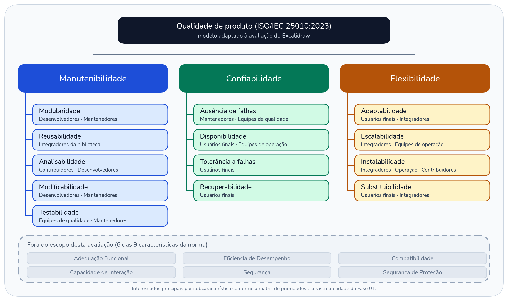

import Link from '@docusaurus/Link';

# Modelo de Qualidade

## Introdução

Especificar o modelo de qualidade é a terceira atividade da fase de requisitos da avaliação: o modelo genérico da norma é adaptado ao contexto do software avaliado, conforme o objetivo declarado pelo requisitante [[2, p. 4 e 14]](#ref-2). Esta página apresenta o modelo da ISO/IEC 25010:2023 adotado, as três características selecionadas, suas subcaracterísticas interpretadas para o Excalidraw e as adaptações feitas ao contexto do produto.

## Metodologia

A seleção partiu da [priorização das características](./priorizacao-caracteristicas.md), que combina a ênfase atribuída pelos [interessados](./interessados.md#matriz-de-prioridades) com uma matriz de impacto e risco. As definições das subcaracterísticas seguem a ISO/IEC 25010:2023 [[1]](#ref-1), e cada uma foi lida à luz da arquitetura descrita em [Descrição e arquitetura do produto](./descricao-produto.md).

---

## Norma de referência

A ISO/IEC 25010:2023, integrante da família SQuaRE (*Systems and software Quality Requirements and Evaluation*), estrutura a qualidade de produto de software em **nove características**, cada uma subdividida em subcaracterísticas [[1]](#ref-1). Em relação à edição de 2011, a edição de 2023 renomeia Portabilidade para **Flexibilidade** e acrescenta a ela **Escalabilidade**, passa a tratar a confiabilidade pela **Ausência de falhas**, renomeia Usabilidade para **Capacidade de Interação** e inclui **Segurança de Proteção** (*safety*) como nova característica.

Para este trabalho, foram selecionadas **três características**: Manutenibilidade, Confiabilidade e Flexibilidade.

---

## Justificativa da seleção

O Excalidraw é um projeto de código aberto organizado em monorepo, com código público, histórico de versões acessível e integração contínua configurada. Isso viabiliza uma avaliação baseada em análise estática do repositório, sem acesso à infraestrutura de produção.

A **Manutenibilidade** é relevante por se tratar de um projeto com contribuições externas frequentes. A organização do código, a separação entre módulos e a cobertura de testes determinam a sustentabilidade do projeto a longo prazo.

A **Confiabilidade** responde às necessidades de quem usa a ferramenta em contextos colaborativos e depende da persistência do trabalho. Falhas de rede, perda de dados e ausência de retorno adequado em situações de erro são pontos críticos para esse grupo.

A **Flexibilidade** é pertinente porque o Excalidraw opera ao mesmo tempo como aplicação web e como biblioteca npm. Isso impõe requisitos de adaptabilidade a diferentes ambientes, capacidade de escalar o uso, facilidade de instalação e interoperabilidade de dados.

Com essas três características, cada um dos sete grupos da [matriz de prioridades](./interessados.md#matriz-de-prioridades) tem ao menos uma prioridade principal atendida. Na [priorização](./priorizacao-caracteristicas.md#seleção-resultante), elas ficaram com as maiores prioridades: Confiabilidade (16), Manutenibilidade (12) e Flexibilidade (9).

### Trade-offs entre as características

- **Manutenibilidade e Confiabilidade:** Investir profundidade em manutenibilidade (métricas de código, acoplamento, cobertura de testes) consome esforço que poderia ser direcionado a testes de runtime para confiabilidade. A equipe optou por aceitar que a confiabilidade será avaliada predominantemente por análise estática, reconhecendo que os resultados terão menor poder preditivo sobre o comportamento em produção.
- **Confiabilidade e Flexibilidade:** Ambas competem por esforço de análise de artefatos similares (package.json, Dockerfile, configurações de build). A equipe priorizou a confiabilidade como mais crítica para o usuário final, tratando a flexibilidade com profundidade suficiente mas com menor granularidade nas métricas de comportamento dinâmico.
- **Profundidade e Cobertura:** A decisão de avaliar 3 características (e não 5 ou mais) privilegia a rastreabilidade e a validade das conclusões em detrimento da abrangência. Os resultados sobre as seis características excluídas ficam fora do escopo e não podem ser inferidos a partir deste trabalho.

---

## Manutenibilidade

Segundo a ISO/IEC 25010, manutenibilidade é o grau de eficácia e eficiência com que um produto pode ser modificado por seus mantenedores [[1]](#ref-1). No Excalidraw, com múltiplos contribuidores externos e uma base de código em monorepo, essa característica é central para a sustentabilidade do desenvolvimento.

Tabela 1: Subcaracterísticas de Manutenibilidade

| Subcaracterística | Definição (ISO/IEC 25010:2023) | Aplicação ao Excalidraw |
|---|---|---|
| **Modularidade** | O sistema é composto por componentes independentes, de forma que uma alteração em um componente cause impacto mínimo nos demais. | Separação entre `excalidraw-app/` e `packages/excalidraw/`, coesão interna dos pacotes e ausência de ciclos de dependência. |
| **Reusabilidade** | Partes do sistema podem ser utilizadas em outros sistemas ou contextos. | Independência funcional da biblioteca `@excalidraw/excalidraw` em relação à aplicação principal, estabilidade da API pública e exemplos de integração disponibilizados. |
| **Analisabilidade** | É possível avaliar o impacto de uma mudança, diagnosticar falhas e identificar partes do sistema a modificar com eficiência. | Clareza da estrutura de diretórios, qualidade da documentação de arquitetura e de contribuição, uso consistente de TypeScript e configuração de ferramentas de análise estática. |
| **Modificabilidade** | O produto pode ser alterado sem introduzir defeitos nem degradar a qualidade existente. | Grau de acoplamento entre componentes, concentração de responsabilidades em partes específicas do código e alcance das alterações observado no histórico de commits e pull requests. |
| **Testabilidade** | É possível estabelecer critérios de teste e executá-los de forma eficaz para verificar o comportamento do sistema. | Existência e organização de testes automatizados nos níveis unitário, de integração e ponta a ponta, reprodução de cenários do editor baseado em canvas e integração dos testes à pipeline de CI. |

Fonte: [Gabriel Monteiro](https://github.com/GabrielSMonteiro), 2026.

---

## Confiabilidade

Confiabilidade é o grau em que um sistema executa as funções esperadas sob condições específicas ao longo do tempo [[1]](#ref-1). No Excalidraw, isso se traduz em perguntas concretas: a aplicação funciona quando a conexão falha? O trabalho é salvo de forma confiável? Os erros são tratados de maneira que o usuário compreenda o que aconteceu?

Tabela 2: Subcaracterísticas de Confiabilidade

| Subcaracterística | Definição (ISO/IEC 25010:2023) | Aplicação ao Excalidraw |
|---|---|---|
| **Ausência de falhas** | O sistema executa as funções especificadas sem falhas em operação normal. | Frequência e regularidade das versões publicadas, processo de revisão de código, verificação automática de tipos, lint e testes na pipeline de CI, e gestão de defeitos registrados via issues. |
| **Disponibilidade** | O sistema está operacional e acessível quando necessário para uso. | Funcionamento das funções essenciais sem conexão (PWA/offline) após o primeiro carregamento e grau de dependência de serviços externos para a operação do editor. |
| **Tolerância a falhas** | O sistema mantém operação adequada na presença de falhas de hardware ou software. | Isolamento entre edição local e sessão colaborativa, tratamento de exceções, comportamento diante de arquivos inválidos ou corrompidos e clareza das mensagens de erro para o usuário. |
| **Recuperabilidade** | O sistema consegue restaurar dados e retomar o estado anterior após uma interrupção ou falha. | Salvamento local automático, persistência dos desenhos entre sessões, funcionamento do desfazer/refazer e comportamento após reconexão em sessão colaborativa. |

Fonte: [Gabriel Monteiro](https://github.com/GabrielSMonteiro), 2026.

Disponibilidade, Tolerância a falhas e Recuperabilidade são observadas em tempo de execução e, nesta avaliação, são investigadas por análise estática, como explica a [adaptação 4](#adaptações-ao-contexto).

---

## Flexibilidade

A Flexibilidade da edição de 2023 amplia o que a edição anterior chamava de Portabilidade: além de operar em diferentes ambientes, a característica passa a incluir a capacidade de escalar [[1]](#ref-1). Ela é relevante tanto para quem acessa a aplicação web em diferentes dispositivos quanto para quem integra a biblioteca em seus próprios projetos.

Tabela 3: Subcaracterísticas de Flexibilidade

| Subcaracterística | Definição (ISO/IEC 25010:2023) | Aplicação ao Excalidraw |
|---|---|---|
| **Adaptabilidade** | O produto pode ser adaptado eficaz e eficientemente para diferentes ambientes operacionais, de hardware ou de uso. | Suporte a diferentes navegadores e versões, compatibilidade com distintos tamanhos de tela e dispositivos de entrada (mouse, toque e caneta), e versões de React compatíveis com a biblioteca. |
| **Escalabilidade** | O produto pode ser expandido para lidar com cargas de trabalho maiores ou contextos de uso mais amplos sem degradação de qualidade. | Capacidade da biblioteca de ser usada em aplicações com grandes volumes de elementos no canvas, comportamento sob uso intensivo de colaboração em tempo real e possibilidade de extensão das funcionalidades via API pública. |
| **Instalabilidade** | O produto pode ser instalado e desinstalado de forma eficaz em um ambiente especificado. | Facilidade de instalação via gerenciadores de pacotes, clareza dos pré-requisitos, disponibilidade de Dockerfile e abrangência da documentação de instalação. |
| **Substituibilidade** | O produto pode substituir outro software de propósito equivalente no mesmo ambiente. | Formatos de exportação disponíveis (`.excalidraw`, PNG, SVG), fidelidade da reimportação e acessibilidade dos dados fora do editor para fins de migração. |

Fonte: [Gabriel Monteiro](https://github.com/GabrielSMonteiro), 2026.

---

## Representação gráfica do modelo

Figura 1: Modelo de qualidade adotado para o Excalidraw (ISO/IEC 25010:2023)

Fonte: [Letícia Santos](https://github.com/LeticiaSantosss), 2026. Redesenhada no Excalidraw por Christopher Paraizo ([arquivo editável](../images/modelo-qualidade.excalidraw)).

Cada característica selecionada se desdobra em suas subcaracterísticas, e abaixo do nome de cada subcaracterística aparecem os interessados principais. As seis características da norma que ficaram fora do escopo aparecem em cinza, para tornar a seleção visível.

---

## Adaptações ao contexto

A ISO/IEC 25010:2023 define um modelo genérico, aplicável a qualquer produto de software. Usá-lo sem ajustes significaria avaliar as nove características e todas as suas subcaracterísticas sem considerar quem usa o Excalidraw nem o que é possível observar dele. Por isso, o modelo foi adaptado em cinco pontos.

Tabela 4: Adaptações do modelo ao contexto do Excalidraw

| # | Adaptação | Justificativa pelo contexto do produto | Interessados que a motivam |
|---|---|---|---|
| 1 | **Seleção de 3 das 9 características** (Manutenibilidade, Confiabilidade e Flexibilidade) | O Excalidraw é, ao mesmo tempo, aplicação web colaborativa e biblioteca npm, mantida em monorepo open source. Essa combinação coloca em primeiro plano a facilidade de evoluir o código, a confiança no trabalho salvo e a capacidade de ser instalado, integrado e migrado. Na matriz de prioridades, cada um dos sete grupos tem ao menos uma dessas três características como prioridade principal: Manutenibilidade para quatro grupos, Confiabilidade para três e Flexibilidade para dois. | Todos os grupos da matriz de prioridades |
| 2 | **Manutenção das 13 subcaracterísticas, cada uma ligada a interessados e a artefatos** | Nenhuma subcaracterística foi descartada, porque cada uma responde a ao menos um interessado principal e tem um artefato do repositório que serve de evidência (ver [Tabela 5](#rastreabilidade-entre-subcaracterísticas-interessados-e-artefatos)). Isso evita avaliar algo sem destinatário e evita deixar de fora algo que alguém precisa. | Conforme indicado sob cada subcaracterística na Figura 1 |
| 3 | **Interpretação das subcaracterísticas para o Excalidraw** | As definições da norma foram traduzidas para o produto. Modularidade é lida como o limite entre `excalidraw-app/` e `packages/excalidraw/`, Testabilidade considera as particularidades de um editor baseado em canvas, Disponibilidade é tratada como funcionamento offline via PWA, Substituibilidade é lida como exportação em `.excalidraw`, PNG e SVG, e Escalabilidade considera desenhos com muitos elementos e extensão pela API pública. | Desenvolvedores, integradores da biblioteca, usuários finais e equipes de operação |
| 4 | **Disponibilidade, Tolerância a falhas e Recuperabilidade investigadas por análise estática** | Essas subcaracterísticas são, por natureza, medidas em tempo de execução. Sem acesso à infraestrutura de produção do `excalidraw.com`, a avaliação examina a configuração de PWA, o tratamento de exceções e os mecanismos de persistência no código. A limitação é assumida e retomada nas questões de [G2 na Fase 02](../fase-02/gqm-confiabilidade.md). | Usuários finais e equipes de operação |
| 5 | **Exclusão de 6 características** (Adequação Funcional, Eficiência de Desempenho, Compatibilidade, Capacidade de Interação, Segurança e Segurança de Proteção) | A especificação do trabalho pede de três a quatro características [[3, p. 1]](#ref-3), e a equipe adotou o limite inferior. Como o esforço total do trabalho ainda não era conhecido, a opção foi entregar poucas características com profundidade e rastreabilidade, em vez de uma cobertura ampla e superficial. As três selecionadas cobrem a prioridade principal dos sete grupos da matriz. Os temas das demais só são tocados quando fazem parte de uma subcaracterística selecionada (por exemplo, desempenho com muitos elementos, dentro de Escalabilidade). A exclusão registra o que a avaliação não afirma sobre o produto. | Equipe avaliadora e docentes |

Fonte: [Letícia Santos](https://github.com/LeticiaSantosss), 2026.

---

## Escopo e limites de validade

Os objetos avaliados, as exclusões e a profundidade de cada característica estão em [Escopo e objetos de avaliação](./escopo-avaliacao.md#3-o-que-está-dentro-do-escopo), e as ameaças à validade dos resultados, em [Validade e ameaças aos resultados](./escopo-avaliacao.md#7-validade-e-ameaças-aos-resultados). As conclusões valem para o commit `e1b7aac` e não permitem afirmações sobre as seis características excluídas: uma conclusão positiva em Manutenibilidade não implica que o software seja seguro, usável ou funcionalmente adequado.

---

## Rastreabilidade entre subcaracterísticas, interessados e artefatos

A Tabela 5 apresenta, para cada subcaracterística, os grupos de interessados diretamente afetados e os artefatos do repositório que servem de evidência na [Fase 02](../fase-02/plano-gqm.md).

Tabela 5: Subcaracterísticas, interessados e artefatos

| Subcaracterística | Característica | Interessados principais | Artefatos previstos como evidência |
|---|---|---|---|
| Modularidade | Manutenibilidade | Desenvolvedores e mantenedores | `packages/`, `excalidraw-app/`, arquivos de dependências |
| Reusabilidade | Manutenibilidade | Integradores da biblioteca | `packages/excalidraw/`, `examples/`, interface pública |
| Analisabilidade | Manutenibilidade | Contribuidores e desenvolvedores | Estrutura de diretórios, configurações de TypeScript e lint, documentação |
| Modificabilidade | Manutenibilidade | Desenvolvedores e mantenedores | Código dos pacotes, commits, pull requests |
| Testabilidade | Manutenibilidade | Equipes de qualidade e mantenedores | Arquivos de teste, configurações, `.github/workflows/` |
| Ausência de falhas | Confiabilidade | Mantenedores e equipes de qualidade | Histórico de issues, pull requests e pipelines de CI |
| Disponibilidade | Confiabilidade | Usuários finais e equipes de operação | Configuração de PWA e suporte offline em `excalidraw-app/` |
| Tolerância a falhas | Confiabilidade | Usuários finais | Código de colaboração e tratamento de erros |
| Recuperabilidade | Confiabilidade | Usuários finais | Persistência local, importação/exportação de arquivos `.excalidraw` |
| Adaptabilidade | Flexibilidade | Usuários finais e integradores | Configurações de compatibilidade e dependências declaradas |
| Escalabilidade | Flexibilidade | Integradores e equipes de operação | API pública, comportamento sob carga, documentação de limites |
| Instalabilidade | Flexibilidade | Integradores, equipes de operação e contribuidores | `package.json`, `Dockerfile`, documentação de instalação |
| Substituibilidade | Flexibilidade | Usuários finais e integradores | Funcionalidades de importação e exportação |

Fonte: [Gabriel Monteiro](https://github.com/GabrielSMonteiro), 2026.

---

## Referências

> <Link id="ref-1">1.</Link> ISO/IEC 25010:2023. *Systems and software engineering: Systems and software Quality Requirements and Evaluation (SQuaRE): Product quality model*.
>
> <Link id="ref-2">2.</Link> RAMOS, Cristiane Soares. **AULA A07 QSW1 PROC AVAL PRODUTO**. Material da disciplina de Qualidade de Software 1, FCTE/UnB, 2026. Páginas 4 e 14. Disponível no Moodle da disciplina.
>
> <Link id="ref-3">3.</Link> **2026-2 Trabalho final completo v1**. Especificação do trabalho final de Qualidade de Software 1, FCTE/UnB, 2026. Página 1. Disponível no Moodle da disciplina.

---

## Histórico de Versões

| Versão | Data | Descrição | Autor(es) | Revisor(es) |
| :---: | :---: | :--- | :--- | :--- |
| 0.1 | 15/10/2026 | Criação do documento | [Gabriel Monteiro](https://github.com/GabrielSMonteiro) | [Letícia Santos](https://github.com/LeticiaSantosss) |
| 0.2 | 18/10/2026 | Elaboração do diagrama modelo de qualidade e tópico adaptações ao contexto | [Letícia Santos](https://github.com/LeticiaSantosss) | [Gabriel Monteiro](https://github.com/GabrielSMonteiro) |
| 0.3 | 18/10/2026 | Inclusão de método formal de priorização, análise de trade-offs e limites de validade | [Gabriel Monteiro](https://github.com/GabrielSMonteiro) | [Maria Eduarda](https://github.com/eduarda-ogomes) |
| 0.4 | 20/10/2026 | Diagrama do modelo de qualidade redesenhado no Excalidraw e publicado em PNG, com o arquivo editável | [Christopher Paraizo](https://github.com/wChrstphr) | |
| 1.0 | 10/11/2026 | Introdução e Metodologia, texto sobre a edição de 2023 corrigido (Portabilidade passou a Flexibilidade), subcaracterística Ausência de falhas adotada como na edição de 2023, tabela de priorização substituída por link à priorização, que tem outra ordem, faixa de características corrigida para três a quatro, escopo e limites de validade substituídos por links ao escopo, tabelas e figura com título e fonte e referências numeradas | [Christopher Paraizo](https://github.com/wChrstphr) | [Gabriel Monteiro](https://github.com/GabrielSMonteiro) |
