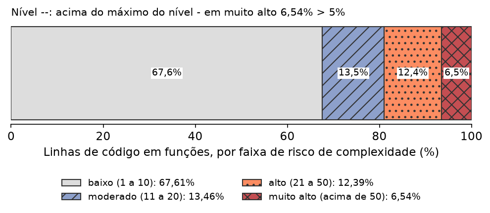

import Link from '@docusaurus/Link';

# Resultados: Manutenibilidade (G1)

## Introdução

Esta página responde ao objetivo [G1](../fase-02/gqm-manutenibilidade.md), que avalia a manutenibilidade do Excalidraw no commit `e1b7aacb356a492aa1e0fc6eb57b8896124027f0`, a partir das 14 métricas coletadas de 10 a 12/11/2026. Na interpretação do GQM, as medidas são analisadas para responder às questões e, por meio delas, ao objetivo [[1, p. 54]](#ref-1), e as hipóteses de baseline são comparadas com os valores reais [[1, p. 46]](#ref-1).

O resultado é que G1 **não atende**. A média da característica fica no nível `o`, mas a questão de reusabilidade está no nível `--`.

## Metodologia

A análise segue o [plano de análise](../fase-03/plano-analise.md#1-fluxo-da-análise) da Fase 03. Os valores de partida são os de [`metricas.csv`](../../dados/fase-04/consolidados/metricas.csv), calculados e verificados a partir dos dados brutos. O script [`scripts/analisa_metricas.py`](https://github.com/FCTE-Qualidade-de-Software-1/2026-2_T02_KAREN_JONES/blob/main/scripts/analisa_metricas.py) compara cada valor com as faixas da [tabela 4 dos níveis de pontuação](../fase-02/pontuacao-julgamento.md#3-níveis-das-métricas-de-manutenibilidade-g1), seguindo as [regras gerais](../fase-02/pontuacao-julgamento.md#23-regras-gerais), e aplica a [agregação](../fase-02/pontuacao-julgamento.md#6-agregação-da-métrica-à-característica) e o [julgamento](../fase-02/pontuacao-julgamento.md#71-julgamento-de-cada-característica). Ele grava [`niveis.csv`](../../dados/fase-04/consolidados/niveis.csv), [`questoes.csv`](../../dados/fase-04/consolidados/questoes.csv), [`caracteristicas.csv`](../../dados/fase-04/consolidados/caracteristicas.csv) e os gráficos desta página. Assim, comparar os resultados com os critérios [[2, p. 20]](#ref-2) é um passo que qualquer pessoa pode repetir.

Cada hipótese foi confirmada ou refutada pela regra do critério de interpretação da sua ficha, independentemente do nível da métrica, como define a [regra das hipóteses](../fase-02/pontuacao-julgamento.md#72-hipóteses). Para cada hipótese refutada, foram consultados os desvios registrados nos arquivos `M<código>_fatores.md` da coleta e o quadrante de impacto da [abstraction sheet de G1](../fase-02/abstraction-sheets.md#2-g1-manutenibilidade), como pede o [plano de análise](../fase-03/plano-analise.md#5-hipóteses-e-fatores-de-variação). Os resultados estão organizados por questão, com tabelas e gráficos [[1, p. 56]](#ref-1). Na coluna Valor de cada tabela, o valor leva ao arquivo bruto de origem.

---

## 1. Q1.1: Modularidade

Tabela 1: Resultados de Q1.1

| Métrica | Valor | Nível | Hipótese | Resultado da hipótese |
| :--- | :---: | :---: | :--- | :--- |
| [M1.1.1](../fase-02/gqm-manutenibilidade.md#m111-ciclos-de-dependência-entre-pacotes) | [4 pares em ciclo](../../dados/fase-04/brutos/M1.1.1_grafo-madge.json) | `-` | [H1.1.1](../fase-02/gqm-manutenibilidade.md#3-q11-modularidade): 0 pares | Refutada |
| [M1.1.2](../fase-02/gqm-manutenibilidade.md#m112-importações-que-violam-a-direção-declarada) | [0,19% (1 de 528)](../../dados/fase-04/brutos/M1.1.1_grafo-madge.json) | `++` | [H1.1.2](../fase-02/gqm-manutenibilidade.md#3-q11-modularidade): 0 importações | Refutada |
| [M1.1.3](../fase-02/gqm-manutenibilidade.md#m113-acoplamento-e-instabilidade-de-cada-pacote) | [10,00% (2 de 20)](../../dados/fase-04/brutos/M1.1.1_grafo-madge.json) | `o` | [H1.1.3](../fase-02/gqm-manutenibilidade.md#3-q11-modularidade): biblioteca com o maior *Ca* | Refutada |
| **Média da questão** | **3,3** | **`o`** | | |

Fonte: [Christopher Paraizo](https://github.com/wChrstphr), 2026.

Os quatro pares em ciclo são `common` e `math`, `element` e `excalidraw`, `element` e `utils`, e `excalidraw` e `utils`. A única importação contra a direção declarada é a de `packages/utils/src/index.ts` para `packages/excalidraw/scene/export.ts`. A dependência de `utils` para a biblioteca também é uma das duas que contrariam o Princípio das Dependências Estáveis. A outra é a de `element` para `utils`. Em [M1.1.3](../fase-02/gqm-manutenibilidade.md#m113-acoplamento-e-instabilidade-de-cada-pacote), o valor de 10% está no limite entre `o` e `-` e fica no nível melhor. Os pacotes que mais recebem dependências são `common` e `math`, com *Ca* 5 cada, enquanto a biblioteca tem *Ca* 2. Por isso, [H1.1.3](../fase-02/gqm-manutenibilidade.md#3-q11-modularidade) é refutada.

As três refutações não são explicadas por fatores registrados. O único desvio da coleta é o caminho do clone, que não altera o grafo. O quadrante de impacto previa que a revisão concentrada em poucos mantenedores preservaria a direção das dependências, e os dados mostram que isso não impediu os ciclos.

**Resposta a [Q1.1](../fase-02/gqm-manutenibilidade.md#3-q11-modularidade):** a modularidade é regular (`o`). As importações entre pacotes quase sempre seguem a direção declarada, mas 4 dos 28 pares de pacotes estão em ciclo e não podem ser alterados ou reutilizados separadamente.

---

## 2. Q1.2: Reusabilidade

Tabela 2: Resultados de Q1.2

| Métrica | Valor | Nível | Hipótese | Resultado da hipótese |
| :--- | :---: | :---: | :--- | :--- |
| [M1.2.1](../fase-02/gqm-manutenibilidade.md#m121-arquivos-de-pacotes-de-base-com-dependência-de-react-ou-do-navegador) | [69,07% (67 de 97)](../../dados/fase-04/brutos/M1.2.1_arquivos-diretos.csv) | `--` | [H1.2.1](../fase-02/gqm-manutenibilidade.md#4-q12-reusabilidade): 0 arquivos em `math` e `utils` | Refutada |
| [M1.2.2](../fase-02/gqm-manutenibilidade.md#m122-proporção-de-propriedades-públicas-documentadas) | [57,69% (30 de 52)](../../dados/fase-04/brutos/M1.2.2_propriedades.csv) | `-` | [H1.2.2](../fase-02/gqm-manutenibilidade.md#4-q12-reusabilidade): de 80% a menos de 100% | Refutada |
| **Média da questão** | **1,5** | **`--`** | | |

Fonte: [Christopher Paraizo](https://github.com/wChrstphr), 2026.

Nos pacotes de base, 67 dos 97 arquivos de produção dependem de React ou do navegador. A maior parte está em `element` (50 de 54) e em `common` (13 de 19). Em `math` (2 de 16) e `utils` (2 de 3), nenhum arquivo usa React ou o navegador diretamente. A dependência é sempre transitiva: `math/src/range.ts` e `utils/src/shape.ts` importam o índice de `common`, que alcança `common/debug.ts`, e `utils/src/index.ts` importa a biblioteca. Das 52 propriedades públicas de `ExcalidrawProps`, 22 não estão documentadas.

A média de 1,5 é arredondada para baixo, pela [regra da agregação](../fase-02/pontuacao-julgamento.md#6-agregação-da-métrica-à-característica), e a questão fica no nível `--`. As refutações também não são explicadas por fatores registrados. Na revisão dos formulários, as 43 ocorrências dos pacotes de base foram conferidas linha a linha. Duas propriedades foram aceitas como documentadas por descrições com outro nome, o que só melhora o resultado de [M1.2.2](../fase-02/gqm-manutenibilidade.md#m122-proporção-de-propriedades-públicas-documentadas).

**Resposta a [Q1.2](../fase-02/gqm-manutenibilidade.md#4-q12-reusabilidade):** a reusabilidade é muito ruim (`--`). Mais de dois terços dos arquivos dos pacotes de base só funcionam junto com React ou dentro de um navegador. Além disso, quem integra a biblioteca não encontra documentação para 42% das propriedades públicas.

---

## 3. Q1.3: Analisabilidade

Tabela 3: Resultados de Q1.3

| Métrica | Valor | Nível | Hipótese | Resultado da hipótese |
| :--- | :---: | :---: | :--- | :--- |
| [M1.3.1](../fase-02/gqm-manutenibilidade.md#m131-perfil-de-risco-de-complexidade-das-funções) | [13,46% / 12,39% / 6,54%](../../dados/fase-04/brutos/M1.3.1_eslint.json) | `--` | [H1.3.1](../fase-02/gqm-manutenibilidade.md#5-q13-analisabilidade): mais de 0% em risco muito alto | Confirmada |
| [M1.3.2](../fase-02/gqm-manutenibilidade.md#m132-cobertura-da-documentação-para-desenvolvedores) | [3 de 4 tópicos](../../dados/fase-04/brutos/M1.3.2_lista-verificacao.csv) | `o` | [H1.3.2](../fase-02/gqm-manutenibilidade.md#5-q13-analisabilidade): tópicos 1 e 2 presentes | Confirmada |
| [M1.3.3](../fase-02/gqm-manutenibilidade.md#m133-verificações-estáticas-executadas-automaticamente) | [3 de 3 verificações](../../dados/fase-04/brutos/M1.3.3_verificacoes.csv) | `++` | [H1.3.3](../fase-02/gqm-manutenibilidade.md#5-q13-analisabilidade): 3 de 3 | Confirmada |
| **Média da questão** | **3,0** | **`o`** | | |

Fonte: [Christopher Paraizo](https://github.com/wChrstphr), 2026.

Os valores de [M1.3.1](../fase-02/gqm-manutenibilidade.md#m131-perfil-de-risco-de-complexidade-das-funções) são as linhas em risco moderado, alto e muito alto. O nível `--` vem do risco muito alto, que passa do máximo de 5% do nível `-` na [tabela 5](../fase-02/pontuacao-julgamento.md#31-faixas-de-m131). O risco alto, de 12,39%, ficaria no nível `-`. Somadas, as linhas em funções de risco alto e muito alto chegam a 18,93%. Na documentação para desenvolvedores, falta só o tópico de arquitetura ou organização do código. Lint, formatação e tipos rodam automaticamente em cada contribuição.

Figura 1: Perfil de risco de complexidade das funções (M1.3.1)

Fonte: [Christopher Paraizo](https://github.com/wChrstphr), 2026, a partir de M1.3.1_eslint.json.

**Resposta a [Q1.3](../fase-02/gqm-manutenibilidade.md#5-q13-analisabilidade):** a analisabilidade é regular (`o`). As verificações automáticas e a documentação de contribuição facilitam a entrada no projeto, mas quase um quinto das linhas está em funções complexas demais para entender e testar com segurança.

---

## 4. Q1.4: Modificabilidade

Tabela 4: Resultados de Q1.4

| Métrica | Valor | Nível | Hipótese | Resultado da hipótese |
| :--- | :---: | :---: | :--- | :--- |
| [M1.4.1](../fase-02/gqm-manutenibilidade.md#m141-mediana-de-arquivos-de-produção-alterados-por-contribuição) | [2,5 arquivos](../../dados/fase-04/brutos/M1.4.1_prs.json) | `+` | [H1.4.1](../fase-02/gqm-manutenibilidade.md#6-q14-modificabilidade): mediana até 4 | Confirmada |
| [M1.4.2](../fase-02/gqm-manutenibilidade.md#m142-arquivos-de-produção-extensos) | [4,22% (21 de 498)](../../dados/fase-04/brutos/M1.4.2_cloc.json) | `+` | [H1.4.2](../fase-02/gqm-manutenibilidade.md#6-q14-modificabilidade): até 5% | Confirmada |
| [M1.4.3](../fase-02/gqm-manutenibilidade.md#m143-proporção-de-contribuições-que-alteram-arquivos-extensos) | [65,75% (96 de 146)](../../dados/fase-04/brutos/M1.4.1_prs.json) | `--` | [H1.4.3](../fase-02/gqm-manutenibilidade.md#6-q14-modificabilidade): mais de 10% | Confirmada |
| **Média da questão** | **3,0** | **`o`** | | |

Fonte: [Christopher Paraizo](https://github.com/wChrstphr), 2026.

A mediana de 2,5 arquivos vem das 146 contribuições integradas, um número par. Ela cai entre as faixas "até 2" e "3 ou 4", que foram escritas para valores inteiros. As faixas foram lidas como contínuas, seguindo a lógica de dobrar a cada nível da [justificativa de M1.4.1](../fase-02/pontuacao-julgamento.md#32-justificativas-específicas). Assim, `+` vai de mais de 2 até 4 arquivos. Nenhuma leitura alternativa muda o nível da questão. A média é de 5,9 arquivos, e a maior contribuição alterou 60. Dos 21 arquivos extensos, o maior é `packages/excalidraw/components/App.tsx`, com 9.563 linhas de código.

**Resposta a [Q1.4](../fase-02/gqm-manutenibilidade.md#6-q14-modificabilidade):** a modificabilidade é regular (`o`). As contribuições costumam ser pequenas, e poucos arquivos são extensos. Mesmo assim, quase dois terços das contribuições passam por algum desses 21 arquivos, que concentram o trabalho de manutenção nos pontos mais difíceis de alterar.

---

## 5. Q1.5: Testabilidade

Tabela 5: Resultados de Q1.5

| Métrica | Valor | Nível | Hipótese | Resultado da hipótese |
| :--- | :---: | :---: | :--- | :--- |
| [M1.5.1](../fase-02/gqm-manutenibilidade.md#m151-cobertura-de-linhas-por-pacote) | [76,74%](../../dados/fase-04/brutos/M1.5.1_coverage-summary.json) | `o` | [H1.5.1](../fase-02/gqm-manutenibilidade.md#7-q15-testabilidade): biblioteca acima da aplicação web | Confirmada |
| [M1.5.2](../fase-02/gqm-manutenibilidade.md#m152-distribuição-dos-testes-por-nível) | [2 de 3 níveis](../../dados/fase-04/brutos/M1.5.2_classificacao.csv) | `o` | [H1.5.2](../fase-02/gqm-manutenibilidade.md#7-q15-testabilidade): unitários e de integração acima de 50% | Confirmada |
| [M1.5.3](../fase-02/gqm-manutenibilidade.md#m153-proporção-de-contribuições-com-testes-executados-antes-da-integração) | [99,12% (113 de 114)](../../dados/fase-04/brutos/M1.4.1_prs.json) | `++` | [H1.5.3](../fase-02/gqm-manutenibilidade.md#7-q15-testabilidade): 95% ou mais | Confirmada |
| **Média da questão** | **3,7** | **`+`** | | |

Fonte: [Christopher Paraizo](https://github.com/wChrstphr), 2026.

A biblioteca tem 75,17% de cobertura de linhas, e a aplicação web 43,48%. Das 143 suítes de teste, 62 são unitárias e 81 de integração, e nenhuma é de ponta a ponta. Em [M1.5.3](../fase-02/gqm-manutenibilidade.md#m153-proporção-de-contribuições-com-testes-executados-antes-da-integração), 32 das 146 contribuições ficaram fora do denominador, como pede a ficha, porque a API do GitHub devolve os jobs do fluxo de cobertura sem a lista de passos. O tratamento está na [verificação dos dados de G1](https://github.com/FCTE-Qualidade-de-Software-1/2026-2_T02_KAREN_JONES/blob/main/dados/fase-04/README.md#verificação-dos-dados-de-g1). Se essas 32 contassem como não verificadas, o valor seria 77,40% (113 de 146), no nível `o`, e a hipótese seria refutada.

**Resposta a [Q1.5](../fase-02/gqm-manutenibilidade.md#7-q15-testabilidade):** a testabilidade é boa (`+`). Os testes rodam em quase toda contribuição antes da integração e cobrem três quartos das linhas. As lacunas são a aplicação web, com menos da metade das linhas cobertas, e a falta de testes de ponta a ponta.

---

## 6. Resposta a G1

Figura 2: Média de cada questão de G1

Fonte: [Christopher Paraizo](https://github.com/wChrstphr), 2026, a partir de questoes.csv.

A média de G1 é (3,3 + 1,5 + 3,0 + 3,0 + 3,7) ÷ 5 = 2,9, calculada sem arredondar as médias das questões, e corresponde ao nível `o`. O [julgamento](../fase-02/pontuacao-julgamento.md#71-julgamento-de-cada-característica) também exige que nenhuma questão esteja no nível `--`, e [Q1.2](../fase-02/gqm-manutenibilidade.md#4-q12-reusabilidade) está. Das 14 hipóteses, 9 foram confirmadas e 5 refutadas, todas em [Q1.1](../fase-02/gqm-manutenibilidade.md#3-q11-modularidade) e [Q1.2](../fase-02/gqm-manutenibilidade.md#4-q12-reusabilidade). A equipe esperava pacotes mais independentes do que os dados mostram.

**Resposta a G1:** a manutenibilidade do Excalidraw **não atende**. O código é regular para analisar e modificar e bom para testar. Ele falha na reusabilidade: os pacotes de base, que deveriam poder ser usados fora do editor, dependem quase todos de React ou do navegador, e estão ligados entre si e à biblioteca por ciclos de dependência.

---

## 7. Pontos de melhoria

As métricas nos níveis `-` e `--` são os [pontos de melhoria](../fase-02/pontuacao-julgamento.md#73-pontos-de-melhoria) de G1. A escolha da ação fica para a [decisão conjunta da equipe](https://github.com/FCTE-Qualidade-de-Software-1/2026-2_T02_KAREN_JONES/issues/118).

Tabela 6: Pontos de melhoria de G1

| Métrica | Nível | Questão | Subcaracterística | Causa |
| :--- | :---: | :--- | :--- | :--- |
| [M1.2.1](../fase-02/gqm-manutenibilidade.md#m121-arquivos-de-pacotes-de-base-com-dependência-de-react-ou-do-navegador) | `--` | [Q1.2](../fase-02/gqm-manutenibilidade.md#4-q12-reusabilidade) | Reusabilidade | 67 de 97 arquivos dos pacotes de base dependem de React ou do navegador |
| [M1.3.1](../fase-02/gqm-manutenibilidade.md#m131-perfil-de-risco-de-complexidade-das-funções) | `--` | [Q1.3](../fase-02/gqm-manutenibilidade.md#5-q13-analisabilidade) | Analisabilidade | 6,54% das linhas em funções com complexidade acima de 50 |
| [M1.4.3](../fase-02/gqm-manutenibilidade.md#m143-proporção-de-contribuições-que-alteram-arquivos-extensos) | `--` | [Q1.4](../fase-02/gqm-manutenibilidade.md#6-q14-modificabilidade) | Modificabilidade | 96 de 146 contribuições alteram arquivos extensos |
| [M1.1.1](../fase-02/gqm-manutenibilidade.md#m111-ciclos-de-dependência-entre-pacotes) | `-` | [Q1.1](../fase-02/gqm-manutenibilidade.md#3-q11-modularidade) | Modularidade | 4 pares de pacotes em ciclo |
| [M1.2.2](../fase-02/gqm-manutenibilidade.md#m122-proporção-de-propriedades-públicas-documentadas) | `-` | [Q1.2](../fase-02/gqm-manutenibilidade.md#4-q12-reusabilidade) | Reusabilidade | 22 de 52 propriedades públicas sem documentação |

Fonte: [Christopher Paraizo](https://github.com/wChrstphr), 2026.

---

## Referências

> <Link id="ref-1">1.</Link> RAMOS, Cristiane Soares. **AULA 08 QSW1 GQM**. Material da disciplina de Qualidade de Software 1, FCTE/UnB, 2026. Páginas 46, 54 e 56. Disponível no Moodle da disciplina.
>
> <Link id="ref-2">2.</Link> RAMOS, Cristiane Soares. **AULA A07 QSW1 PROC AVAL PRODUTO**. Material da disciplina de Qualidade de Software 1, FCTE/UnB, 2026. Página 20. Disponível no Moodle da disciplina.

---

## Histórico de Versões

| Versão | Data | Descrição | Autor(es) | Revisor(es) |
| :---: | :---: | :--- | :--- | :--- |
| 1.0 | 15/11/2026 | Criação dos resultados de G1: níveis, hipóteses, respostas às questões e ao objetivo, gráficos e pontos de melhoria | [Christopher Paraizo](https://github.com/wChrstphr) | |
| 1.1 | 18/11/2026 | Revisão de coerência, cross-links e redação: posição na barra lateral ajustada à nova visão geral da Fase 04 | [Christopher Paraizo](https://github.com/wChrstphr) | |
| 1.2 | 18/11/2026 | Revisão de coerência, cross-links e redação: códigos M, H e Q linkados às fichas da Fase 02 | [Christopher Paraizo](https://github.com/wChrstphr) | |
