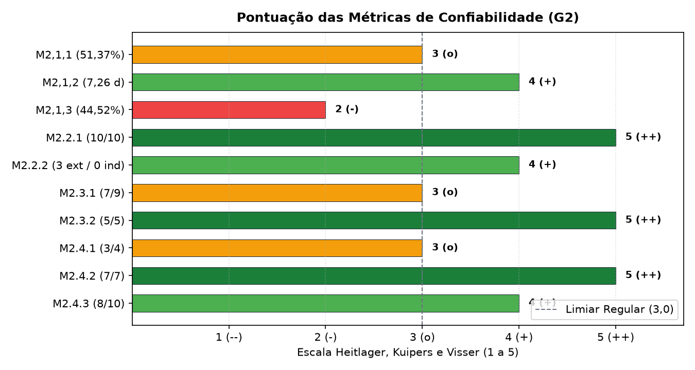
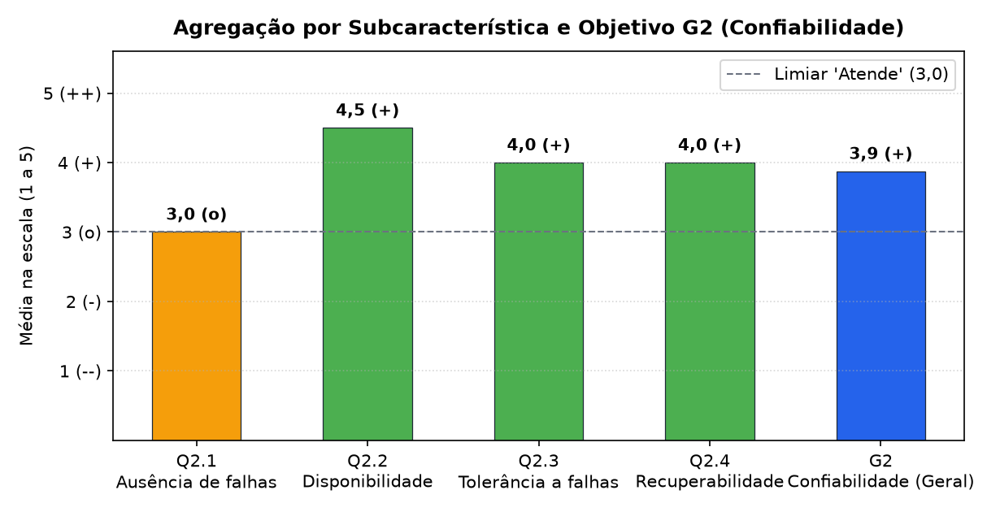

import Link from '@docusaurus/Link';

# Resultados e Julgamento: Confiabilidade (G2)

## Introdução

Esta página apresenta os resultados e o julgamento do objetivo [G2 (Confiabilidade)](../fase-02/gqm-confiabilidade.md) sobre o Excalidraw no commit `e1b7aacb356a492aa1e0fc6eb57b8896124027f0`, com o propósito de converter as dez medidas coletadas na Fase 04 em níveis de pontuação, confrontar as hipóteses formuladas, responder às questões GQM e julgar a característica.

## Metodologia

A análise segue a escala de cinco níveis (`++`, `+`, `o`, `-` e `--`, equivalentes a 5 a 1 pontos), a regra de agregação em duas etapas e os critérios de julgamento definidos nos [níveis de pontuação e critérios de julgamento](../fase-02/pontuacao-julgamento.md#4-níveis-das-métricas-de-confiabilidade-g2), baseados em Heitlager, Kuipers e Visser [[1, p. 5-8]](#ref-1) e em Baggen, Schill e Visser [[2, p. 3]](#ref-2). Os dados brutos foram obtidos conforme as [instruções de G2](../fase-03/instrucoes-g2-confiabilidade.md), combinando consultas à API do GitHub na janela histórica de 18/04/2026 a 18/10/2026 (`Q2.1`) e testes manuais gravados em vídeo com verificação de saída via `scripts/compara_elementos.py` e inspeção JSON (`Q2.2` a `Q2.4`). Como a [#114](https://github.com/FCTE-Qualidade-de-Software-1/2026-2_T02_KAREN_JONES/issues/114) foi encerrada consolidando apenas G1, os valores de G2 foram consolidados em [`G2_metricas_consolidadas.csv`](https://github.com/FCTE-Qualidade-de-Software-1/2026-2_T02_KAREN_JONES/blob/main/dados/fase-04/consolidados/G2_metricas_consolidadas.csv) e [`G2_questoes_pontuacao.csv`](https://github.com/FCTE-Qualidade-de-Software-1/2026-2_T02_KAREN_JONES/blob/main/dados/fase-04/consolidados/G2_questoes_pontuacao.csv) a partir das evidências brutas do [PR #170](https://github.com/FCTE-Qualidade-de-Software-1/2026-2_T02_KAREN_JONES/pull/170).

---

## 1. Contexto e Desvios de Execução

Tabela 1: Parâmetros do ambiente e desvios registrados na coleta de G2

| Parâmetro | Registro da Execução |
| :--- | :--- |
| **Objetivo Avaliado** | G2: Confiabilidade (Ausência de falhas, Disponibilidade, Tolerância a falhas, Recuperabilidade) |
| **Avaliador Responsável** | Luiz Henrique Soares ([luizh-gsoares](https://github.com/luizh-gsoares)) |
| **Versão Avaliada** | Excalidraw, commit `e1b7aacb356a492aa1e0fc6eb57b8896124027f0` |
| **Janela Histórica (`Q2.1`)** | 18/04/2026 a 18/10/2026 |
| **Período dos Testes Manuais** | 14 a 15 de novembro de 2026 |
| **Máquina e Sistema** | Intel Core i5-14450HX, 15,6 GB utilizáveis (16 GB instalados), Windows 11 Home Single Language (Build 26300) |
| **Ambiente e Ferramentas** | Contêiner Docker em `http://127.0.0.1:3001`, Mozilla Firefox `160.0`, OBS Studio `32.1.2`, GitHub CLI `2.102.0` e Python `3.14.4` |
| **Desvios Registrados** | Porta `3001` (`127.0.0.1:3001`) em vez de `localhost:3000` (ocupada) e Firefox `160.0` em vez de `159.0.1` previsto nos [recursos e ambiente](../fase-03/recursos-ambiente.md) |
| **Vídeos das Gravações** | Cinco gravações menores no repositório e nove acima de 95 MB armazenadas no [Google Drive da equipe](https://drive.google.com/drive/folders/1wXbU0MzATtES2GC4-c06XPoyK1heDm6T?usp=sharing), com hashes SHA-256 nos `*_coleta.csv` |

Fonte: [Luiz Henrique Soares](https://github.com/luizh-gsoares), 2026.

---

## 2. Painel Consolidado das Medições

A Tabela 2 reúne os valores medidos para as dez métricas de G2, convertidos conforme as faixas definidas na [Tabela 6 da Fase 02](../fase-02/pontuacao-julgamento.md#4-níveis-das-métricas-de-confiabilidade-g2), e a Figura 1 ilustra a distribuição das pontuações.

Tabela 2: Painel consolidado das medições de confiabilidade (G2)

| Métrica | Questão | Valor Medido | Nível | Pontos | Hipótese | Veredito | Dado Bruto Auditável |
| :---: | :---: | :---: | :---: | :---: | :--- | :---: | :--- |
| **M2.1.1** | Q2.1 | **51,37%** (`75 / 146`) | Regular (`o`) | 3 | H2.1.1 ≥ 20% | **Confirmada** | [M2.1.1_coleta.csv](https://github.com/FCTE-Qualidade-de-Software-1/2026-2_T02_KAREN_JONES/blob/main/dados/fase-04/brutos/Q2.1-ausencia-de-falhas/M2.1.1_coleta.csv) |
| **M2.1.2** | Q2.1 | **7,26 dias** (`7,255602`) | Bom (`+`) | 4 | H2.1.2 mediana ≤ 30 dias | **Confirmada** | [M2.1.2_coleta.csv](https://github.com/FCTE-Qualidade-de-Software-1/2026-2_T02_KAREN_JONES/blob/main/dados/fase-04/brutos/Q2.1-ausencia-de-falhas/M2.1.2_coleta.csv) |
| **M2.1.3** | Q2.1 | **44,52%** (`65 / 146`) | Ruim (`-`) | 2 | H2.1.3 ≥ 95% | **Refutada** | [M2.1.3_coleta.csv](https://github.com/FCTE-Qualidade-de-Software-1/2026-2_T02_KAREN_JONES/blob/main/dados/fase-04/brutos/Q2.1-ausencia-de-falhas/M2.1.3_coleta.csv) |
| **M2.2.1** | Q2.2 | **100,0%** (`10 / 10`) | Excelente (`++`) | 5 | H2.2.1 = 10 de 10 funções | **Confirmada** | [M2.2.1_coleta.csv](https://github.com/FCTE-Qualidade-de-Software-1/2026-2_T02_KAREN_JONES/blob/main/dados/fase-04/brutos/Q2.2-disponibilidade/M2.2.1_coleta.csv) |
| **M2.2.2** | Q2.2 | **3 externos, 0 indispensáveis** | Bom (`+`) | 4 | H2.2.2 = 0 indispensáveis | **Confirmada** | [M2.2.2_coleta.csv](https://github.com/FCTE-Qualidade-de-Software-1/2026-2_T02_KAREN_JONES/blob/main/dados/fase-04/brutos/Q2.2-disponibilidade/M2.2.2_coleta.csv) |
| **M2.3.1** | Q2.3 | **77,78%** (`7 / 9`) | Regular (`o`) | 3 | H2.3.1 = 9 de 9 casos | **Refutada** | [M2.3.1_coleta.csv](https://github.com/FCTE-Qualidade-de-Software-1/2026-2_T02_KAREN_JONES/blob/main/dados/fase-04/brutos/Q2.3-tolerancia-a-falhas/M2.3.1_coleta.csv) |
| **M2.3.2** | Q2.3 | **100,0%** (`5 / 5`) | Excelente (`++`) | 5 | H2.3.2 V1 a V4 aprovadas | **Confirmada** | [M2.3.2_coleta.csv](https://github.com/FCTE-Qualidade-de-Software-1/2026-2_T02_KAREN_JONES/blob/main/dados/fase-04/brutos/Q2.3-tolerancia-a-falhas/M2.3.2_coleta.csv) |
| **M2.4.1** | Q2.4 | **75,0%** (`3 / 4`) | Regular (`o`) | 3 | H2.4.1 = 4 de 4 cenários | **Refutada** | [M2.4.1_coleta.csv](https://github.com/FCTE-Qualidade-de-Software-1/2026-2_T02_KAREN_JONES/blob/main/dados/fase-04/brutos/Q2.4-recuperabilidade/M2.4.1_coleta.csv) |
| **M2.4.2** | Q2.4 | **100,0%** (`7 / 7`) | Excelente (`++`) | 5 | H2.4.2 = 7 de 7 arquivos | **Confirmada** | [M2.4.2_coleta.csv](https://github.com/FCTE-Qualidade-de-Software-1/2026-2_T02_KAREN_JONES/blob/main/dados/fase-04/brutos/Q2.4-recuperabilidade/M2.4.2_coleta.csv) |
| **M2.4.3** | Q2.4 | **80,0%** (`8 / 10`) | Bom (`+`) | 4 | H2.4.3 = 10 de 10 ações | **Refutada** | [M2.4.3_coleta.csv](https://github.com/FCTE-Qualidade-de-Software-1/2026-2_T02_KAREN_JONES/blob/main/dados/fase-04/brutos/Q2.4-recuperabilidade/M2.4.3_coleta.csv) |

Fonte: [Luiz Henrique Soares](https://github.com/luizh-gsoares), 2026.

Figura 1: Pontuação individual das métricas de G2. Fonte: [Luiz Henrique Soares](https://github.com/luizh-gsoares), 2026.

---

## 3. Análise e Respostas às Questões GQM

### 3.1 Q2.1: Ausência de falhas

> **Questão:** *O projeto evita que falhas cheguem ao usuário e trata de forma organizada os defeitos que chegam?*

Tabela 3: Detalhamento das métricas de Q2.1 (Ausência de falhas)

| Métrica | Detalhes da Medição | Valor e Nível |
| :--- | :--- | :---: |
| **M2.1.1** | `150` PRs integrados na janela, `4` excluídos por automação (`excalibot` / Crowdin), `146` elegíveis e `75` do tipo `fix` (escopos: `editor` = 62, sem escopo = 6, `app` = 4, `packages/excalidraw` = 3). | **51,37%** (`o`, 3 pts) |
| **M2.1.2** | Dos `75` PRs `fix` elegíveis, `20` (`26,67%`) possuíam vínculo `closingIssuesReferences` e `55` não tinham relato ligado. A mediana entre abertura do relato e integração da correção foi de `7,255602` dias. | **7,26 dias** (`+`, 4 pts) |
| **M2.1.3** | Dos `146` PRs elegíveis, `65` receberam ao menos uma revisão `APPROVED` de terceiro antes da integração e `81` foram integrados sem aprovação de terceiro. | **44,52%** (`-`, 2 pts) |

Fonte: [Luiz Henrique Soares](https://github.com/luizh-gsoares), 2026.

**Análise:** Mais da metade das contribuições integradas na janela (`51,37%`, nível `o`) corresponde a correções, concentradas no escopo `editor`, o que confirma que parte relevante do esforço do projeto vai para corrigir defeitos. Quando há relato vinculado, a resposta é rápida (`7,255602` dias de mediana, logo acima do teto de `7` dias do nível `++`, ficando em `+`), porém apenas `26,67%` das correções referenciam explicitamente uma *issue*, limitando a rastreabilidade desse tempo ao subconjunto vinculado. O principal ponto fraco aparece em **M2.1.3**: `55,48%` dos PRs (`81` de `146`) foram integrados sem revisão aprovada por outra pessoa, deixando a prevenção de falhas dependente sobretudo das verificações automáticas.

> **Resposta a Q2.1:** **Parcialmente.** O projeto corrige com agilidade os defeitos que chegam vinculados a relatos (mediana de `7,26` dias), mas mais da metade das contribuições integradas são correções (`51,37%`), grande parte sem vínculo formal com relatos (`73,33%`) e sem revisão humana aprovada antes da integração (`55,48%`).
>
> **Pontuação de Q2.1:** Média de **3,0** pontos (Nível **Regular `o`**).

---

### 3.2 Q2.2: Disponibilidade

> **Questão:** *O editor continua disponível para o usuário sem conexão e sem depender de serviços externos?*

Tabela 4: Detalhamento das métricas de Q2.2 (Disponibilidade)

| Métrica | Detalhes da Medição | Valor e Nível |
| :--- | :--- | :---: |
| **M2.2.1** | Com o *service worker* `sw.js` ativo em `127.0.0.1:3001`, todas as `10` funções essenciais (recarregar, criar formas, texto, mover/redimensionar, desfazer/refazer, salvar `.excalidraw`, abrir `.excalidraw`, exportar PNG, exportar SVG e renderizar fonte padrão) funcionaram em modo *offline*. | **10 / 10** (`++`, 5 pts) |
| **M2.2.2** | Na abertura com cache vazio (`M2.2.2_abertura.har`), foram identificados `3` domínios externos (`excalidraw.nyc3.cdn.digitaloceanspaces.com`, `scripts.simpleanalyticscdn.com` e `queue.simpleanalyticscdn.com`). Bloqueados um a um, `0` impediram criar formas ou texto. | **3 ext., 0 ind.** (`+`, 4 pts) |

Fonte: [Luiz Henrique Soares](https://github.com/luizh-gsoares), 2026.

**Análise:** Após o primeiro carregamento, o *service worker* garante operação local completa sem rede (`10/10` em `M2.2.1`, nível `++`). Mesmo com o cache inicialmente vazio, nenhum dos três domínios externos observados é indispensável para desenhar: o bloqueio das fontes externas recorre à fonte local de *fallback* e o bloqueio dos domínios de telemetria não afeta o editor. A existência de `3` domínios de terceiros posiciona `M2.2.2` no nível `+` (1 a 3 externos, 0 indispensáveis).

> **Resposta a Q2.2:** **Sim.** O editor funciona integralmente sem conexão após o primeiro carregamento (`10/10`) e não depende de nenhum serviço externo indispensável para criar formas e texto (`0` de `3` domínios externos).
>
> **Pontuação de Q2.2:** Média de **4,5** pontos, arredondada para baixo conforme a [regra da Fase 02](../fase-02/pontuacao-julgamento.md#6-agregação-da-métrica-à-característica) para **4** (Nível **Bom `+`**).

---

### 3.3 Q2.3: Tolerância a falhas

> **Questão:** *O editor continua funcionando quando recebe dados inválidos ou quando a conexão com a colaboração falha?*

Tabela 5: Detalhamento das métricas de Q2.3 (Tolerância a falhas)

| Métrica | Detalhes da Medição | Valor e Nível |
| :--- | :--- | :---: |
| **M2.3.1** | Dos `9` arquivos inválidos testados pelo menu e por arrastar, `7` foram recusados com mensagem e mantiveram o editor utilizável. Falharam `invalido_05` (campos obrigatórios ausentes, aceito sem mensagem) e `invalido_06` (coordenadas não numéricas, aceito sem mensagem e causou tela branca ao inserir elementos). | **7 / 9** (`o`, 3 pts) |
| **M2.3.2** | Nas `3` repetições, as `5` verificações (`V1` a `V5`) passaram: o desenho permaneceu na tela, foi editável, exibiu aviso de *offline*, permitiu salvar em arquivo e sincronizou após reconexão. Ressalvas: em `V2` elementos criados *offline* ficaram visualmente transparentes/deslocados e `V5` exigiu `F5` na janela B para exibir a sincronização. | **5 / 5** (`++`, 5 pts) |

Fonte: [Luiz Henrique Soares](https://github.com/luizh-gsoares), 2026.

**Análise:** Em tolerância a falhas, o comportamento se divide entre a colaboração e a validação de entrada. Quando a rede cai durante a colaboração (`M2.3.2`), o editor preserva o estado local e permite continuar trabalhando e salvar o arquivo (`5/5`, nível `++`), embora apresente atritos visuais e de atualização na janela parceira. Já diante de arquivos `.excalidraw` estruturalmente corrompidos (`M2.3.1`, nível `o`), o parser trata erros de sintaxe JSON e tipos desconhecidos, mas falha quando o JSON é sintaticamente válido porém viola o esquema dos elementos (`invalido_05` e, de forma crítica, `invalido_06`, que derruba a interface ao desenhar).

> **Resposta a Q2.3:** **Parcialmente.** O editor tolera bem quedas de rede na colaboração (`5/5`), mantendo a edição local, mas falha ao validar arquivos JSON sintaticamente corretos com elementos malformados (`7/9`), chegando a travar com tela branca no caso de coordenadas não numéricas.
>
> **Pontuação de Q2.3:** Média de **4,0** pontos (Nível **Bom `+`**).

---

### 3.4 Q2.4: Recuperabilidade

> **Questão:** *O usuário recupera seu trabalho depois de fechar a aplicação, de reabrir arquivos antigos ou de cometer um erro de edição?*

Tabela 6: Detalhamento das métricas de Q2.4 (Recuperabilidade)

| Métrica | Detalhes da Medição | Valor e Nível |
| :--- | :--- | :---: |
| **M2.4.1** | `C1` (recarregar), `C2` (fechar aba) e `C3` (fechar Firefox) restauraram `10/10` elementos e propriedades. Em `C4` (mover `ref_rect_01` para a direita e encerrar com `taskkill` em menos de `3 s`), os `10` elementos iniciais voltaram, mas a última edição foi perdida. | **3 / 4** (`o`, 3 pts) |
| **M2.4.2** | Todos os `7` arquivos do conjunto (`c1` atual, `c2` `v0.15.0`, `c3` `v0.16.4`, `c4` `v0.17.6`, `c5` `v0.18.0`, `c6` `test_embedded_v1.png` e `c7` `smiley_embedded_v2.png`) reabriram com `100%` dos elementos preservados frente às suas entradas/referências (`manifesto.csv`). | **7 / 7** (`++`, 5 pts) |
| **M2.4.3** | Pelo critério estrito de igualdade de arquivo, `8` de `10` ações (`A1`–`A7` e `A10`) passaram em desfazer e refazer. Em `A8a` (refeito: `+11,2/+20,0 px`) e `A9` (`-0,8 px` em `y`), os mecanismos de grupo e ordem funcionaram, mas houve pequena divergência de coordenadas. | **8 / 10** (`+`, 4 pts) |

Fonte: [Luiz Henrique Soares](https://github.com/luizh-gsoares), 2026.

**Análise:** A compatibilidade retroativa na reabertura de arquivos (`M2.4.2`, `7/7`, nível `++`) é o destaque de recuperabilidade: todas as versões desde `v0.15.0` e os PNGs com cena embutida reabriram sem perda frente às suas referências (com a ressalva registrada no `manifesto.csv` de que o arquivo da `v0.15.0` já continha 9 elementos por não suportar *frame*). O histórico de desfazer/refazer (`M2.4.3`, `8/10`, nível `+`) cobriu criação, exclusão, edição de texto, estilo, rotação e vínculo de setas, com desvios milimétricos de posição apenas ao agrupar (`A8a`) e reordenar (`A9`). Já a persistência automática local (`M2.4.1`, nível `o`) protege fechamentos normais e recargas, mas perde edições feitas imediatamente antes de um encerramento abrupto do navegador (`< 3 s`), devido à janela de gravação assíncrona no armazenamento local.

> **Resposta a Q2.4:** **Sim, na maior parte dos cenários.** O Excalidraw reabre integralmente arquivos antigos e PNGs embutidos (`7/7`), desfaz e refaz as ações principais (`8/10` sem desvio de coordenadas) e restaura o desenho após fechamentos normais (`3/4`), ficando vulnerável apenas à perda da última edição em encerramentos abruptos imediatos.
>
> **Pontuação de Q2.4:** Média de **4,0** pontos (Nível **Bom `+`**).

---

## 4. Confronto Formal de Hipóteses

Conforme a [regra da seção 7.2 da Fase 02](../fase-02/pontuacao-julgamento.md#72-hipóteses), o confronto com as dez hipóteses do [GQM de Confiabilidade](../fase-02/gqm-confiabilidade.md) resultou em **6 hipóteses confirmadas** e **4 hipóteses refutadas**.

Tabela 7: Confronto formal das hipóteses de G2

| Hipótese | Regra de Confirmação | Valor Medido | Veredito | Leitura |
| :---: | :--- | :---: | :---: | :--- |
| **H2.1.1** | Valor ≥ 20% | **51,37%** | **Confirmada** | Mais da metade dos PRs integrados são correções (`fix`). |
| **H2.1.2** | Mediana ≤ 30 dias | **7,26 dias** | **Confirmada** | Correções vinculadas a relatos são integradas em cerca de uma semana. |
| **H2.1.3** | Valor ≥ 95% | **44,52%** | **Refutada** | Maioria dos PRs entra sem aprovação `APPROVED` de terceiro. |
| **H2.2.1** | = 10 de 10 funções | **10 de 10** | **Confirmada** | Operação *offline* integral após carregamento com *service worker*. |
| **H2.2.2** | = 0 domínios indispensáveis | **0 indispensáveis** | **Confirmada** | Os 3 domínios externos (fontes e telemetria) não bloqueiam o editor. |
| **H2.3.1** | = 9 de 9 casos | **7 de 9** | **Refutada** | Elementos sem campos obrigatórios ou com coordenadas inválidas passam sem aviso e podem quebrar a UI. |
| **H2.3.2** | Verificações 1 a 4 aprovadas | **5 de 5** | **Confirmada** | Editor local permanece utilizável e permite salvar durante queda de rede. |
| **H2.4.1** | = 4 de 4 cenários | **3 de 4** | **Refutada** | Encerramento abrupto (`taskkill < 3 s`) perde a última edição não persistida a tempo. |
| **H2.4.2** | = 7 de 7 arquivos | **7 de 7** | **Confirmada** | Versões antigas (`v0.15.0` a `v0.18.0`) e PNGs embutidos reabrem sem perda. |
| **H2.4.3** | = 10 de 10 ações | **8 de 10** | **Refutada** | Pequenas variações de coordenadas em `A8a` (agrupar) e `A9` (sobreposição). |

Fonte: [Luiz Henrique Soares](https://github.com/luizh-gsoares), 2026.

---

## 5. Agregação e Julgamento do Objetivo G2

Aplicando a [agregação em duas etapas da Fase 02](../fase-02/pontuacao-julgamento.md#6-agregação-da-métrica-à-característica), obtém-se a Tabela 8 e a Figura 2.

Tabela 8: Agregação das questões e julgamento de G2 (Confiabilidade)

| Questão / Objetivo | Pontos das Métricas | Média | Nível |
| :--- | :--- | :---: | :---: |
| Q2.1: Ausência de falhas | `3`, `4`, `2` | `3,0` | **`o`** |
| Q2.2: Disponibilidade | `5`, `4` | `4,5` *(arredondado para baixo)* | **`+`** |
| Q2.3: Tolerância a falhas | `3`, `5` | `4,0` | **`+`** |
| Q2.4: Recuperabilidade | `3`, `5`, `4` | `4,0` | **`+`** |
| **G2: Confiabilidade** | Média das 4 questões sem arredondar (`15,5 ÷ 4 = 3,875`) | **3,9** | **`+` (Bom)** |

Fonte: [Luiz Henrique Soares](https://github.com/luizh-gsoares), 2026.

Figura 2: Agregação por subcaracterística e pontuação geral de G2. Fonte: [Luiz Henrique Soares](https://github.com/luizh-gsoares), 2026.

### Resposta ao Objetivo G2 e Julgamento

> **Resposta ao objetivo G2:** O Excalidraw demonstra **boa confiabilidade** do ponto de vista dos usuários finais, com destaque para a disponibilidade *offline* (`M2.2.1` em `++`), a continuidade local durante falhas de colaboração (`M2.3.2` em `++`) e a compatibilidade retroativa na reabertura de arquivos (`M2.4.2` em `++`). Os pontos que limitam a nota máxima são a ausência de revisão humana em mais da metade das integrações (`M2.1.3`), a aceitação sem tratamento de arquivos com atributos de elemento inválidos (`M2.3.1`) e a perda da edição imediata em encerramentos abruptos (`M2.4.1`).
>
> **Julgamento de G2:** Pelos [critérios da Fase 02](../fase-02/pontuacao-julgamento.md#71-julgamento-de-cada-característica), a característica **Confiabilidade atende**: G2 alcança nível **`+`** (3,9 pontos, acima do mínimo `o`) e nenhuma das quatro questões está no nível `--` (a menor é Q2.1 em `o`).

### Pontos de Melhoria e Atenção Identificados

Pela [regra de pontos de melhoria da Fase 02](../fase-02/pontuacao-julgamento.md#73-pontos-de-melhoria), toda métrica nos níveis `-` ou `--` é registrada como ponto de melhoria:

1. **M2.1.3 (`-`, 2 pontos, Q2.1: Ausência de falhas):** `55,48%` dos PRs integrados (`81` de `146`) não contam com aprovação `APPROVED` de outro revisor antes do *merge*.

Como **pontos de atenção** adicionais (nível `o` ou ressalvas funcionais):

2. **M2.3.1 (`o`, Q2.3: Tolerância a falhas):** validar obrigatoriedade e tipos numéricos dos campos de elementos na importação `.excalidraw` para impedir tela branca com coordenadas não numéricas (`invalido_06`) e falha silenciosa com campos ausentes (`invalido_05`).
3. **M2.4.1 (`o`, Q2.4: Recuperabilidade):** reduzir o atraso de persistência no armazenamento local para diminuir a janela de perda em encerramentos abruptos (`< 3 s`).
4. **M2.1.1 (`o`, Q2.1: Ausência de falhas) e M2.3.2 / M2.4.3 (ressalvas):** ampliar o vínculo formal entre PRs `fix` e *issues* (`26,67%`), corrigir a renderização e a sincronização visual pós-reconexão na colaboração e investigar o desvio residual de coordenadas em `undo/redo` ao agrupar e reordenar.

---

## 6. Rastreabilidade com Dados Brutos e Consolidados

Tabela 9: Rastreabilidade entre as métricas de G2, dados brutos e consolidados

| Métrica | Dado Bruto Principal (`dados/fase-04/brutos/`) | Consolidado (`dados/fase-04/consolidados/`) |
| :---: | :--- | :--- |
| **M2.1.1** | [`Q2.1-ausencia-de-falhas/M2.1.1_coleta.csv`](https://github.com/FCTE-Qualidade-de-Software-1/2026-2_T02_KAREN_JONES/blob/main/dados/fase-04/brutos/Q2.1-ausencia-de-falhas/M2.1.1_coleta.csv) e [`M2.1.1_prs.csv`](https://github.com/FCTE-Qualidade-de-Software-1/2026-2_T02_KAREN_JONES/blob/main/dados/fase-04/brutos/Q2.1-ausencia-de-falhas/M2.1.1_prs.csv) | [`G2_metricas_consolidadas.csv`](https://github.com/FCTE-Qualidade-de-Software-1/2026-2_T02_KAREN_JONES/blob/main/dados/fase-04/consolidados/G2_metricas_consolidadas.csv) e [`G2_questoes_pontuacao.csv`](https://github.com/FCTE-Qualidade-de-Software-1/2026-2_T02_KAREN_JONES/blob/main/dados/fase-04/consolidados/G2_questoes_pontuacao.csv) |
| **M2.1.2** | [`Q2.1-ausencia-de-falhas/M2.1.2_coleta.csv`](https://github.com/FCTE-Qualidade-de-Software-1/2026-2_T02_KAREN_JONES/blob/main/dados/fase-04/brutos/Q2.1-ausencia-de-falhas/M2.1.2_coleta.csv) e [`M2.1.2_pares.csv`](https://github.com/FCTE-Qualidade-de-Software-1/2026-2_T02_KAREN_JONES/blob/main/dados/fase-04/brutos/Q2.1-ausencia-de-falhas/M2.1.2_pares.csv) | [`G2_metricas_consolidadas.csv`](https://github.com/FCTE-Qualidade-de-Software-1/2026-2_T02_KAREN_JONES/blob/main/dados/fase-04/consolidados/G2_metricas_consolidadas.csv) e [`G2_questoes_pontuacao.csv`](https://github.com/FCTE-Qualidade-de-Software-1/2026-2_T02_KAREN_JONES/blob/main/dados/fase-04/consolidados/G2_questoes_pontuacao.csv) |
| **M2.1.3** | [`Q2.1-ausencia-de-falhas/M2.1.3_coleta.csv`](https://github.com/FCTE-Qualidade-de-Software-1/2026-2_T02_KAREN_JONES/blob/main/dados/fase-04/brutos/Q2.1-ausencia-de-falhas/M2.1.3_coleta.csv) e [`M2.1.3_revisoes.csv`](https://github.com/FCTE-Qualidade-de-Software-1/2026-2_T02_KAREN_JONES/blob/main/dados/fase-04/brutos/Q2.1-ausencia-de-falhas/M2.1.3_revisoes.csv) | [`G2_metricas_consolidadas.csv`](https://github.com/FCTE-Qualidade-de-Software-1/2026-2_T02_KAREN_JONES/blob/main/dados/fase-04/consolidados/G2_metricas_consolidadas.csv) e [`G2_questoes_pontuacao.csv`](https://github.com/FCTE-Qualidade-de-Software-1/2026-2_T02_KAREN_JONES/blob/main/dados/fase-04/consolidados/G2_questoes_pontuacao.csv) |
| **M2.2.1** | [`Q2.2-disponibilidade/M2.2.1_coleta.csv`](https://github.com/FCTE-Qualidade-de-Software-1/2026-2_T02_KAREN_JONES/blob/main/dados/fase-04/brutos/Q2.2-disponibilidade/M2.2.1_coleta.csv) e [`M2.2.1_funcoes.csv`](https://github.com/FCTE-Qualidade-de-Software-1/2026-2_T02_KAREN_JONES/blob/main/dados/fase-04/brutos/Q2.2-disponibilidade/M2.2.1_funcoes.csv) | [`G2_metricas_consolidadas.csv`](https://github.com/FCTE-Qualidade-de-Software-1/2026-2_T02_KAREN_JONES/blob/main/dados/fase-04/consolidados/G2_metricas_consolidadas.csv) e [`G2_questoes_pontuacao.csv`](https://github.com/FCTE-Qualidade-de-Software-1/2026-2_T02_KAREN_JONES/blob/main/dados/fase-04/consolidados/G2_questoes_pontuacao.csv) |
| **M2.2.2** | [`Q2.2-disponibilidade/M2.2.2_coleta.csv`](https://github.com/FCTE-Qualidade-de-Software-1/2026-2_T02_KAREN_JONES/blob/main/dados/fase-04/brutos/Q2.2-disponibilidade/M2.2.2_coleta.csv), [`M2.2.2_dominios.csv`](https://github.com/FCTE-Qualidade-de-Software-1/2026-2_T02_KAREN_JONES/blob/main/dados/fase-04/brutos/Q2.2-disponibilidade/M2.2.2_dominios.csv) e [`M2.2.2_abertura.har`](https://github.com/FCTE-Qualidade-de-Software-1/2026-2_T02_KAREN_JONES/blob/main/dados/fase-04/brutos/Q2.2-disponibilidade/M2.2.2_abertura.har) | [`G2_metricas_consolidadas.csv`](https://github.com/FCTE-Qualidade-de-Software-1/2026-2_T02_KAREN_JONES/blob/main/dados/fase-04/consolidados/G2_metricas_consolidadas.csv) e [`G2_questoes_pontuacao.csv`](https://github.com/FCTE-Qualidade-de-Software-1/2026-2_T02_KAREN_JONES/blob/main/dados/fase-04/consolidados/G2_questoes_pontuacao.csv) |
| **M2.3.1** | [`Q2.3-tolerancia-a-falhas/M2.3.1_coleta.csv`](https://github.com/FCTE-Qualidade-de-Software-1/2026-2_T02_KAREN_JONES/blob/main/dados/fase-04/brutos/Q2.3-tolerancia-a-falhas/M2.3.1_coleta.csv) e [`M2.3.1_casos.csv`](https://github.com/FCTE-Qualidade-de-Software-1/2026-2_T02_KAREN_JONES/blob/main/dados/fase-04/brutos/Q2.3-tolerancia-a-falhas/M2.3.1_casos.csv) | [`G2_metricas_consolidadas.csv`](https://github.com/FCTE-Qualidade-de-Software-1/2026-2_T02_KAREN_JONES/blob/main/dados/fase-04/consolidados/G2_metricas_consolidadas.csv) e [`G2_questoes_pontuacao.csv`](https://github.com/FCTE-Qualidade-de-Software-1/2026-2_T02_KAREN_JONES/blob/main/dados/fase-04/consolidados/G2_questoes_pontuacao.csv) |
| **M2.3.2** | [`Q2.3-tolerancia-a-falhas/M2.3.2_coleta.csv`](https://github.com/FCTE-Qualidade-de-Software-1/2026-2_T02_KAREN_JONES/blob/main/dados/fase-04/brutos/Q2.3-tolerancia-a-falhas/M2.3.2_coleta.csv) e [`M2.3.2_verificacoes.csv`](https://github.com/FCTE-Qualidade-de-Software-1/2026-2_T02_KAREN_JONES/blob/main/dados/fase-04/brutos/Q2.3-tolerancia-a-falhas/M2.3.2_verificacoes.csv) | [`G2_metricas_consolidadas.csv`](https://github.com/FCTE-Qualidade-de-Software-1/2026-2_T02_KAREN_JONES/blob/main/dados/fase-04/consolidados/G2_metricas_consolidadas.csv) e [`G2_questoes_pontuacao.csv`](https://github.com/FCTE-Qualidade-de-Software-1/2026-2_T02_KAREN_JONES/blob/main/dados/fase-04/consolidados/G2_questoes_pontuacao.csv) |
| **M2.4.1** | [`Q2.4-recuperabilidade/M2.4.1_coleta.csv`](https://github.com/FCTE-Qualidade-de-Software-1/2026-2_T02_KAREN_JONES/blob/main/dados/fase-04/brutos/Q2.4-recuperabilidade/M2.4.1_coleta.csv) e [`M2.4.1_cenarios.csv`](https://github.com/FCTE-Qualidade-de-Software-1/2026-2_T02_KAREN_JONES/blob/main/dados/fase-04/brutos/Q2.4-recuperabilidade/M2.4.1_cenarios.csv) | [`G2_metricas_consolidadas.csv`](https://github.com/FCTE-Qualidade-de-Software-1/2026-2_T02_KAREN_JONES/blob/main/dados/fase-04/consolidados/G2_metricas_consolidadas.csv) e [`G2_questoes_pontuacao.csv`](https://github.com/FCTE-Qualidade-de-Software-1/2026-2_T02_KAREN_JONES/blob/main/dados/fase-04/consolidados/G2_questoes_pontuacao.csv) |
| **M2.4.2** | [`Q2.4-recuperabilidade/M2.4.2_coleta.csv`](https://github.com/FCTE-Qualidade-de-Software-1/2026-2_T02_KAREN_JONES/blob/main/dados/fase-04/brutos/Q2.4-recuperabilidade/M2.4.2_coleta.csv) e [`M2.4.2_arquivos.csv`](https://github.com/FCTE-Qualidade-de-Software-1/2026-2_T02_KAREN_JONES/blob/main/dados/fase-04/brutos/Q2.4-recuperabilidade/M2.4.2_arquivos.csv) | [`G2_metricas_consolidadas.csv`](https://github.com/FCTE-Qualidade-de-Software-1/2026-2_T02_KAREN_JONES/blob/main/dados/fase-04/consolidados/G2_metricas_consolidadas.csv) e [`G2_questoes_pontuacao.csv`](https://github.com/FCTE-Qualidade-de-Software-1/2026-2_T02_KAREN_JONES/blob/main/dados/fase-04/consolidados/G2_questoes_pontuacao.csv) |
| **M2.4.3** | [`Q2.4-recuperabilidade/M2.4.3_coleta.csv`](https://github.com/FCTE-Qualidade-de-Software-1/2026-2_T02_KAREN_JONES/blob/main/dados/fase-04/brutos/Q2.4-recuperabilidade/M2.4.3_coleta.csv) e [`M2.4.3_acoes.csv`](https://github.com/FCTE-Qualidade-de-Software-1/2026-2_T02_KAREN_JONES/blob/main/dados/fase-04/brutos/Q2.4-recuperabilidade/M2.4.3_acoes.csv) | [`G2_metricas_consolidadas.csv`](https://github.com/FCTE-Qualidade-de-Software-1/2026-2_T02_KAREN_JONES/blob/main/dados/fase-04/consolidados/G2_metricas_consolidadas.csv) e [`G2_questoes_pontuacao.csv`](https://github.com/FCTE-Qualidade-de-Software-1/2026-2_T02_KAREN_JONES/blob/main/dados/fase-04/consolidados/G2_questoes_pontuacao.csv) |

Fonte: [Luiz Henrique Soares](https://github.com/luizh-gsoares), 2026.

---

## Referências

> <Link id="ref-1">1.</Link> HEITLAGER, I.; KUIPERS, T.; VISSER, J. A Practical Model for Measuring Maintainability. In: *6th International Conference on the Quality of Information and Communications Technology (QUATIC 2007)*. IEEE, 2007. p. 30-39. Páginas 5 a 8 da versão dos autores. Disponível em: [https://www.di.uminho.pt/~joost/publications/HeitlagerKuipersVisser-Quatic2007.pdf](https://www.di.uminho.pt/~joost/publications/HeitlagerKuipersVisser-Quatic2007.pdf). Acesso em: 16 nov. 2026.
>
> <Link id="ref-2">2.</Link> BAGGEN, R.; SCHILL, K.; VISSER, J. Standardized Code Quality Benchmarking for Improving Software Maintainability. In: *4th International Workshop on Software Quality and Maintainability (SQM 2010)*, 2010. Página 3. Disponível em: [https://webarchive.di.uminho.pt/wiki.di.uminho.pt/twiki/pub/Personal/Joost/PublicationList/SQM2010-StandardizedCodeQuality.pdf](https://webarchive.di.uminho.pt/wiki.di.uminho.pt/twiki/pub/Personal/Joost/PublicationList/SQM2010-StandardizedCodeQuality.pdf). Acesso em: 16 nov. 2026.

---

## Histórico de Versões

| Versão | Data | Descrição | Autor(es) | Revisor(es) |
| :---: | :---: | :--- | :--- | :--- |
| `1.0` | 16/11/2026 | Elaboração da análise, respostas GQM, confronto de hipóteses e julgamento de G2 (Confiabilidade) | [Luiz Henrique Soares](https://github.com/luizh-gsoares) | |
| `1.1` | 16/11/2026 | Inclusão dos arquivos consolidados de G2 em `dados/fase-04/consolidados/` e atualização dos links de rastreabilidade | [Luiz Henrique Soares](https://github.com/luizh-gsoares) | |
