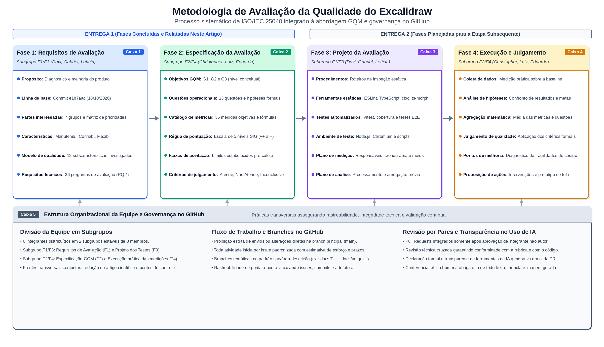

import Link from '@docusaurus/Link';

# Metodologia da equipe

## Introdução

A condução deste trabalho combina o processo de avaliação da qualidade da ISO/IEC 25040 [[1]](#ref-1), o desdobramento orientado a metas do paradigma GQM (Goal Question Metric) [[2]](#ref-2) e a governança do trabalho no repositório. A metodologia mostra como as quatro fases da avaliação e a gestão da equipe se articulam, com links às páginas de cada fase.

## Metodologia

A Figura 1 organiza a metodologia em quatro blocos sequenciais, um para cada fase da ISO/IEC 25040, e um bloco transversal com a estrutura da equipe e a governança no GitHub. Na figura, os blocos aparecem como Caixa 1 a Caixa 5. As seções a seguir seguem a mesma ordem. A figura foi produzida na Entrega 1, e as ferramentas efetivamente usadas na Fase 03 estão em [Recursos e ambiente](../fase-03/recursos-ambiente.md#5-ferramentas-de-análise-e-suas-versões).

*Figura 1: Diagrama metodológico do processo de avaliação da qualidade. Fonte: Equipe Karen Jones.*

## Fase 01: Requisitos da avaliação

Estabelece o escopo e as prioridades do estudo antes da medição empírica. A equipe definiu como propósito identificar pontos de melhoria no Excalidraw, adotando o commit congelado `e1b7aac` como linha de base estática. A partir da identificação de sete partes interessadas e de uma matriz de impacto × risco técnico, priorizaram-se três características da ISO/IEC 25010:2023: Manutenibilidade (P1), Confiabilidade (P2) e Flexibilidade (P3). Foram delineadas 13 subcaracterísticas e 36 requisitos formais de avaliação (RQ-MAN-01 a RQ-FLEX-12). Esta etapa foi conduzida pelo Subgrupo F1/F3 na Entrega 1.

Detalhes nas [páginas da Fase 01](../fase-01/visao-geral.md).

## Fase 02: Especificação da avaliação

Traduz os requisitos de qualidade em medição objetiva via GQM. As características foram desdobradas em três objetivos conceituais (G1, G2 e G3), 13 questões com hipóteses técnicas e um catálogo de 36 métricas com fórmulas de cálculo. Antes da coleta, definiu-se uma escala ordinal de cinco níveis (Heitlager/SIG) e critérios de julgamento inspirados na TÜViT (Atende, Não Atende e Inconclusivo). Esta etapa foi conduzida pelo Subgrupo F2/F4 na Entrega 1.

Detalhes nas [páginas da Fase 02](../fase-02/visao-geral.md) e em [Pontuação e julgamento](../fase-02/pontuacao-julgamento.md).

## Fase 03: Projeto da avaliação

Planeja como, com quais recursos e quando cada uma das 36 métricas é obtida. As ferramentas de análise estática e de teste são Madge, ESLint com `@typescript-eslint/parser`, cloc e Vitest com cobertura, complementadas pelo GitHub CLI, por Browserslist e por Docker. O [plano de medição da avaliação](../fase-03/visao-geral.md) reúne o método, os recursos, as instruções do avaliador e o cronograma, e o [plano de análise](../fase-03/plano-analise.md) define o tratamento e o julgamento dos resultados. Esta etapa foi conduzida pelo Subgrupo F1/F3.

Detalhes em [Recursos e ambiente](../fase-03/recursos-ambiente.md) e nas demais páginas da Fase 03.

## Fase 04: Execução da avaliação e julgamento

Materializa a coleta empírica das 36 métricas sobre a linha de base congelada, confrontando os resultados com as hipóteses formuladas. A consolidação adota agregação em duas etapas (média das métricas por questão e média das questões por característica), aplicando os critérios de julgamento para emitir o diagnóstico final e recomendar melhorias na Entrega 2, sob responsabilidade do Subgrupo F2/F4.

Detalhes na [visão geral da Fase 04](../fase-04/visao-geral.md).

## Gestão: estrutura da equipe e governança no GitHub

Eixo transversal às quatro fases. A equipe organizou-se em dois subgrupos estáveis de três integrantes (Tabela 1) para atuar em paralelo sem sobreposição de escopo. A escrita do artigo e as apresentações são compartilhadas por todos os membros.

Tabela 1: Estrutura organizacional da equipe e distribuição de responsabilidades

| Subgrupo | Integrantes | Fases | Escopo principal |
| :--- | :--- | :--- | :--- |
| Subgrupo F1/F3 | Davi Pierre, Gabriel Monteiro e Letícia de Carvalho | Fase 01 e Fase 03 | Requisitos, interessados, modelo de qualidade e projeto de testes |
| Subgrupo F2/F4 | Christopher Paraizo, Luiz Henrique Soares e Maria Eduarda | Fase 02 e Fase 04 | Objetivos e métricas GQM, pontuação, execução prática e ações de melhoria |

Fonte: [Letícia de Carvalho](https://github.com/LeticiaSantosss), 2026.

O fluxo de trabalho no GitHub segue o [guia de contribuição](https://github.com/FCTE-Qualidade-de-Software-1/2026-2_T02_KAREN_JONES/blob/main/CONTRIBUTING.md), que proíbe envios diretos na branch principal (`main`). Toda atividade nasce vinculada a uma issue padronizada com estimativa de horas, é desenvolvida em branch temática individual e integrada via pull request com fechamento automático da issue, declaração obrigatória de uso de IA generativa e revisão por ao menos um membro do grupo.

O acompanhamento da gestão usa as métricas PSM/CID. O [plano de medição PSM](./plano-medicao-psm.md) define os constructs e os critérios de decisão, distinto do plano de medição da avaliação da Fase 03, e as medições, a interpretação e as decisões ficam no [registro de medições](./registro-medicoes.md) e no [relatório da Fase 3](./relatorios/relatorio-psm-fase-3.md).

## Referências

> <Link id="ref-1">1.</Link> ISO/IEC 25040. *Systems and software engineering: Systems and software Quality Requirements and Evaluation (SQuaRE): Evaluation process*.

> <Link id="ref-2">2.</Link> BASILI, V. R., CALDIERA, G. e ROMBACH, H. D. The Goal Question Metric Approach. In: *Encyclopedia of Software Engineering*. Wiley, 1994.

---

## Histórico de Versões

| Versão | Data | Descrição | Autor(es) | Revisor(es) |
| :---: | :---: | :--- | :--- | :--- |
| `1.0` | 15/11/2026 | Página da metodologia da equipe, adaptada da seção removida do artigo | [Letícia de Carvalho](https://github.com/LeticiaSantosss) | [Christopher Paraizo](https://github.com/wChrstphr) |
| `1.1` | 18/11/2026 | Revisão de coerência, cross-links e redação: link da Caixa 4 à visão geral da Fase 4 e relatório PSM citado só na Fase 3, referências sem travessão e ponto e vírgula, Introdução e Metodologia, seções por fase no lugar das caixas, ferramentas reais da Fase 03, distinção entre o plano de medição da avaliação e o plano PSM, referências no formato Link e tabela com título e fonte | [Christopher Paraizo](https://github.com/wChrstphr) | |
