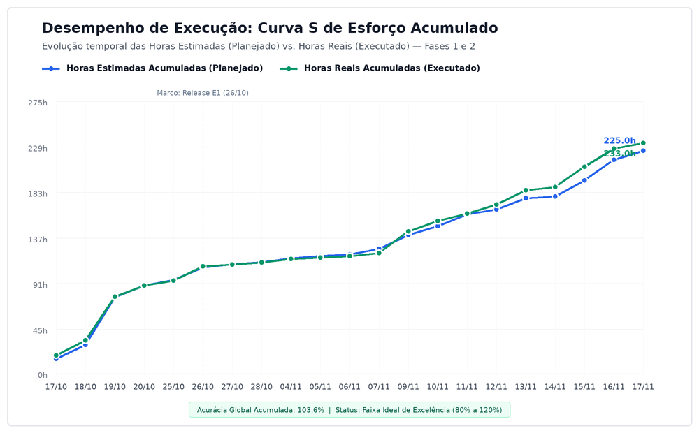
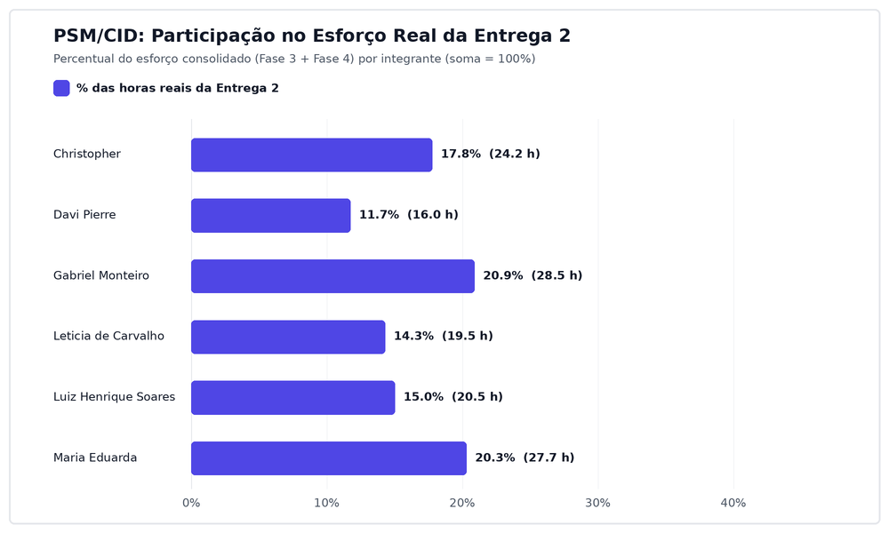
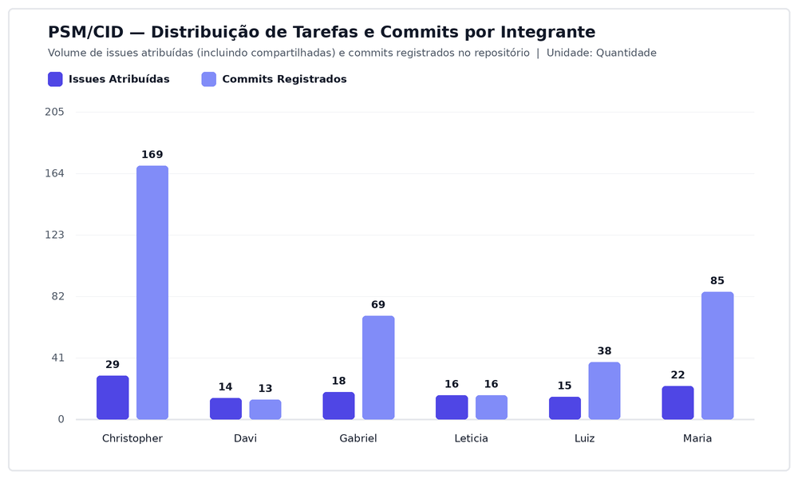

import Link from '@docusaurus/Link';

# Painel de Medição PSM/CID

Este painel consolida os **indicadores quantitativos**, **gráficos de desempenho** e **tabelas de auditoria** do projeto de avaliação de qualidade do **Excalidraw**, estruturados a partir das definições do [Plano de Medição PSM](plano-medicao-psm.md) e fundamentados na norma **ISO/IEC 15939** e no modelo **Practical Software and Systems Measurement (PSM/CID)** [[1]](#ref-1).

A interpretação analítica das causas de desvio e o histórico contínuo de decisões de gestão encontram-se registrados na página [Registro de Medições e Decisões](registro-medicoes.md).

---

## 1. Resumo Executivo por Entrega e por Fase

A tabela a seguir sintetiza os dados apurados nas Fases 1 e 2 (Linha de Base consolidada da Entrega 1) e o acompanhamento das Fases 3 e 4 (Entrega 2), gerados automaticamente a partir de [`dados/gestao/07_resumo_entregas.csv`](https://github.com/FCTE-Qualidade-de-Software-1/2026-2_T02_KAREN_JONES/blob/main/dados/gestao/07_resumo_entregas.csv) e da base de custos e cronograma:

Tabela 1: Resumo executivo consolidado por fase e por entrega

| Escopo | Issues (Concl. / Total) | Progresso (%) | Aderência Prazo (%) | Horas Est. (h) | Horas Reais (h) | Custo Est. (R$) | Custo Real (R$) | Acurácia (%) | Lead Time (dias) | Governança Est. (%) |
| :--- | :---: | :---: | :---: | :---: | :---: | :---: | :---: | :---: | :---: | :---: |
| **Fase 1** *(Requisitos: Linha de Base)* | 18 / 18 | 100,0% | 33,3% | 59,50 | 59,01 | R$ 2.677,50 | R$ 2.655,45 | 99,2% | 1,21 | 100,0% |
| **Fase 2** *(Especificação GQM e Artigo E1)* | 29 / 29 | 100,0% | 48,3% | 70,50 | 64,70 | R$ 3.172,50 | R$ 2.911,50 | 91,8% | 3,74 | 89,7% |
| **Consolidado Entrega 1 (F1 + F2)** | **47 / 47** | **100,0%** | **42,6%** | **130,00** | **123,71** | **R$ 5.850,00** | **R$ 5.566,95** | **95,2%** | **2,77** | **93,6%** |
| **Fase 3** *(Projeto da Avaliação)* | 23 / 23 | 100,0% | 8,7% | 48,00 | 62,50 | R$ 2.160,00 | R$ 2.812,50 | 135,9% | 7,62 | 100,0% |
| **Fase 4** *(Execução da Avaliação)* | 19 / 27 | 70,4% | 55,6% | 92,00 | 63,75 | R$ 4.140,00 | R$ 2.868,75 | 102,8% | 12,34 | 100,0% |
| **Consolidado Entrega 2 (F3 + F4)** | **42 / 50** | **84,0%** | **34,0%** | **140,00** | **126,25** | **R$ 6.300,00** | **R$ 5.681,25** | **116,9%** | **9,76** | **100,0%** |
| **Total do Projeto (F1 a F4)** | **89 / 97** | **91,8%** | **38,1%** | **270,00** | **249,96** | **R$ 12.150,00** | **R$ 11.248,20** | **106,4%** | **6,36** | **96,9%** |

Fonte: [Maria Eduarda](https://github.com/eduarda-ogomes), com base em <code>dados/gestao/07_resumo_entregas.csv</code> e coleta automatizada de 18/11/2026.

---

## 2. Calendário e Progresso: Curva S de Execução

A **Curva S** compara o avanço temporal do esforço planejado acumulado (baseado nos prazos internos das issues cadastradas no [GitHub Project](priorizacao-issues.md)) com o esforço real executado (baseado na data de conclusão das tarefas), integrando as medições das Fases 1 e 2 e a linha de base planejada para as Fases 3 e 4.

Figura 1: Curva S de desempenho de execução (planejado vs. realizado)

Fonte: [Maria Eduarda](https://github.com/eduarda-ogomes), com base em <code>dados/gestao/02_calendario_e_progresso_fases.csv</code> e <code>scripts/gerar_grafico_desempenho.py</code>, 2026.

### 2.1. Aderência ao Cronograma Interno

Tabela 2: Indicadores de conclusão e aderência aos prazos internos

| Recorte | Total de Issues | Concluídas | Abertas | Progresso (%) | Concluídas no Prazo Interno | Concluídas Após Prazo Interno | Abertas em Atraso | Aderência ao Prazo (%) |
| :--- | :---: | :---: | :---: | :---: | :---: | :---: | :---: | :---: |
| **Fase 1** | 18 | 18 | 0 | 100,0% | 6 | 12 | 0 | 33,3% |
| **Fase 2** | 29 | 29 | 0 | 100,0% | 14 | 15 | 0 | 48,3% |
| **Entrega 1 (F1 + F2)** | **47** | **47** | **0** | **100,0%** | **20** | **27** | **0** | **42,6%** |
| **Fase 3** | 23 | 23 | 0 | 100,0% | 2 | 21 | 0 | 8,7% |
| **Fase 4** | 27 | 19 | 8 | 70,4% | 15 | 12 | 8 | 55,6% |
| **Entrega 2 (F3 + F4)** | **50** | **42** | **8** | **84,0%** | **17** | **33** | **8** | **34,0%** |

Fonte: [Maria Eduarda](https://github.com/eduarda-ogomes), com base em <code>dados/gestao/02_calendario_e_progresso_fases.csv</code> e histórico consolidado, 2026.

---

## 3. Recursos e Custos: Contribuição Individual por Entrega e no Projeto

A equipe adotou a consolidação por Entrega (**Entrega 1 = Fase 1 + Fase 2** e **Entrega 2 = Fase 3 + Fase 4**) como unidade principal para monitorar o equilíbrio de carga de trabalho entre os integrantes, em virtude da divisão funcional em dois subgrupos técnicos (**Subgrupo F1/F3** e **Subgrupo F2/F4**).

### 3.1. Contribuição Individual na Entrega 1 (Fases 1 e 2)

A tabela abaixo reproduz os dados apurados no [Apêndice B do Artigo](https://github.com/FCTE-Qualidade-de-Software-1/2026-2_T02_KAREN_JONES/blob/main/artigo/contribuicao-e-ia.md) e no arquivo [`dados/gestao/08_contribuicao_por_entrega.csv`](https://github.com/FCTE-Qualidade-de-Software-1/2026-2_T02_KAREN_JONES/blob/main/dados/gestao/08_contribuicao_por_entrega.csv):

Tabela 3: Distribuição de esforço e custo individual na Entrega 1 (Fases 1 e 2)

| Integrante | Login GitHub | Subgrupo | Issues Atribuídas | Horas Est. (h) | Horas Reais (h) | Custo Real (R$) | Esforço Real (%) |
| :--- | :--- | :---: | :---: | :---: | :---: | :---: | :---: |
| **Christopher** | `@wChrstphr` | F2/F4 | 15 | 37,00 | 28,40 | R$ 1.278,00 | **22,96%** |
| **Davi Pierre** | `@DaviPierre` | F1/F3 | 6 | 20,00 | 21,00 | R$ 945,00 | **16,98%** |
| **Gabriel Monteiro** | `@GabrielSMonteiro` | F1/F3 | 8 | 27,50 | 28,50 | R$ 1.282,50 | **23,04%** |
| **Letícia de Carvalho** | `@LeticiaSantosss` | F1/F3 | 7 | 12,00 | 9,91 | R$ 445,95 | **8,01%** |
| **Luiz Henrique Soares** | `@luizh-gsoares` | F2/F4 | 7 | 12,00 | 12,40 | R$ 558,00 | **10,02%** |
| **Maria Eduarda** | `@eduarda-ogomes` | F2/F4 | 9 | 21,50 | 23,50 | R$ 1.057,50 | **19,00%** |
| **Total da Entrega 1** | Equipe | Todas | **47** | **130,00** | **123,71** | **R$ 5.566,95** | **100,00%** |

Fonte: [Maria Eduarda](https://github.com/eduarda-ogomes), com base em <code>dados/gestao/08_contribuicao_por_entrega.csv</code>, 2026.

> **Nota explicativa dos dados:** Os valores decorrem da base oficial consolidada e somam as milestones Fase 1 e Fase 2, incluindo as correções e tarefas complementares auditadas. As issues com desenvolvimento conjunto contam o rateio proporcional de cada responsável. Todos os seis integrantes mantiveram-se dentro da faixa de equilíbrio de esforço estipulada no Construct 2 (entre 8% e 30% do esforço acumulado da Entrega 1).

Figura 2: Participação percentual no esforço da Entrega 1 com discriminação por fase

Fonte: [Maria Eduarda](https://github.com/eduarda-ogomes), com base em <code>dados/gestao/08_contribuicao_por_entrega.csv</code>, 2026.

### 3.2. Contribuição Individual na Entrega 2 (Fases 3 e 4)

A consolidação da **Entrega 2 (Fase 3 + Fase 4)** abrange o planejamento experimental da avaliação (Fase 3) e a execução prática com a apuração dos resultados (Fase 4). Os dados a seguir foram extraídos de [`dados/gestao/08_contribuicao_por_entrega.csv`](https://github.com/FCTE-Qualidade-de-Software-1/2026-2_T02_KAREN_JONES/blob/main/dados/gestao/08_contribuicao_por_entrega.csv):

Tabela 4: Distribuição de esforço e custo individual na Entrega 2 (Fases 3 e 4)

| Integrante | Login GitHub | Subgrupo | Issues Atribuídas | Horas Est. (h) | Horas Reais (h) | Custo Real (R$) | Esforço Real (%) |
| :--- | :--- | :---: | :---: | :---: | :---: | :---: | :---: |
| **Christopher** | `@wChrstphr` | F2/F4 | 13 | 34,50 | 11,55 | R$ 519,75 | **9,15%** |
| **Davi Pierre** | `@DaviPierre` | F1/F3 | 8 | 18,00 | 16,00 | R$ 720,00 | **12,67%** |
| **Gabriel Monteiro** | `@GabrielSMonteiro` | F1/F3 | 10 | 22,00 | 28,50 | R$ 1.282,50 | **22,57%** |
| **Letícia de Carvalho** | `@LeticiaSantosss` | F1/F3 | 10 | 19,50 | 18,00 | R$ 810,00 | **14,26%** |
| **Luiz Henrique Soares** | `@luizh-gsoares` | F2/F4 | 8 | 20,00 | 20,50 | R$ 922,50 | **16,24%** |
| **Maria Eduarda** | `@eduarda-ogomes` | F2/F4 | 11 | 26,00 | 31,70 | R$ 1.426,50 | **25,11%** |
| **Total da Entrega 2** | Equipe | Todas | **50** | **140,00** | **126,25** | **R$ 5.681,25** | **100,00%** |

Fonte: [Maria Eduarda](https://github.com/eduarda-ogomes), com base em <code>dados/gestao/08_contribuicao_por_entrega.csv</code>, 2026.

> **Nota explicativa dos dados:** Na Entrega 2, o total de 50 issues únicas corresponde a 60 atribuições em razão das tarefas compartilhadas entre integrantes. Todos os seis membros mantiveram-se dentro da faixa de equilíbrio de esforço estipulada no Construct 2 (entre 8% e 30% do esforço acumulado da Entrega 2), oscilando entre 9,15% e 25,11%, com média equilibrada entre os subgrupos.

Figura 3: Participação percentual no esforço da Entrega 2 com discriminação por fase

Fonte: [Maria Eduarda](https://github.com/eduarda-ogomes), com base em <code>dados/gestao/08_contribuicao_por_entrega.csv</code>, 2026.

### 3.3. Balanço Consolidado de Esforço e Custo no Projeto (Fases 1 a 4)

No cômputo geral do projeto (Fases 1, 2, 3 e 4), a equipe somou 249,96 horas reais executadas frente a 270,00 horas estimadas, totalizando R$ 11.248,20 em custo real apurado à taxa horária de R$ 45,00. A tabela a seguir sintetiza a contribuição individual acumulada em todo o repositório, extraída de [`dados/gestao/04_contribuicao_individual.csv`](https://github.com/FCTE-Qualidade-de-Software-1/2026-2_T02_KAREN_JONES/blob/main/dados/gestao/04_contribuicao_individual.csv):

Tabela 5: Distribuição de esforço acumulado e custo total no projeto (Fases 1 a 4)

| Integrante | Login GitHub | Issues Atribuídas | Horas Est. (h) | Horas Reais (h) | Custo Real (R$) | Commits | PRs Abertos | Esforço Real (%) |
| :--- | :--- | :---: | :---: | :---: | :---: | :---: | :---: | :---: |
| **Christopher** | `@wChrstphr` | 28 | 71,50 | 39,95 | R$ 1.797,75 | 154 | 24 | **15,98%** |
| **Davi Pierre** | `@DaviPierre` | 14 | 38,00 | 37,00 | R$ 1.665,00 | 13 | 6 | **14,80%** |
| **Gabriel Monteiro** | `@GabrielSMonteiro` | 18 | 49,50 | 57,00 | R$ 2.565,00 | 69 | 16 | **22,80%** |
| **Letícia de Carvalho** | `@LeticiaSantosss` | 17 | 31,50 | 27,91 | R$ 1.255,95 | 16 | 11 | **11,17%** |
| **Luiz Henrique Soares** | `@luizh-gsoares` | 15 | 32,00 | 32,90 | R$ 1.480,50 | 38 | 16 | **13,16%** |
| **Maria Eduarda** | `@eduarda-ogomes` | 20 | 47,50 | 55,20 | R$ 2.484,00 | 71 | 15 | **22,08%** |
| **Total do Projeto** | **Equipe** | **97 (112 atrib.)** | **270,00** | **249,96** | **R$ 11.248,20** | **321** | **88** | **100,00%** |

Fonte: [Maria Eduarda](https://github.com/eduarda-ogomes), com base em <code>dados/gestao/04_contribuicao_individual.csv</code>, 2026.

Figura 4: Distribuição de tarefas e commits por integrante no projeto

Fonte: [Maria Eduarda](https://github.com/eduarda-ogomes), com base em <code>dados/gestao/04_contribuicao_individual.csv</code>, 2026.

---

## 4. Desempenho dos Processos e Governança

Os indicadores de eficiência do processo avaliam a estabilidade orçamentária, a velocidade de fluxo, a conformidade de preenchimento e o rigor na revisão por pares:

Tabela 6: Indicadores de processo e governança consolidados por entrega e no projeto

| Indicador de Processo | Entrega 1 (F1 + F2) | Entrega 2 (F3 + F4) | Total do Projeto | Meta do Construct | Diagnóstico |
| :--- | :---: | :---: | :---: | :---: | :--- |
| **Acurácia da Estimativa** | 95,2% | 116,9% | **106,4%** | 80% a 120% | Excelente convergência, mantendo-se dentro da faixa ideal de controle em todas as entregas do projeto. |
| **Cycle / Lead Time Médio** | 2,77 dias | 9,76 dias | **6,36 dias** | Até 3,00 dias | Dentro do limite na Entrega 1. Na Entrega 2, a duração ampliou-se em decorrência da complexidade de setup do contêiner Docker e da execução dos ensaios práticos. |
| **Governança de Estimativa** | 93,6% | 100,0% | **96,9%** | 100,0% | Recuperação da conformidade integral na Entrega 2, com 100% das 50 issues abertas com estimativa registrada. |
| **Taxa de Revisão por Pares (PRs)** | 47,7% (21 de 44) | 57,1% (24 de 42) | **52,3% (45 de 86)** | 100,0% | Evolução positiva de 9,4 p.p. na Entrega 2, embora revisões informais e merges de sincronização ainda tenham deixado PRs sem aprovação formal na API. |
| **Tempo Mediano de Espera por Revisão** | 0,79 h (47 min) | 3,50 h | **2,75 h** | Até 24,00 h | Resposta ágil nas revisões em todo o projeto, com eliminação de filas acima de 24 horas na Fase 4 (mediana de apenas 1,50 h). |

Fonte: [Maria Eduarda](https://github.com/eduarda-ogomes), com base em <code>dados/gestao/07_resumo_entregas.csv</code>, <code>03_desempenho_processos_fases.csv</code> e auditoria de PRs via GitHub API, 2026.

Figura 5: Acurácia da estimativa de esforço por fase em relação à faixa ideal (80% a 120%)

Fonte: [Maria Eduarda](https://github.com/eduarda-ogomes), com base em <code>dados/gestao/01_recursos_e_custos_fases.csv</code>, 2026.

---

## 5. Insights de Gestão: Evolução da Organização da Equipe da Fase 1 à Fase 4

A análise comparativa das métricas PSM/CID ao longo do projeto mostra como a equipe diagnosticou o gargalo de dependências entre tarefas nas Fases 1 e 2 e como a adoção de **prazos individuais escalonados nas issues** e de **priorização por impacto de bloqueio** nas Fases 3 e 4 elevou a pontualidade das entregas na Fase 4.

Tabela 7: Comparativo das métricas PSM/CID e evolução do fluxo de trabalho entre as Fases 1, 2, 3 e 4

| Dimensão (PSM/CID) | Métrica Específica | Fase 1 | Fase 2 | Fase 3 | Fase 4 (parcial) | Evolução e Impacto no Fluxo |
| :--- | :--- | :---: | :---: | :---: | :---: | :--- |
| **Calendário e Progresso** | Aderência aos prazos internos | 33,3% (6/18) | 48,3% (14/29) | 8,7% (2/23) | **55,6% (15/27)** | Maior índice do projeto na Fase 4 (78,9% das 19 issues já concluídas foram entregues no prazo) após a adoção dos prazos individuais escalonados. |
| **Ritmo de Execução** | Conclusão na 1ª metade da fase | 0,0% (0/18) | 55,2% (16/29) | 0,0% (0/23) | 7,4% (2/27) | Salto de 0,0% na Fase 1 para 55,2% na Fase 2 com a redução de dependências cruzadas nos blocos do GQM. |
| **Ritmo de Execução** | Concentração nos 2 últimos dias | 72,2% (13/18) | 27,6% (8/29) | 30,4% (7/23) | **0,0% (0/27)** | Redução da entrega em lote de 72,2% na Fase 1 para 27,6% na Fase 2, distribuindo as conclusões conforme os prazos individuais. |
| **Desempenho do Processo** | Tempo médio de espera de PR | 13,68 h | 3,66 h | 24,17 h | **5,19 h** | Queda de 73,2% da Fase 1 para a Fase 2 e estabilização em 5,19 h na Fase 4. |
| **Desempenho do Processo** | Tempo mediano de espera de PR | 10,82 h | 0,40 h (24 min) | 20,88 h | **1,50 h** | Redução expressiva de 10,82 h na Fase 1 para 0,40 h na Fase 2 e manutenção de respostas rápidas (1,50 h) na Fase 4. |
| **Desempenho do Processo** | PRs com espera acima de 24 h | 1 PR | 1 PR | 5 PRs | **0 PRs** | Eliminação completa de filas críticas de revisão na Fase 4. |
| **Desempenho do Processo** | Governança de estimativa | 100,0% | 89,7% | 100,0% | **100,0%** | Recuperação integral do preenchimento de estimativas nas Fases 3 e 4 (100,0%). |
| **Recursos e Custos** | Acurácia da estimativa de esforço | 99,2% | 91,8% | 135,9% | **102,8%** | Alta precisão nas Fases 1 e 2 e retorno ao centro da faixa ideal (80% a 120%) na Fase 4 (102,8%). |

Fonte: [Maria Eduarda](https://github.com/eduarda-ogomes), com base em <code>dados/gestao/constructs_e_tabelas.md</code>, <code>02_calendario_e_progresso_fases.csv</code> e <code>03_desempenho_processos_fases.csv</code>, 2026.

### 5.1. Diferença entre as Fases 1 e 2: O Diagnóstico do Gargalo de Dependências

Na Entrega 1, a comparação entre a Fase 1 e a Fase 2 permitiu identificar a causa raiz dos atrasos de cronograma:

* **Bloqueio em Cadeia na Fase 1:** Na Fase 1, as issues foram divididas entre os integrantes sem considerar as dependências entre elas e sem prazos individuais intermediários. Como as tarefas iniciais de escopo, partes interessadas e modelo de qualidade eram pré-requisitos para as demais, o acúmulo de agenda de um integrante travava o início das tarefas dependentes. Isso resultou em 0,0% de conclusão na primeira metade da fase, 72,2% das entregas concentradas nos dois últimos dias e apenas 33,3% de aderência ao prazo.
* **Avanço Parcial na Fase 2:** Na Fase 2, a atribuição de blocos correlatos de questões e métricas GQM a um mesmo responsável reduziu parte das esperas entre integrantes. Com menos dependências cruzadas, 55,2% das issues foram concluídas já na primeira metade da fase, a concentração nos dois últimos dias caiu de 72,2% para 27,6%, a aderência ao prazo subiu de 33,3% para 48,3% (+15,0 p.p.) e o tempo mediano de espera por revisão de PR caiu de 10,82 h para 0,40 h (24 minutos). Contudo, nas tarefas finais que voltavam a depender de múltiplos membros (como o fechamento do artigo), o gargalo de espera reapareceu.

### 5.2. A Mudança nas Fases 3 e 4: Prazos Individuais nas Issues e Controle de Dependências

A partir da análise das métricas PSM na [reunião de 04/11/2026](atas/2026-11-04-apresentacao-psm.md), a equipe mudou a forma de gerenciar os prazos e as dependências para as Fases 3 e 4, conforme detalhado em [Priorização e datas no GitHub Project](priorizacao-issues.md):

* **Prazos Individuais por Issue:** Em vez de trabalhar apenas com a data limite geral da fase, cada issue passou a ter um prazo individual definido para o responsável entregar a sua atividade a tempo de não atrasar as tarefas seguintes.
* **Prioridade pelo Volume de Desbloqueio:** As issues receberam etiquetas de prioridade conforme a quantidade de atividades que liberam no fluxo, destacando no quadro do projeto quais entregas não podiam sofrer atraso.
* **Efeito de Transição na Fase 3:** Como as issues da Fase 3 já estavam montadas e em andamento quando a medida foi adotada em 04/11/2026, e houve atrito técnico não previsto na preparação dos contêineres e testes-piloto, a aderência da Fase 3 ainda sofreu impacto (8,7%) e exigiu 62,50 h reais frente a 48,00 h estimadas (acurácia de 135,9%).
* **Resultado Consolidado na Fase 4:** Na Fase 4, planejada integralmente desde a abertura com os prazos individuais escalonados em cada issue, a melhoria apareceu de imediato nos indicadores: a **aderência aos prazos atingiu 55,6% do total da fase** (15 de 27 issues concluídas no prazo, o equivalente a **78,9% das 19 issues já finalizadas** entregues sem atraso), superando todas as fases anteriores do projeto. Além disso, a acurácia de esforço convergiu para **102,8%** e nenhum PR ficou aguardando revisão por mais de 24 horas.

### 5.3. Conclusão do Insight de Gestão

O histórico de medições do PSM/CID comprovou que os atrasos iniciais da equipe não decorriam de falta de esforço ou de erro nas estimativas de horas (a acurácia manteve-se excelente: 99,2% na Fase 1, 91,8% na Fase 2 e 102,8% na Fase 4). O problema estava na ausência de prazos individuais intermediários que respeitassem a ordem de dependência entre as tarefas. A introdução dos prazos individuais por issue destravou o fluxo de trabalho entre os membros e permitiu que a Fase 4 alcançasse o maior índice de entregas no prazo de todo o semestre.

---

## 6. Rastreabilidade dos Dados Primários

Para assegurar auditabilidade completa, todos os dados apresentados neste painel decorrem de scripts automatizados e arquivos CSV versionados no repositório:

* **Tabelas de Dados:**
  * [`dados/gestao/07_resumo_entregas.csv`](https://github.com/FCTE-Qualidade-de-Software-1/2026-2_T02_KAREN_JONES/blob/main/dados/gestao/07_resumo_entregas.csv): Indicadores consolidados por entrega.
  * [`dados/gestao/08_contribuicao_por_entrega.csv`](https://github.com/FCTE-Qualidade-de-Software-1/2026-2_T02_KAREN_JONES/blob/main/dados/gestao/08_contribuicao_por_entrega.csv): Esforço e custo individual detalhado por entrega.
  * [`dados/gestao/04_contribuicao_individual.csv`](https://github.com/FCTE-Qualidade-de-Software-1/2026-2_T02_KAREN_JONES/blob/main/dados/gestao/04_contribuicao_individual.csv): Esforço, custo, commits e PRs individuais acumulados no projeto.
  * [`dados/gestao/01_recursos_e_custos_fases.csv`](https://github.com/FCTE-Qualidade-de-Software-1/2026-2_T02_KAREN_JONES/blob/main/dados/gestao/01_recursos_e_custos_fases.csv): Horas estimadas e reais por fase.
  * [`dados/gestao/02_calendario_e_progresso_fases.csv`](https://github.com/FCTE-Qualidade-de-Software-1/2026-2_T02_KAREN_JONES/blob/main/dados/gestao/02_calendario_e_progresso_fases.csv): Séries temporais de progresso e marcos.
  * [`dados/gestao/03_desempenho_processos_fases.csv`](https://github.com/FCTE-Qualidade-de-Software-1/2026-2_T02_KAREN_JONES/blob/main/dados/gestao/03_desempenho_processos_fases.csv): Métricas de acurácia, governança e lead time.
* **Automações:**
  * [`scripts/coleta_psm.py`](https://github.com/FCTE-Qualidade-de-Software-1/2026-2_T02_KAREN_JONES/blob/main/scripts/coleta_psm.py): Extração, cálculo e geração automática de planilhas e gráficos.
  * [`scripts/gerar_grafico_desempenho.py`](https://github.com/FCTE-Qualidade-de-Software-1/2026-2_T02_KAREN_JONES/blob/main/scripts/gerar_grafico_desempenho.py): Geração automática do gráfico da Curva S integrada.

---

## Referências

> <Link id="ref-1">1.</Link> CARD, David et al. **Practical Software and Systems Measurement (PSM): A Foundation for Objective Project Management**. Version 4.0d. PSM Support Center, 2021. Disponível em: [https://psmsc.com](https://psmsc.com). Acesso em: 18 out. 2026.

---

## Histórico de Versões

| Versão | Data | Descrição | Autor(es) | Revisor(es) |
| :---: | :---: | :--- | :--- | :--- |
| 1.0 | 07/11/2026 | Criação do Painel Executivo PSM/CID consolidado por entrega com Curva S, distribuição de esforço e indicadores de processo | [Maria Eduarda](https://github.com/eduarda-ogomes) | |
| 1.1 | 09/11/2026 | Taxa de revisão por pares das Fases 1 e 2 recalculada pela coleta automática de PRs | [Christopher Paraizo](https://github.com/wChrstphr) | |
| 1.2 | 18/11/2026 | Atualização dos dados consolidados das Fases 1 a 4 e inclusão da seção de insights sobre prazos individuais por issue e evolução entre as fases | [Maria Eduarda](https://github.com/eduarda-ogomes) | |
| 1.3 | 18/11/2026 | Inclusão dos recursos e custos da Entrega 2, balanço acumulado do projeto e gráficos de esforço individual | [Maria Eduarda](https://github.com/eduarda-ogomes) | |

