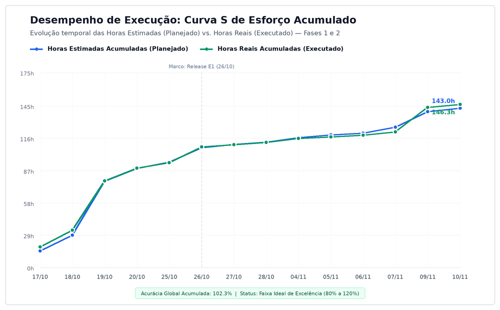
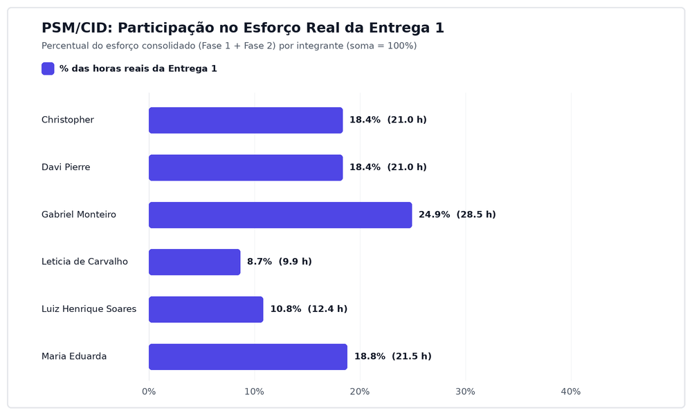
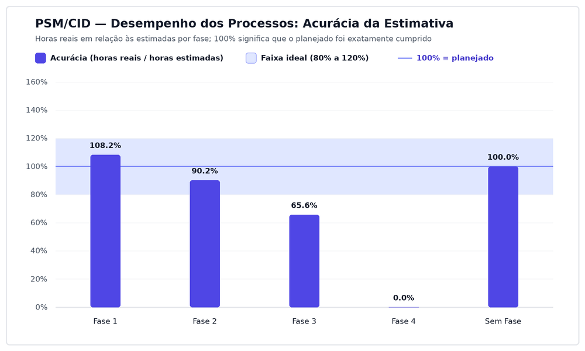

import Link from '@docusaurus/Link';

# Painel de Medição PSM/CID

Este painel consolida os **indicadores quantitativos**, **gráficos de desempenho** e **tabelas de auditoria** do projeto de avaliação de qualidade do **Excalidraw**, estruturados a partir das definições do [Plano de Medição PSM](plano-medicao-psm.md) e fundamentados na norma **ISO/IEC 15939** e no modelo **Practical Software and Systems Measurement (PSM/CID)** [[1]](#ref-1).

A interpretação analítica das causas de desvio e o histórico contínuo de decisões de gestão encontram-se registrados na página [Registro de Medições e Decisões](registro-medicoes.md).

---

## 1. Resumo Executivo por Entrega e por Fase

A tabela a seguir sintetiza os dados apurados nas Fases 1 e 2 (Linha de Base consolidada da Entrega 1) e o acompanhamento das Fases 3 e 4 (Entrega 2), gerados automaticamente a partir de [`dados/gestao/07_resumo_entregas.csv`](https://github.com/FCTE-Qualidade-de-Software-1/2026-2_T02_KAREN_JONES/blob/main/dados/gestao/07_resumo_entregas.csv):

Tabela 1: Resumo executivo consolidado por fase e por entrega

| Escopo | Issues (Concl. / Total) | Progresso (%) | Aderência Prazo (%) | Horas Est. (h) | Horas Reais (h) | Custo Est. (R$) | Custo Real (R$) | Acurácia (%) | Cycle Time (dias) | Governança Est. (%) |
| :--- | :---: | :---: | :---: | :---: | :---: | :---: | :---: | :---: | :---: | :---: |
| **Fase 1** *(Requisitos: Linha de Base)* | 17 / 17 | 100,0% | 29,4% | 53,50 | 57,91 | R$ 2.407,50 | R$ 2.605,95 | 108,2% | 1,23 | 100,0% |
| **Fase 2** *(Especificação GQM e Artigo E1)* | 27 / 27 | 100,0% | 44,4% | 62,50 | 56,40 | R$ 2.812,50 | R$ 2.538,00 | 90,2% | 3,97 | 88,9% |
| **Consolidado Entrega 1 (F1 + F2)** | **44 / 44** | **100,0%** | **38,6%** | **116,00** | **114,31** | **R$ 5.220,00** | **R$ 5.143,95** | **98,5%** | **2,91** | **93,2%** |
| *Transversal (Sem Fase: Issue #90)* | *1 / 1* | *100,0%* | *100,0%* | *2,00* | *2,00* | *R$ 90,00* | *R$ 90,00* | *100,0%* | *0,01* | *100,0%* |
| **Fase 3** *(Projeto da Avaliação)* | 9 / 23 | 39,1% | 8,7% | 48,00 | 18,50 | R$ 2.160,00 | R$ 832,50 | 38,5% | 5,02 | 100,0% |
| **Fase 4** *(Execução da Avaliação)* | 0 / 24 | 0,0% | 91,7% | 80,00 | 0,00 | R$ 3.600,00 | R$ 0,00 | — | — | 100,0% |
| **Consolidado Entrega 2 (F3 + F4)** | **9 / 47** | **19,1%** | **51,1%** | **128,00** | **18,50** | **R$ 5.760,00** | **R$ 832,50** | **14,5%** | **5,02** | **100,0%** |

Fonte: [Maria Eduarda](https://github.com/eduarda-ogomes), com base em <code>dados/gestao/07_resumo_entregas.csv</code> e coleta automatizada de 08/11/2026.

---

## 2. Calendário e Progresso: Curva S de Execução

A **Curva S** compara o avanço temporal do esforço planejado acumulado (baseado nos prazos internos das issues cadastradas no [GitHub Project](priorizacao-issues.md)) com o esforço real executado (baseado na data de conclusão das tarefas), integrando as medições das Fases 1 e 2 e a linha de base planejada para as Fases 3 e 4.

Figura 1: Curva S de desempenho de execução (planejado vs. realizado)

Fonte: [Maria Eduarda](https://github.com/eduarda-ogomes), com base em <code>dados/gestao/02_calendario_e_progresso_fases.csv</code> e <code>scripts/gerar_grafico_desempenho.py</code>, 2026.

### 2.1. Aderência ao Cronograma Interno

Tabela 2: Indicadores de conclusão e aderência aos prazos internos

| Recorte | Total de Issues | Concluídas | Abertas | Progresso (%) | Concluídas no Prazo Interno | Concluídas Após Prazo Interno | Abertas em Atraso | Aderência ao Prazo (%) |
| :--- | :---: | :---: | :---: | :---: | :---: | :---: | :---: | :---: |
| **Fase 1** | 17 | 17 | 0 | 100,0% | 5 | 12 | 0 | 29,4% |
| **Fase 2** | 27 | 27 | 0 | 100,0% | 12 | 15 | 0 | 44,4% |
| **Entrega 1 (F1 + F2)** | **44** | **44** | **0** | **100,0%** | **17** | **27** | **0** | **38,6%** |

Fonte: [Maria Eduarda](https://github.com/eduarda-ogomes), com base em <code>dados/gestao/05_detalhamento_issues.csv</code> e histórico das Fases 1 e 2, 2026.

---

## 3. Recursos e Custos: Contribuição Individual na Entrega 1

A equipe adotou a consolidação por Entrega (**Entrega 1 = Fase 1 + Fase 2**) como unidade principal para monitorar o equilíbrio de carga de trabalho entre os integrantes, em virtude da divisão funcional em dois subgrupos técnicos (**Subgrupo F1/F3** e **Subgrupo F2/F4**).

A tabela abaixo reproduz os dados apurados no [Apêndice B do Artigo](https://github.com/FCTE-Qualidade-de-Software-1/2026-2_T02_KAREN_JONES/blob/main/artigo/contribuicao-e-ia.md) e no arquivo [`dados/gestao/08_contribuicao_por_entrega.csv`](https://github.com/FCTE-Qualidade-de-Software-1/2026-2_T02_KAREN_JONES/blob/main/dados/gestao/08_contribuicao_por_entrega.csv):

Tabela 3: Distribuição de esforço e custo individual na Entrega 1 (Fases 1 e 2)

| Integrante | Login GitHub | Subgrupo | Issues Atribuídas | Horas Est. (h) | Horas Reais (h) | Custo Real (R$) | Esforço Real (%) |
| :--- | :--- | :---: | :---: | :---: | :---: | :---: | :---: |
| **Christopher** | `@wChrstphr` | F2/F4 | 13 | 25,00 | 21,00 | R$ 945,00 | **18,37%** |
| **Davi Pierre** | `@DaviPierre` | F1/F3 | 6 | 20,00 | 21,00 | R$ 945,00 | **18,37%** |
| **Gabriel Monteiro** | `@GabrielSMonteiro` | F1/F3 | 8 | 27,50 | 28,50 | R$ 1.282,50 | **24,93%** |
| **Letícia de Carvalho** | `@LeticiaSantosss` | F1/F3 | 7 | 12,00 | 9,91 | R$ 445,95 | **8,67%** |
| **Luiz Henrique Soares** | `@luizh-gsoares` | F2/F4 | 7 | 12,00 | 12,40 | R$ 558,00 | **10,85%** |
| **Maria Eduarda** | `@eduarda-ogomes` | F2/F4 | 8 | 19,50 | 21,50 | R$ 967,50 | **18,81%** |
| **Total da Entrega 1** | — | — | **49** | **116,00** | **114,31** | **R$ 5.143,95** | **100,00%** |

Fonte: [Maria Eduarda](https://github.com/eduarda-ogomes), com base em <code>dados/gestao/08_contribuicao_por_entrega.csv</code> e <code>artigo/contribuicao-e-ia.md</code>, 2026.

> **Nota explicativa dos dados:** Os valores decorrem da coleta oficial consolidada e somam as milestones Fase 1 e Fase 2, incluindo a [#28](https://github.com/FCTE-Qualidade-de-Software-1/2026-2_T02_KAREN_JONES/issues/28) e as correções [#88](https://github.com/FCTE-Qualidade-de-Software-1/2026-2_T02_KAREN_JONES/issues/88) e [#92](https://github.com/FCTE-Qualidade-de-Software-1/2026-2_T02_KAREN_JONES/issues/92). As issues compartilhadas contam para cada responsável. Todos os seis integrantes mantiveram-se dentro da faixa de equilíbrio de esforço estipulada no Construct 2 (entre 8% e 30% do esforço acumulado da Entrega 1).

Figura 2: Participação percentual no esforço da Entrega 1 com discriminação por fase

Fonte: [Maria Eduarda](https://github.com/eduarda-ogomes), com base em <code>dados/gestao/08_contribuicao_por_entrega.csv</code>, 2026.

---

## 4. Desempenho dos Processos e Governança

Os indicadores de eficiência do processo avaliam a estabilidade orçamentária, a velocidade de fluxo, a conformidade de preenchimento e o rigor na revisão por pares:

Tabela 4: Indicadores de processo e governança nas Fases 1 e 2

| Indicador de Processo | Fase 1 | Fase 2 | Consolidado Entrega 1 | Meta do Construct | Diagnóstico |
| :--- | :---: | :---: | :---: | :---: | :--- |
| **Acurácia da Estimativa** | 108,2% | 90,2% | **98,5%** | 80% a 120% | Excelente convergência: 114,31h reais frente a 116,00h estimadas (desvio de apenas -1,5% no acumulado). |
| **Cycle / Lead Time Médio** | 1,23 dias | 3,97 dias | **2,91 dias** | Até 3,00 dias | Dentro do limite estipulado; o aumento na Fase 2 decorre da densidade técnica dos artefatos GQM e das issues #28 e #30 fechadas em 05/11. |
| **Governança de Estimativa** | 100,0% | 88,9% | **93,2%** | 100,0% | Queda pontual na Fase 2 decorrente de issues complementares abertas inicialmente sem estimativa. |
| **Taxa de Revisão por Pares (PRs)** | 50,0% (5 de 10) | 45,0% (9 de 20) | **46,7% (14 de 30)** | 100,0% | Abaixo da meta de 100%. A métrica contabiliza aprovações registradas via GitHub API por revisores não-autores antes do merge. Dos 11 PRs sem aprovação formal na Fase 2, 6 foram integrados por outro integrante e 5 pelo próprio autor (revisões informais fora do GitHub não foram registradas). |

Fonte: [Maria Eduarda](https://github.com/eduarda-ogomes), com base em <code>dados/gestao/03_desempenho_processos_fases.csv</code> e auditoria de PRs via GitHub API, 2026.

Figura 3: Acurácia da estimativa de esforço por fase e na Entrega 1

Fonte: [Maria Eduarda](https://github.com/eduarda-ogomes), com base em <code>dados/gestao/01_recursos_e_custos_fases.csv</code>, 2026.

---

## 5. Rastreabilidade dos Dados Primários

Para assegurar auditabilidade completa, todos os dados apresentados neste painel decorrem de scripts automatizados e arquivos CSV versionados no repositório:

* **Tabelas de Dados:**
  * [`dados/gestao/07_resumo_entregas.csv`](https://github.com/FCTE-Qualidade-de-Software-1/2026-2_T02_KAREN_JONES/blob/main/dados/gestao/07_resumo_entregas.csv): Indicadores consolidados por entrega.
  * [`dados/gestao/08_contribuicao_por_entrega.csv`](https://github.com/FCTE-Qualidade-de-Software-1/2026-2_T02_KAREN_JONES/blob/main/dados/gestao/08_contribuicao_por_entrega.csv): Esforço e custo individual detalhado.
  * [`dados/gestao/01_recursos_e_custos_fases.csv`](https://github.com/FCTE-Qualidade-de-Software-1/2026-2_T02_KAREN_JONES/blob/main/dados/gestao/01_recursos_e_custos_fases.csv): Horas estimadas e reais por fase.
  * [`dados/gestao/02_calendario_e_progresso_fases.csv`](https://github.com/FCTE-Qualidade-de-Software-1/2026-2_T02_KAREN_JONES/blob/main/dados/gestao/02_calendario_e_progresso_fases.csv): Séries temporais de progresso e marcos.
  * [`dados/gestao/03_desempenho_processos_fases.csv`](https://github.com/FCTE-Qualidade-de-Software-1/2026-2_T02_KAREN_JONES/blob/main/dados/gestao/03_desempenho_processos_fases.csv): Métricas de acurácia, governança e lead time.
* **Automações:**
  * [`scripts/coleta_psm.py`](https://github.com/FCTE-Qualidade-de-Software-1/2026-2_T02_KAREN_JONES/blob/main/scripts/coleta_psm.py): Extração, cálculo e geração automática de planilhas e gráficos.
  * [`scripts/gerar_grafico_desempenho.py`](https://github.com/FCTE-Qualidade-de-Software-1/2026-2_T02_KAREN_JONES/blob/main/scripts/gerar_grafico_desempenho.py): Geração automática do gráfico da Curva S integrada.

---

## Referências

> <Link id="ref-1">1.</Link> CARD, David et al. **Practical Software and Systems Measurement (PSM): A Foundation for Objective Project Management**. Version 4.0d. PSM Support Center, 2021. Disponível em: [https://psmsc.com](https://psmsc.com). Acesso em: 18 out. 2026.

---

## Histórico de Versões

| Versão | Data | Descrição | Autor(es) | Revisor(es) |
| :---: | :---: | :--- | :--- | :--- |
| 1.0 | 07/11/2026 | Criação do Painel Executivo PSM/CID consolidado por entrega com Curva S, distribuição de esforço e indicadores de processo | [Maria Eduarda](https://github.com/eduarda-ogomes) | [Christopher](https://github.com/wChrstphr) |
