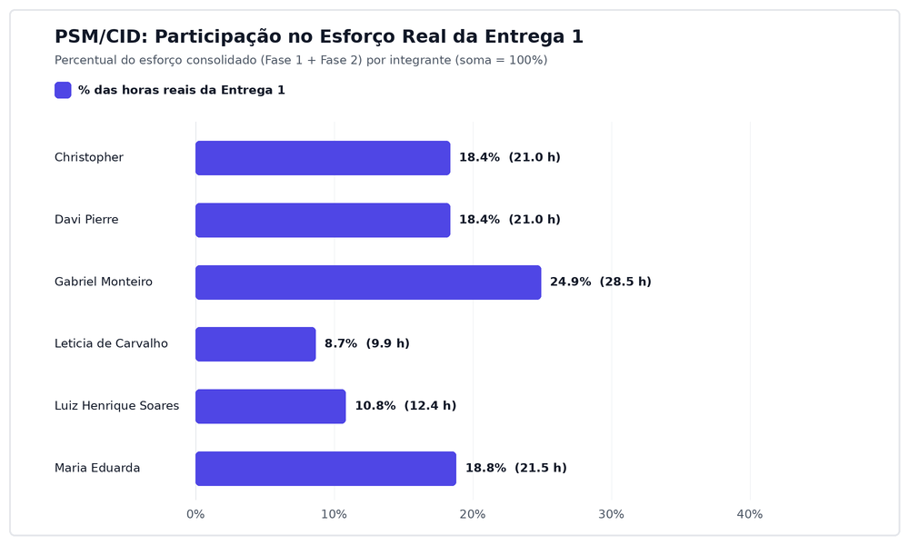
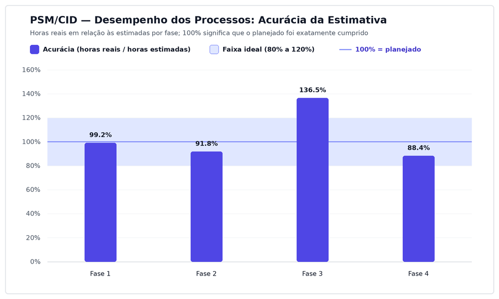

import Link from '@docusaurus/Link';

# Painel de medição PSM/CID

## 1. Introdução

O painel apresenta os indicadores definidos no [Plano de Medição PSM](plano-medicao-psm.md), que segue o modelo Practical Software and Systems Measurement (PSM/CID) [[1]](#ref-1), para as quatro fases da avaliação do Excalidraw. No retrato de 18/11/2026, a Entrega 1 está concluída (47 de 47 issues) e a Entrega 2 tem 42 de 50 issues concluídas, com as 8 abertas na Fase 4. A interpretação das causas de desvio e as decisões de gestão ficam no [Registro de Medições e Decisões](registro-medicoes.md).

## 2. Metodologia

As tabelas são o retrato de 18/11/2026 dos dados gerados automaticamente pelo `scripts/coleta_psm.py`, que lê issues, PRs e revisões pela API do GitHub. A fonte é o commit [`9733fa2`](https://github.com/FCTE-Qualidade-de-Software-1/2026-2_T02_KAREN_JONES/tree/9733fa2a68625d07405c3b2d2275851d6d4a7f68/dados/gestao), a última atualização automática de 18/11/2026: `07_resumo_entregas.csv` para as entregas, `01_recursos_e_custos_fases.csv`, `02_calendario_e_progresso_fases.csv` e `03_desempenho_processos_fases.csv` para as fases, `05_detalhamento_issues.csv` para a situação de cada issue, `08_contribuicao_por_entrega.csv` para a participação individual e `constructs_e_tabelas.md` para a revisão de PRs. As figuras, ao contrário das tabelas, continuam se atualizando: o workflow `coleta-psm.yml` roda todo dia e regenera as imagens de `static/img/gestao/`, que podem mostrar valores posteriores ao retrato.

Os indicadores seguem as medidas derivadas dos constructs do plano. A acurácia da estimativa considera só as issues com horas estimadas e reais preenchidas. O lead time das issues é a média, em dias, entre a abertura e o fechamento das issues fechadas, e a meta de até 3 dias vem da [linha de base do plano](plano-medicao-psm.md#5-linha-de-base-das-fases-1-e-2-dados-históricos). Uma issue conta no prazo quando fecha até o campo `Prazo` ou quando segue aberta antes dele.

O retrato da Entrega 1 difere da linha de base do plano, apurada em 09/11/2026. Depois dessa data, as issues [#90](https://github.com/FCTE-Qualidade-de-Software-1/2026-2_T02_KAREN_JONES/issues/90), [#153](https://github.com/FCTE-Qualidade-de-Software-1/2026-2_T02_KAREN_JONES/issues/153) e [#155](https://github.com/FCTE-Qualidade-de-Software-1/2026-2_T02_KAREN_JONES/issues/155) passaram a contar nas milestones das Fases 1 e 2 (de 44 para 47 issues) e os PRs integrados das duas fases passaram de 41 para 44.

---

## 3. Resumo por entrega e por fase

Tabela 1: Resumo por fase e por entrega. Retrato de 18/11/2026

| Escopo | Issues (concl. / total) | Progresso (%) | Aderência ao prazo (%) | Horas est. (h) | Horas reais (h) | Custo est. (R$) | Custo real (R$) | Acurácia (%) | [Lead time das issues](plano-medicao-psm.md#5-linha-de-base-das-fases-1-e-2-dados-históricos) (dias) | Governança da estimativa (%) |
| :--- | :---: | :---: | :---: | :---: | :---: | :---: | :---: | :---: | :---: | :---: |
| Fase 1 *(requisitos)* | 18 / 18 | 100,0 | 33,3 | 59,50 | 59,01 | 2.677,50 | 2.655,45 | 99,2 | 1,21 | 100,0 |
| Fase 2 *(especificação GQM e artigo)* | 29 / 29 | 100,0 | 48,3 | 70,50 | 64,70 | 3.172,50 | 2.911,50 | 91,8 | 3,74 | 89,7 |
| **Entrega 1 (F1 + F2)** | **47 / 47** | **100,0** | **42,6** | **130,00** | **123,71** | **5.850,00** | **5.566,95** | **95,2** | **2,77** | **93,6** |
| Fase 3 *(projeto da avaliação)* | 23 / 23 | 100,0 | 8,7 | 48,00 | 62,50 | 2.160,00 | 2.812,50 | 135,9 | 7,62 | 100,0 |
| Fase 4 *(execução da avaliação)* | 19 / 27 | 70,4 | 55,6 | 92,00 | 63,75 | 4.140,00 | 2.868,75 | 102,8 | 12,34 | 100,0 |
| **Entrega 2 (F3 + F4)** | **42 / 50** | **84,0** | **34,0** | **140,00** | **126,25** | **6.300,00** | **5.681,25** | **116,9** | **9,76** | **100,0** |

Fonte: [Maria Eduarda](https://github.com/eduarda-ogomes), com base em <code>dados/gestao/07_resumo_entregas.csv</code>, <code>01_recursos_e_custos_fases.csv</code>, <code>02_calendario_e_progresso_fases.csv</code> e <code>03_desempenho_processos_fases.csv</code> do retrato de 18/11/2026.

---

## 4. Calendário e progresso

A Curva S compara o esforço planejado acumulado, pelos prazos internos das issues no [GitHub Project](priorizacao-issues.md), com o esforço realizado, pela data de conclusão das issues.

Figura 1: Curva S de desempenho de execução (planejado vs. realizado)

Fonte: [Maria Eduarda](https://github.com/eduarda-ogomes), com base em <code>dados/gestao/02_calendario_e_progresso_fases.csv</code> e <code>scripts/gerar_grafico_desempenho.py</code>, 2026.

### 4.1. Aderência ao cronograma interno

Tabela 2: Conclusão e aderência aos prazos internos. Retrato de 18/11/2026

| Recorte | Total de issues | Concluídas | Abertas | Progresso (%) | Concluídas no prazo | Concluídas após o prazo | Abertas antes do prazo | Abertas em atraso | Aderência ao prazo (%) |
| :--- | :---: | :---: | :---: | :---: | :---: | :---: | :---: | :---: | :---: |
| Fase 1 | 18 | 18 | 0 | 100,0 | 6 | 12 | 0 | 0 | 33,3 |
| Fase 2 | 29 | 29 | 0 | 100,0 | 14 | 15 | 0 | 0 | 48,3 |
| **Entrega 1 (F1 + F2)** | **47** | **47** | **0** | **100,0** | **20** | **27** | **0** | **0** | **42,6** |
| Fase 3 | 23 | 23 | 0 | 100,0 | 2 | 21 | 0 | 0 | 8,7 |
| Fase 4 | 27 | 19 | 8 | 70,4 | 7 | 12 | 8 | 0 | 55,6 |
| **Entrega 2 (F3 + F4)** | **50** | **42** | **8** | **84,0** | **9** | **33** | **8** | **0** | **34,0** |

Fonte: [Maria Eduarda](https://github.com/eduarda-ogomes), com base em <code>dados/gestao/05_detalhamento_issues.csv</code> do retrato de 18/11/2026.

A aderência da Fase 4 inclui as 8 issues abertas cujo prazo ainda não venceu. Considerando só as concluídas, 7 de 19 fecharam no prazo.

---

## 5. Recursos e custos: contribuição individual

A equipe consolida a participação por entrega (Entrega 1 = Fases 1 e 2, Entrega 2 = Fases 3 e 4), em razão da divisão em dois subgrupos (F1/F3 e F2/F4). As issues compartilhadas contam para cada responsável, e o custo usa o valor-hora de R$ 45,00 do [Construct 2 do plano](plano-medicao-psm.md#42-construct-2-recursos-e-custos-acurácia-das-estimativas-de-esforço).

Tabela 3: Esforço e custo individual na Entrega 1 (Fases 1 e 2). Retrato de 18/11/2026

| Integrante | Login GitHub | Subgrupo | Issues atribuídas | Horas est. (h) | Horas reais (h) | Custo real (R$) | Esforço real (%) |
| :--- | :--- | :---: | :---: | :---: | :---: | :---: | :---: |
| Christopher Paraizo | `@wChrstphr` | F2/F4 | 15 | 37,00 | 28,40 | 1.278,00 | 22,96 |
| Davi Pierre | `@DaviPierre` | F1/F3 | 6 | 20,00 | 21,00 | 945,00 | 16,98 |
| Gabriel Monteiro | `@GabrielSMonteiro` | F1/F3 | 8 | 27,50 | 28,50 | 1.282,50 | 23,04 |
| Letícia de Carvalho | `@LeticiaSantosss` | F1/F3 | 7 | 12,00 | 9,91 | 445,95 | 8,01 |
| Luiz Henrique Soares | `@luizh-gsoares` | F2/F4 | 7 | 12,00 | 12,40 | 558,00 | 10,02 |
| Maria Eduarda | `@eduarda-ogomes` | F2/F4 | 9 | 21,50 | 23,50 | 1.057,50 | 19,00 |
| **Total da Entrega 1** | | | **52** | **130,00** | **123,71** | **5.566,95** | **100** |

Fonte: [Maria Eduarda](https://github.com/eduarda-ogomes), com base em <code>dados/gestao/08_contribuicao_por_entrega.csv</code> do retrato de 18/11/2026.

Tabela 4: Esforço e custo individual na Entrega 2 (Fases 3 e 4). Retrato de 18/11/2026

| Integrante | Login GitHub | Subgrupo | Issues atribuídas | Horas est. (h) | Horas reais (h) | Custo real (R$) | Esforço real (%) |
| :--- | :--- | :---: | :---: | :---: | :---: | :---: | :---: |
| Christopher Paraizo | `@wChrstphr` | F2/F4 | 13 | 34,50 | 11,55 | 519,75 | 9,15 |
| Davi Pierre | `@DaviPierre` | F1/F3 | 8 | 18,00 | 16,00 | 720,00 | 12,67 |
| Gabriel Monteiro | `@GabrielSMonteiro` | F1/F3 | 10 | 22,00 | 28,50 | 1.282,50 | 22,57 |
| Letícia de Carvalho | `@LeticiaSantosss` | F1/F3 | 10 | 19,50 | 18,00 | 810,00 | 14,26 |
| Luiz Henrique Soares | `@luizh-gsoares` | F2/F4 | 8 | 20,00 | 20,50 | 922,50 | 16,24 |
| Maria Eduarda | `@eduarda-ogomes` | F2/F4 | 11 | 26,00 | 31,70 | 1.426,50 | 25,11 |
| **Total da Entrega 2** | | | **60** | **140,00** | **126,25** | **5.681,25** | **100** |

Fonte: [Christopher Paraizo](https://github.com/wChrstphr), 2026.

Nas duas entregas, todos os integrantes ficam dentro da faixa de equilíbrio de 8% a 30% do esforço definida no [Construct 2 do plano](plano-medicao-psm.md#42-construct-2-recursos-e-custos-acurácia-das-estimativas-de-esforço). Os valores da Entrega 1 diferem do [Apêndice B do artigo](https://github.com/FCTE-Qualidade-de-Software-1/2026-2_T02_KAREN_JONES/blob/main/artigo/contribuicao-e-ia.md), fechado na entrega, pelas issues incluídas depois, descritas na [Metodologia](#2-metodologia).

Figura 2: Participação percentual no esforço da Entrega 1 com discriminação por fase

Fonte: [Maria Eduarda](https://github.com/eduarda-ogomes), com base em <code>dados/gestao/08_contribuicao_por_entrega.csv</code>, 2026.

---

## 6. Desempenho dos processos e governança

Tabela 5: Indicadores de processo e governança. Retrato de 18/11/2026

| Indicador | Fase 1 | Fase 2 | Entrega 1 | Fase 3 | Fase 4 | Entrega 2 | Meta do plano |
| :--- | :---: | :---: | :---: | :---: | :---: | :---: | :---: |
| Acurácia da estimativa (%) | 99,2 | 91,8 | **95,2** | 135,9 | 102,8 | **116,9** | 80 a 120 |
| [Lead time das issues](plano-medicao-psm.md#5-linha-de-base-das-fases-1-e-2-dados-históricos) (dias) | 1,21 | 3,74 | **2,77** | 7,62 | 12,34 | **9,76** | até 3 |
| Governança da estimativa (%) | 100,0 | 89,7 | **93,6** | 100,0 | 100,0 | **100,0** | 100 |
| Revisão formal por pares (%) | 47,1 (8 de 17) | 48,1 (13 de 27) | **47,7 (21 de 44)** | 65,2 (15 de 23) | 47,4 (9 de 19) | **57,1 (24 de 42)** | 100 |
| Espera por revisão, mediana (h) | 10,82 | 0,40 | **0,79** | 20,88 | 1,50 | **13,61** | até 24 |
| PRs com espera acima de 24 h | 1 | 1 | **2** | 5 | 0 | **5** | 0 |

Fonte: [Maria Eduarda](https://github.com/eduarda-ogomes), com base em <code>dados/gestao/03_desempenho_processos_fases.csv</code>, <code>07_resumo_entregas.csv</code> e na seção de revisão de PRs de <code>constructs_e_tabelas.md</code> do retrato de 18/11/2026.

A Fase 3 é a única fora da faixa de acurácia: as horas reais superaram as estimadas em 35,9%, o que aciona a recalibração do [Construct 2](plano-medicao-psm.md#42-construct-2-recursos-e-custos-acurácia-das-estimativas-de-esforço). O lead time passou da meta nas Fases 3 e 4, e a revisão formal ficou abaixo de 100% em todas as fases. A taxa conta os PRs integrados com aprovação (`APPROVED`) de outro integrante no GitHub, e a espera conta só os PRs que receberam revisão (21 na Entrega 1 e 25 na Entrega 2).

Figura 3: Acurácia da estimativa de esforço por fase e na Entrega 1

Fonte: [Maria Eduarda](https://github.com/eduarda-ogomes), com base em <code>dados/gestao/01_recursos_e_custos_fases.csv</code>, 2026.

---

## Referências

> <Link id="ref-1">1.</Link> CARD, David et al. **Practical Software and Systems Measurement (PSM): A Foundation for Objective Project Management**. Version 4.0d. PSM Support Center, 2021. Disponível em: [https://psmsc.com](https://psmsc.com). Acesso em: 18 out. 2026.

---

## Histórico de Versões

| Versão | Data | Descrição | Autor(es) | Revisor(es) |
| :---: | :---: | :--- | :--- | :--- |
| 1.0 | 07/11/2026 | Criação do Painel Executivo PSM/CID consolidado por entrega com Curva S, distribuição de esforço e indicadores de processo | [Maria Eduarda](https://github.com/eduarda-ogomes) | [Christopher Paraizo](https://github.com/wChrstphr) |
| 1.1 | 09/11/2026 | Taxa de revisão por pares das Fases 1 e 2 recalculada pela coleta automática de PRs | [Christopher Paraizo](https://github.com/wChrstphr) | |
| 1.2 | 18/11/2026 | Revisão de coerência, cross-links e redação: tabelas recalculadas com o retrato de 18/11/2026, Entrega 2 incluída, lead time das issues linkado ao plano, Introdução e Metodologia, links ao Plano de Medição PSM ajustados à nova numeração das seções | [Christopher Paraizo](https://github.com/wChrstphr) | |
