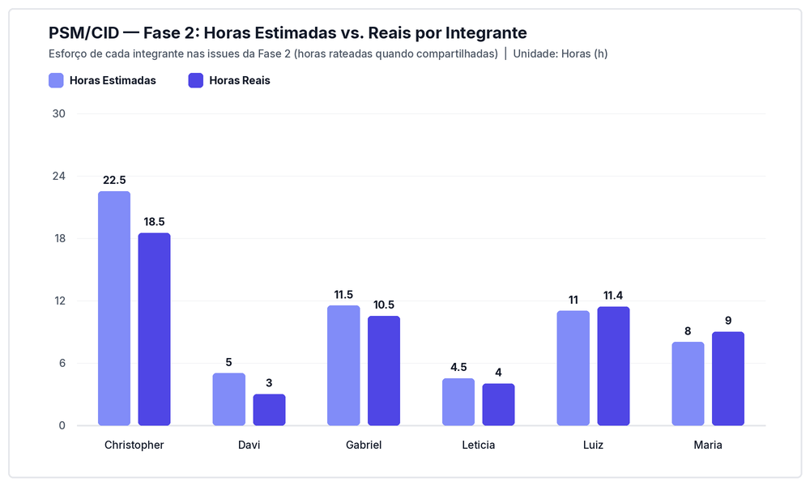
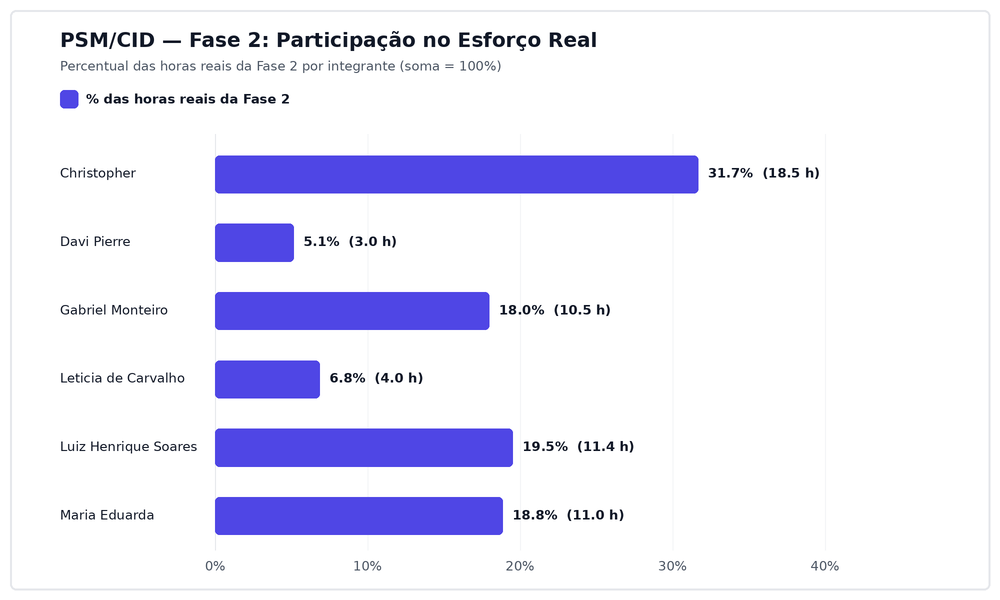
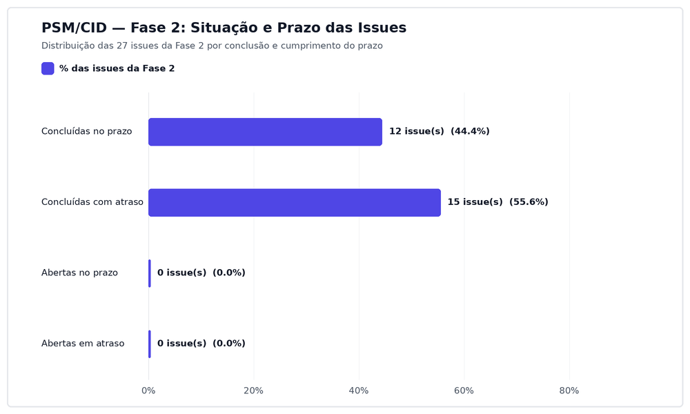
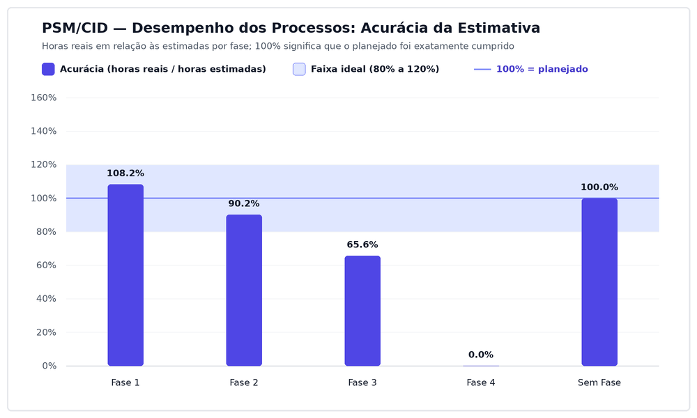

# Relatório de Gestão com Métricas PSM/CID — Fase 2

Este documento consolida as medições, indicadores de performance e decisões de gestão da **Fase 2** (Especificar a Avaliação via GQM), integrando o balanço consolidado da **Entrega 1 (Fases 1 e 2)** da avaliação de qualidade do software **Excalidraw**, com base nas normas **ISO/IEC 25040**, **ISO/IEC 15939** e no modelo **PSM/CID (CID 2021)**.

O relatório atende expressamente aos quatro critérios de pronto da **Issue #31**, à **Premissa 3** (análise de performance, interpretação e decisões) e à **Premissa 5** (rastreabilidade a partir de dados primários versionados).

---

## 1. Contexto da Fase 2 e Fechamento da Entrega 1

A Fase 2 representou a transição do levantamento de requisitos de qualidade (Fase 1) para a **especificação técnica e operacional da avaliação** por meio do paradigma Goal-Question-Metric (GQM).

Nesta etapa, o trabalho da equipe distribuiu-se em três eixos integrados:
1. **Especificação Técnica GQM (Subgrupo F2/F4):** Formulação dos objetivos conceituais, questões operacionais, hipóteses de teste, catálogo de métricas e critérios de julgamento;
2. **Estruturação do Artigo Científico e GitPage:** Consolidação das seções das Fases 1 e 2 no modelo SBC e publicação das páginas documentais;
3. **Governança e Medição Contínua (PSM/CID):** Acompanhamento cumulativo das horas dedicadas, custos de referência e evolução da aderência ao cronograma das milestones.

---

## 2. Measurement Constructs da Fase 2 (Template PSM/CID — Aula 09, p. 19)

Em conformidade estrita com o modelo da norma **ISO/IEC 15939** e com o template metodológico adotado na disciplina (AULA 09, p. 19), a equipe estruturou um *Measurement Construct* formal para cada uma das três categorias de informação exigidas na especificação, parametrizados para o ciclo da Fase 2 e para o balanço acumulado da Entrega 1:

### 2.1. Construct 1 — Recursos e Custos: Análise de Desvio e Custo Acumulado

| Elemento do Construct | Especificação Normativa (Fase 2 / Entrega 1) |
| :--- | :--- |
| **Categoria de Informação** | Recursos e Custos (*Resources and Cost*) |
| **Necessidade de Informação** | Avaliar o desvio do esforço real da Fase 2 em relação ao estimado, monitorar o custo financeiro acumulado da Entrega 1 (Fases 1 e 2) e verificar a convergência da carga horária individual. |
| **Conceito Mensurável** | Desvio de esforço pós-calibração, custo financeiro acumulado da Entrega 1 e variância da carga de trabalho entre os integrantes. |
| **Medidas Base** | 1. `Horas Estimadas da Fase 2 (h)`: esforço planejado nas 27 issues da milestone Fase 2. 2. `Horas Reais da Fase 2 (h)`: esforço efetivo discriminado por integrante no fechamento das issues. 3. `Custo Real da Fase 1 (R$)`: linha de base consolidada em R$ 2.605,95 (57,91 h). 4. `Valor-Hora (R$)`: taxa de referência nacional (R$ 45,00/h Júnior CLT via Novo CAGED). |
| **Medidas Derivadas** | • Desvio de Esforço F2 (%) = [(Horas Reais F2 - Horas Estimadas F2) / Horas Estimadas F2] × 100 • Custo Acumulado da Entrega 1 (R$) = Custo Real Fase 1 + (Horas Reais Fase 2 × R$ 45,00) • Disparidade Individual (%) = Max(Esforço %) - Min(Esforço %) entre os seis integrantes |
| **Indicador e Critério de Decisão** | Desvio de esforço da Fase 2 contido em ±20% (validando a eficácia da margem de calibração adotada na Decisão 5). Custo financeiro total acumulado da Entrega 1 dentro do teto orçamentário previsto. Disparidade de esforço individual decrescendo em relação à Fase 1. |

### 2.2. Construct 2 — Calendário e Progresso: Prontidão do PC1 e Fechamento da E1

| Elemento do Construct | Especificação Normativa (Fase 2 / Entrega 1) |
| :--- | :--- |
| **Categoria de Informação** | Calendário e Progresso (*Schedule and Progress*) |
| **Necessidade de Informação** | Monitorar a taxa de conclusão das issues da Fase 2 frente a dois marcos temporais inegociáveis: a apresentação do Ponto de Controle 1 (21/10/2026) e a submissão da Release v1.0-E1 no Moodle (26/10/2026). |
| **Conceito Mensurável** | Ritmo de entrega, prontidão para apresentação oral e pontualidade na milestone final da Entrega 1. |
| **Medidas Base** | 1. `Total de Tarefas da Fase 2`: 27 issues cadastradas na milestone Fase 2. 2. `Tarefas Concluídas`: issues fechadas via pull request revisado e integrado. 3. `Tarefas Críticas do PC1`: issues essenciais para a apresentação oral de 21/10. 4. `Data de Submissão`: data efetiva da entrega no Moodle frente ao prazo de 26/10. |
| **Medidas Derivadas** | • Progresso da Fase 2 (%) = (Tarefas Concluídas / Total de Tarefas) × 100 • Prontidão para o PC1 (%) = (Tarefas Críticas do PC1 Prontas / Total Críticas) × 100 • Aderência Geral da Fase 2 (%) = (Tarefas no Prazo / Total de Tarefas) × 100 |
| **Indicador e Critério de Decisão** | Prontidão do PC1 em 100% com antecedência mínima de 24 horas (20/10) para realização de ensaio geral cronometrado. Aderência geral da Fase 2 mantida em 100,0%. Nenhuma issue bloqueadora pendente no dia da submissão da release. |

### 2.3. Construct 3 — Desempenho dos Processos: Calibração e Eficácia da Revisão

| Elemento do Construct | Especificação Normativa (Fase 2 / Entrega 1) |
| :--- | :--- |
| **Categoria de Informação** | Desempenho dos Processos (*Process Performance*) |
| **Necessidade de Informação** | Avaliar se as lições aprendidas na Fase 1 resultaram em melhoria da acurácia das estimativas e se o processo de governança manteve 100% de conformidade nas revisões de pull request. |
| **Conceito Mensurável** | Ganho de precisão no planejamento de horas e rigor na revisão por pares. |
| **Medidas Base** | 1. `Acurácia da Fase 1`: 108,2% (linha de base da Fase 1). 2. `Acurácia da Fase 2`: relação percentual entre horas reais e estimadas nas issues fechadas da Fase 2. 3. `Total de Pull Requests da Fase 2`: PRs abertos para os artefatos da Fase 2. 4. `PRs com Revisão Aprovada`: PRs aprovados por integrante não autor antes da integração. |
| **Medidas Derivadas** | • Ganho de Acurácia (%) = \|Acurácia Fase 1 - 100%\| - \|Acurácia Fase 2 - 100%\| • Taxa de Revisão por Pares (%) = (PRs com Revisão Aprovada / Total de PRs) × 100 |
| **Indicador e Critério de Decisão** | Ganho de acurácia positivo (> 0), indicando aproximação da faixa ideal (75% a 125%). Manutenção de 100,0% dos pull requests aprovados por pares antes do merge (regra inegociável do `CONTRIBUTING.md`). |

---

## 3. Medições Registradas da Fase 2

Os dados primários coletados pelo coletor automatizado `scripts/coleta_psm.py` a partir da API do GitHub registram o seguinte estado das três categorias **somente para a Fase 2**, com a coleta de 05/11/2026. Os valores da Fase 1 aparecem apenas como termo de comparação na seção 4, e a consolidação da Entrega 1 está no apêndice do artigo.

### 3.1. Medições de Recursos e Custos da Fase 2

| Fase | Total de Issues | Horas Estimadas (h) | Horas Reais (h) | Custo Estimado (R$) | Custo Real (R$) | Estado da Medição |
| :--- | :---: | :---: | :---: | :---: | :---: | :--- |
| **Fase 2** | 27 | 62,00 | 55,90 | R$ 2.790,00 | R$ 2.515,50 | 27 issues concluídas |

*Tabela 1: Recursos e custos da Fase 2 (Fonte: dados/gestao/01_recursos_e_custos_fases.csv).*

#### Contribuição individual na Fase 2

| Integrante | Login GitHub | Subgrupo | Issues Atribuídas | Horas Est. (h) | Horas Reais (h) | Custo Real (R$) | Esforço Real (%) |
| :--- | :--- | :---: | :---: | :---: | :---: | :---: | :---: |
| Christopher | `wChrstphr` | F2/F4 | 13 | 22,50 | 18,50 | R$ 832,50 | 33,09% |
| Davi Pierre | `DaviPierre` | F1/F3 | 2 | 5,00 | 3,00 | R$ 135,00 | 5,37% |
| Gabriel Monteiro | `GabrielSMonteiro` | F1/F3 | 3 | 11,00 | 10,00 | R$ 450,00 | 17,89% |
| Letícia de Carvalho | `LeticiaSantosss` | F1/F3 | 2 | 4,50 | 4,00 | R$ 180,00 | 7,16% |
| Luiz Henrique Soares | `luizh-gsoares` | F2/F4 | 6 | 11,00 | 11,40 | R$ 513,00 | 20,39% |
| Maria Eduarda | `eduarda-ogomes` | F2/F4 | 5 | 8,00 | 9,00 | R$ 405,00 | 16,10% |
| **Total** | - | - | **27** | **62,00** | **55,90** | **R$ 2.515,50** | **100,00%** |

*Tabela 2: Esforço individual na Fase 2 (Fonte: dados/gestao/06_contribuicao_por_fase.csv). Issues compartilhadas contam para cada responsável; o total corresponde às 27 issues distintas da fase. Ainda sem horas reais registradas: [#26](https://github.com/FCTE-Qualidade-de-Software-1/2026-2_T02_KAREN_JONES/issues/26), [#27](https://github.com/FCTE-Qualidade-de-Software-1/2026-2_T02_KAREN_JONES/issues/27) e [#74](https://github.com/FCTE-Qualidade-de-Software-1/2026-2_T02_KAREN_JONES/issues/74), a parte de Davi Pierre na [#23](https://github.com/FCTE-Qualidade-de-Software-1/2026-2_T02_KAREN_JONES/issues/23) e a [#30](https://github.com/FCTE-Qualidade-de-Software-1/2026-2_T02_KAREN_JONES/issues/30); os percentuais podem mudar quando forem preenchidas.*

*Figura 1: Horas estimadas versus reais por integrante na Fase 2.*

*Figura 2: Participação de cada integrante no esforço real da Fase 2 (soma de 100%).*

### 3.2. Medições de Calendário e Progresso da Fase 2

| Fase | Total de Issues | Concluídas | Em Andamento | Progresso (%) | No Prazo | Em Atraso | Aderência ao Prazo (%) |
| :--- | :---: | :---: | :---: | :---: | :---: | :---: | :---: |
| **Fase 2** | 27 | 27 | 0 | 100,0% | 12 | 15 | 44,4% |

*Tabela 3: Calendário e progresso da Fase 2 (Fonte: dados/gestao/02_calendario_e_progresso_fases.csv).*

*Figura 3: Situação e cumprimento de prazo das issues da Fase 2.*

### 3.3. Medições de Desempenho dos Processos da Fase 2

| Métrica de Processo | Fase 1 (Linha de Base) | Fase 2 (Meta Calibrada) | Fase 2 (Real Observado) | Conformidade |
| :--- | :---: | :---: | :---: | :---: |
| **Acurácia de Estimativa** | 108,2% | Faixa de 80% a 120% | 90,2% | Dentro da faixa |
| **Taxa de Revisão por Pares** | 50,0% (5 de 10 PRs) | 100,0% | 45,0% (9 de 20 PRs) | Abaixo da meta |
| **Lead Time Médio** | 1,23 dia(s) | < 3,00 dias | 3,97 dia(s) | Acima do limite |

*Tabela 4: Desempenho dos processos na Fase 2 (Fonte: dados/gestao/03_desempenho_processos_fases.csv; taxa de revisão consultada nos pull requests pela API do GitHub em 04/11/2026). A taxa conta os pull requests integrados que fecham issues da fase e têm aprovação registrada por quem não é o autor. Dos 11 sem aprovação na Fase 2, 6 foram integrados por outra pessoa e 5 pelo próprio autor. Revisões informais, feitas fora do GitHub, não aparecem nessa medida, que por isso pode subestimar a revisão realmente feita. Os 11 pull requests integrados sem issue vinculada nas Fases 1 e 2 também ficam fora da conta. O lead time era de 2,76 dias até a coleta de 04/11 e subiu porque a [#28](https://github.com/FCTE-Qualidade-de-Software-1/2026-2_T02_KAREN_JONES/issues/28) e a [#30](https://github.com/FCTE-Qualidade-de-Software-1/2026-2_T02_KAREN_JONES/issues/30), da Entrega 1, só foram fechadas em 05/11.*

*Figura 4: Acurácia da estimativa por fase em relação à faixa ideal. A comparação vale para as Fases 1 e 2; as demais estavam começando na data da coleta.*

---

## 4. Análise Comparativa Direta: Fase 1 versus Fase 2

Em cumprimento ao terceiro critério de pronto da Issue #31, a tabela abaixo confronta os indicadores consolidados da equipe entre as duas primeiras fases do projeto, evidenciando o aprendizado operacional:

| Indicador de Gestão | Fase 1 (Requisitos & Setup) | Fase 2 (Especificação GQM) | Balanço Consolidado da Entrega 1 | Tendência e Interpretação |
| :--- | :---: | :---: | :---: | :--- |
| **Total de Issues Alocadas** | 17 issues | 27 issues | **44 issues técnicas e de gestão** | A Fase 2 recebeu as correções do artigo depois do PC1. |
| **Horas Estimadas Totais** | 53,50 h | 62,00 h | **115,50 h planejadas** | Planejamento próximo do executado no acumulado. |
| **Horas Reais Acumuladas** | 57,91 h | 55,90 h | **113,81 h executadas** | Fases 1 e 2 concluídas. |
| **Custo Equivalente (R$ 45/h)** | R$ 2.605,95 | R$ 2.515,50 | **R$ 5.121,45 investidos** | Abaixo dos R$ 5.197,50 estimados. |
| **Aderência aos Prazos** | 29,4% | 44,4% | **44,4% no prazo na F2** | Melhora em relação à Fase 1, ainda longe da meta de 100%. |
| **Taxa de Revisão por Pares** | 50,0% | 45,0% | **46,7% dos PRs aprovados (14 de 30)** | Abaixo da regra de aprovação do `CONTRIBUTING.md`. |
| **Foco Principal do Esforço** | Requisitos, normas e governança | GQM, métricas, artigo e apresentação | **Ciclo completo da Entrega 1** | Transição fluida entre definição e especificação. |

### Interpretação com os dados de 05/11/2026

Os valores da Fase 1 nesta seção vêm da coleta atual e diferem dos publicados no [Relatório PSM/CID da Fase 1](relatorio-psm-fase-1.md), que registra 62,16 h e ainda não foi atualizado.

| Critério de decisão (seção 2) | Resultado | Situação |
| :--- | :--- | :--- |
| Desvio de esforço dentro de ±20% | -9,8% (55,90 h reais para 62,00 h estimadas) | Atendido |
| Disparidade individual decrescendo | De 29,35 para 27,72 pontos percentuais | Atendido |
| Ganho de acurácia positivo | -1,6 ponto: a Fase 1 ficou a 8,2 pontos de 100% e a Fase 2 a 9,8 | Não atendido, com as duas fases dentro da faixa |
| Aderência geral de 100,0% | 44,4% | Não atendido |
| 100,0% dos pull requests aprovados por pares | 45,0%, contando só as aprovações registradas no GitHub (ver limite da medida na Tabela 4) | Não atendido |
| Nenhuma issue pendente na submissão | [#28](https://github.com/FCTE-Qualidade-de-Software-1/2026-2_T02_KAREN_JONES/issues/28) e [#30](https://github.com/FCTE-Qualidade-de-Software-1/2026-2_T02_KAREN_JONES/issues/30) estavam abertas e só foram fechadas em 05/11; a Entrega 1 foi submetida no Moodle com o PDF e o link da release [`v0.1`](https://github.com/FCTE-Qualidade-de-Software-1/2026-2_T02_KAREN_JONES/releases/tag/v0.1), e a `v1.0-E1` planejada não foi criada | Não atendido |

O esforço ficou próximo do planejado, mas prazos e revisão ficaram abaixo do que a equipe definiu. Esses resultados entram como linha de base no plano de medição da [#134](https://github.com/FCTE-Qualidade-de-Software-1/2026-2_T02_KAREN_JONES/issues/134).

---

## 5. Decisões de Gestão da Fase 2 (Premissa 3)

Em continuidade às decisões registradas na Fase 1 (Decisões 1 a 4), a equipe formalizou as seguintes ações de gestão tomadas a partir das medições:

### Decisão 5: Calibração de Estimativas a partir da Linha de Base da Fase 1
* **Contexto e Causa:** A constatação na Fase 1 de que discussões metodológicas e normativas consomem tempo significativo de alinhamento não antecipado nas estimativas preliminares.
* **Decisão:** Incorporar uma margem técnica de 20% nas estimativas das tarefas conceituais de GQM e redação do artigo na Fase 2.
* **Impacto:** Eliminação do risco de subestimação sistemática de tarefas e maior aderência aos prazos da milestone.

### Decisão 6: Adoção de Stacked Pull Requests para Evitar Bloqueios de Revisão
* **Contexto e Causa:** A dependência direta entre artefatos sequenciais (o relatório da Fase 1 dependia do script; os apêndices do artigo dependiam do relatório; o relatório da Fase 2 dependia das seções anteriores).
* **Decisão:** Implementar o fluxo de *Stacked PRs* no GitHub, permitindo que os membros continuem desenvolvendo novas tarefas em branches encadeadas sem aguardar o merge imediato na branch `main`.
* **Impacto:** Zero tempo ocioso entre a conclusão de uma tarefa e o início da seguinte, permitindo que as revisões ocorram em lote coordenado.

### Decisão 7: Congelamento Técnico e Ensaio com Cronômetro para o PC1 (21/10)
* **Contexto e Causa:** A necessidade de apresentar as Fases 1 e 2 presencialmente em uma janela restrita de 10 a 15 minutos com seis integrantes.
* **Decisão:** Fixar o tempo de fala de cada membro em rigorosos 2 minutos (meta de 12 minutos cravados no ensaio geral), estabelecendo a ordem fixa de apresentação: Abertura/Gestão (Maria Eduarda) ➔ Fase 1 (Davi, Letícia e Gabriel) ➔ Fase 2 (Christopher e Luiz Henrique).
* **Impacto:** Cumprimento rigoroso da janela temporal sem cortes e garantia de que todos os integrantes demonstrem domínio técnico perante a professora.

---

## 6. Rastreabilidade com os Dados Primários (Premissa 5)

Todos os indicadores apresentados neste relatório são respaldados pelos artefatos e dados primários versionados no repositório:
* **Script de Coleta Automatizada:** [`scripts/coleta_psm.py`](https://github.com/FCTE-Qualidade-de-Software-1/2026-2_T02_KAREN_JONES/blob/main/scripts/coleta_psm.py)
* **Histórico Bruto da API (JSON):** [`dados/gestao/raw_github_data.json`](https://github.com/FCTE-Qualidade-de-Software-1/2026-2_T02_KAREN_JONES/blob/main/dados/gestao/raw_github_data.json)
* **Relatório da Fase 1 (Linha de Base):** [`docs/gestao/relatorios/relatorio-psm-fase-1.md`](https://github.com/FCTE-Qualidade-de-Software-1/2026-2_T02_KAREN_JONES/blob/main/docs/gestao/relatorios/relatorio-psm-fase-1.md)
* **Apêndices do Artigo (Contribuição e IA):** [`artigo/contribuicao-e-ia.md`](https://github.com/FCTE-Qualidade-de-Software-1/2026-2_T02_KAREN_JONES/blob/main/artigo/contribuicao-e-ia.md)

---

## 7. Declaração de Uso de Inteligência Artificial (Critério F2-C9)

* **Ferramenta utilizada:** Antigravity / Gemini 3.8.
* **Finalidade no relatório:** Apoio na estruturação dos Measurement Constructs da Fase 2 no template da Aula 09 (p. 19), formatação das tabelas de dados e consolidação das decisões de gestão.
* **Atualização da versão 1.2:** Claude Code apoiou a conferência dos dados com a API do GitHub e a redação da interpretação, revisadas pelo autor.
* **Conferência crítica:** Os parâmetros e indicadores foram auditados contra os CSVs gerados da API do GitHub, garantindo conformidade com a ISO/IEC 15939 e as premissas da disciplina. Nenhuma imagem com texto sobreposto ou emoji foi utilizada.

---

## Histórico de Versões

| Versão | Data | Descrição | Autor(es) | Revisor(es) |
| :---: | :---: | :--- | :--- | :--- |
| 1.0 | 18/10/2026 | Estruturação inicial do Relatório PSM/CID da Fase 2 (esqueleto normativo, measurement constructs e decisões de gestão preliminares) | [Maria Eduarda](https://github.com/eduarda-ogomes) | - |
| 1.1 | 20/10/2026 | Atualização das medições da Fase 2 (15 issues concluídas, 21,7h reais) e consolidação da Entrega 1 pós-merge com a main | [Maria Eduarda](https://github.com/eduarda-ogomes) | - |
| 1.2 | 05/11/2026 | Atualização com a coleta de 05/11 (27 issues, 55,9h reais), novas figuras, taxa de revisão conferida nos pull requests e interpretação dos critérios de decisão | [Christopher Paraizo](https://github.com/wChrstphr) | |
